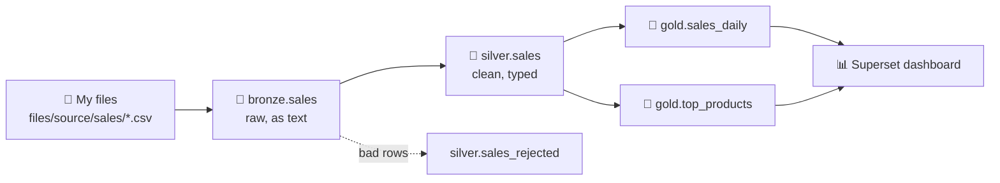

# Stack demo — files to Bronze, Silver, Gold, Airflow and a Superset dashboard

A complete pipeline, built live by a brand-new member in about 30 minutes. The story:
**Nordic Coffee Co.** exports its online orders as CSV files. They are messy. We land them, clean
them, sum them up, automate it, and put a dashboard on top.



## What's in this folder

| File | Where it goes in the demo | What it does |
|---|---|---|
| `data/sales_2026_h1.csv` | 📁 My files → `files/source/sales/` (step 1) | 6,385 orders, Jan–Jun 2026, with mistakes on purpose |
| `data/sales_2026_07.csv` | 📁 My files → `files/source/sales/` (step 5) | 1,192 more orders for July, the "new data" for the Airflow run |
| `notebooks/demo_01_bronze.ipynb` | Jupyter → `my_files/notebooks/` | every CSV in the folder → `my.bronze.sales` |
| `notebooks/demo_02_silver.ipynb` | Jupyter → `my_files/notebooks/` | duplicates, types, nulls, messy text → `my.silver.sales` (+ `sales_rejected`) |
| `notebooks/demo_03_gold.ipynb` | Jupyter → `my_files/notebooks/` | `my.gold.sales_daily` and `my.gold.top_products` |
| `dags/demo_sales_pipeline.py` | Jupyter → `my_files/dags/` (step 5) | runs the three notebooks in order: `<you>_demo_sales` |
| `data/make_data.py` | — | makes the two CSVs again (same seed → same files) |

`<you>` below is the new member's username, e.g. `demo1` → lakehouse `demo1_lake`, bucket
`demo1-lake`.

## The day before

1. Start the stack and open every tool once: Jupyter, Airflow, Superset, SQLPad, My files.
2. **Do a dry run with a throwaway member** — the whole runbook, start to end — then delete that
   member (Manage members). Every first time is slow (Jupyter server, the first Spark session,
   Airflow's first parse); you don't want to see it for the first time on stage.
3. Have this folder open on the laptop you present from. You'll upload from it.

## 0 · Create the member (≈ 2 min)

Create the member (Manage members, or **Register** on the sign-in page), sign in as them and show
the landing page: **📁 My files** says **bucket `<you>-lake` · lakehouse `<you>_lake`** — a private
bucket and a private lakehouse with `bronze` / `silver` / `gold`, made on first sign-in.

Open **Jupyter** now: the server takes a minute to start the first time, and you'll need it in
step 2.

## 1 · Upload the file to My files (≈ 2 min)

1. **📁 My files** → open `files` → `source`.
2. **New folder** → `sales` → open it.
3. **Upload** → `data/sales_2026_h1.csv`. (Keep `sales_2026_07.csv` for step 5.)

Talking point: the file is now in object storage (S3-compatible, RustFS), in the member's own
bucket — like an Azure Data Lake container or an S3 bucket. Open a few lines to show the mess:
`estonia` in lower case, dates like `05/03/2026`, an empty price.

## 2 · Spark job: file → Bronze (≈ 4 min)

1. Jupyter → open `my_files/notebooks/` → **Upload** (↑ in the file browser) → pick the three
   `demo_0*.ipynb` files. (Uploaded here, they are also copied to the bucket's
   `files/src/notebooks/` — that's where Airflow will find them in step 5.)
2. Open **`demo_01_bronze.ipynb`** → **Run → Run All Cells**.

Expected:

```text
lakehouse: <you>_lake · reading: s3a://<you>-lake/files/source/sales/
6385 rows read
...
_source_file       rows_loaded
sales_2026_h1.csv  6385
```

Talking points: `spark` is already there (Spark Connect to the lab's cluster); Bronze keeps the
data **exactly as it came** — every column is text — plus `_source_file` and `_ingested_at`.

Optional, 30 s: **SQLPad** (connection *Lakehouse (Trino) — &lt;you&gt;*) —
`SELECT * FROM <you>_lake.bronze.sales LIMIT 10;` — the table Spark just wrote, read by a
different engine (Trino), no copying.

## 3 · Spark job: clean → Silver (≈ 4 min)

Open **`demo_02_silver.ipynb`** → **Run All**. The markdown at the top lists each problem and its
fix — walk through it. Expected:

```text
rows in bronze                       6385
after dropping exact duplicates      6235
rejected (missing / bad values)       186
after one row per order_id           6049
my.silver.sales: 6049 rows
my.silver.sales_rejected: 186 rows
```

The country table shows six clean names (`Finland`, not `  FINLAND `), and the last cell shows
rejected rows: quantity `0` or `-1`, price `NULL` (was `N/A`).

Talking point: bad rows are **kept aside** in `sales_rejected`, not silently thrown away — someone
can look at them and fix the source.

## 4 · Aggregate → Gold (≈ 3 min)

Open **`demo_03_gold.ipynb`** → **Run All**. Expected:

```text
my.gold.sales_daily: 4417 rows
my.gold.top_products: 18 rows
```

Revenue per month (Jan 18,575.50 … May 27,448.10) and the top 5 products, Espresso Beans 1kg first.

Talking point: `gold.sales_daily` keeps day, country, category and channel, and every number in it
adds up — so one table feeds every chart and filter on the dashboard.

## 5 · The same pipeline, automated with Airflow (≈ 5 min)

New data arrives — July's file — and nobody should have to run three notebooks by hand.

1. **📁 My files** → `files/source/sales/` → **Upload** `data/sales_2026_07.csv`.
2. Jupyter → `my_files/dags/` → **Upload** `dags/demo_sales_pipeline.py`.
3. **Airflow** → wait ≈ 30 s → DAG **`<you>_demo_sales`** appears (the file names itself after the
   member's username, from the folder Airflow loads it from). Open it → **Graph**:
   `bronze → silver → gold`.
4. Switch it **on** → **▶ Trigger**. In **Grid**, the three boxes go green one after another
   (≈ 1–2 min).
5. Click **silver** → **Logs**. Expected near the end:

```text
rows in bronze                       7577
after dropping exact duplicates      7397
rejected (missing / bad values)       222
after one row per order_id           7175
```

and in **gold**'s log: `my.gold.sales_daily: 5215 rows`, plus a July row in revenue per month.

Talking points: each task runs a notebook **as the member** (`run_notebook` → `lab_spark`), so the
notebook you developed interactively *is* the production job; the order is enforced (Silver never
runs on a half-written Bronze); `schedule="@daily"` would run it every night.

> **No DAG after a minute?** Airflow → **Import errors** shows why (a typo, or a dag_id with the
> wrong prefix).

## 6 · Superset dashboard (≈ 10 min)

### Datasets
**Datasets → + Dataset** → database **ShopFlow Lakehouse** → catalog **`<you>_lake`** → schema
**gold** → table **`sales_daily`** → **Create dataset and create chart**. Do the same for
**`top_products`**.

### Charts
Make each one, **Save** it, and on the first one choose **Add to dashboard → new dashboard**
**Nordic Coffee — Sales**. Pick each chart type from **View all charts** and search for its name.

| # | Chart name | Type | Dataset | Settings |
|---|---|---|---|---|
| 1 | Revenue | **Big Number with Trendline** | `sales_daily` | X-axis `order_date`, time grain **Week**, metric `SUM(revenue)`, number format `,.0f` |
| 2 | Orders | **Big Number with Trendline** | `sales_daily` | X-axis `order_date`, grain **Week**, metric `SUM(orders)` |
| 3 | Avg order value | **Big Number** | `sales_daily` | metric → **Custom SQL** `SUM(revenue) / SUM(orders)`, format `,.2f` |
| 4 | Weekly revenue by channel | **Line Chart** | `sales_daily` | X-axis `order_date`, grain **Week**, metric `SUM(revenue)`, dimensions `channel` |
| 5 | Revenue by category | **Bar Chart** | `sales_daily` | X-axis `category`, metric `SUM(revenue)`, sort by metric, descending |
| 6 | Revenue by country | **Pie Chart** | `sales_daily` | dimensions `country`, metric `SUM(revenue)`, **Donut** on, show labels as percent |
| 7 | Top 10 products | **Table** | `top_products` | query mode **Raw records**, columns `revenue_rank, product, category, units, revenue`, ordering `revenue_rank` ascending, row limit 10 |

### Dashboard
**Dashboards → Nordic Coffee — Sales → Edit dashboard**:

- Top row: the three big numbers (Revenue, Orders, Avg order value).
- Second row: *Weekly revenue by channel*, full width.
- Third row: *Revenue by category*, *Revenue by country*, *Top 10 products*.
- **Filters** (left panel) → **+ Add or edit filters**:
  - **Time range** on `order_date`, called *Date*,
  - **Value** filters on `country`, `category` and `channel` (dataset `sales_daily`).
- **Save**.

Demo it: pick `Finland` in the country filter — every `sales_daily` chart changes at once.
(*Top 10 products* stays the same: `top_products` has no country — a nice question for the
audience: what would you add to Gold to make it follow the filter?)

Talking point: Superset queries Trino **as the signed-in member**, so the dashboard can only show
what that member may read — governed by the same Polaris rules as Spark.

## Resetting for another run

Delete the member in **Manage members** — bucket, lakehouse, Jupyter, DAG and all go with them.
Or, to keep the member, run this in a notebook and delete the files under `files/source/sales/`:

```python
for t in ["bronze.sales", "silver.sales", "silver.sales_rejected", "gold.sales_daily", "gold.top_products"]:
    spark.sql(f"DROP TABLE IF EXISTS my.{t} PURGE")
```

The Superset dataset, charts and dashboard are not part of the lakehouse; delete them in Superset.
