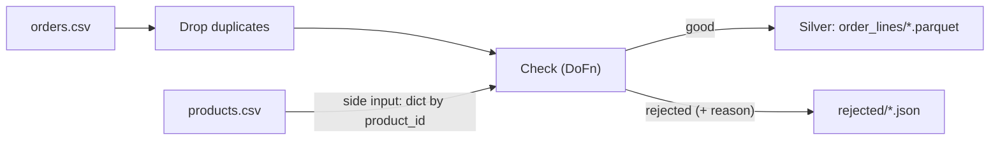

# A real pipeline: ShopFlow orders into Silver

## Concept
A Silver pipeline cleans raw data and keeps track of what it threw away. Three Beam patterns,
all common in Dataflow jobs:

- **`DoFn` + `ParDo`**: your own step, as a class. Its `process` method gets one element and can
  **yield** none, one or many, to several **outputs**. It's `Map`, `Filter` and `FlatMap` in one.
- **Dead-letter output**: bad rows don't crash the job and aren't silently dropped. They go to a
  second output, with the reason, and land in their own file. Someone can look at them later.
- **Side input**: a small dataset (here, the product list) handed **whole** to every worker, to
  look things up in. It's like joining with a small table, without a shuffle.



## Lab
It runs on the Flink cluster ([Run it on workers](workers.md)); `lab_beam("local")` works too.

### 1 · The raw data
`orders.csv` (22 lines) has everything wrong a Silver step meets: two lines that are **exact
duplicates**, three without a **quantity**, one with quantity **0**, one for a product that doesn't
exist (**P999**). `products.csv` writes categories any which way (`Electronics`, `electronics`,
`ELECTRONICS`) and lists P001 twice.

### 2 · The pipeline
```python
import apache_beam as beam, json, pyarrow as pa
SRC = "s3://<you>-lake/files/source/shopflow/"
OUT = "s3://<you>-lake/files/silver/"

def product(line):
    pid, name, category, price = line.split(",")
    return pid, {"name": name, "category": category.strip().title(), "price": float(price)}

class Check(beam.DoFn):
    def process(self, line, products):
        order_id, day, customer_id, product_id, qty = line.split(",")
        if not qty:
            yield beam.pvalue.TaggedOutput("rejected", {"line": line, "reason": "no quantity"}); return
        if int(qty) <= 0:
            yield beam.pvalue.TaggedOutput("rejected", {"line": line, "reason": "quantity " + qty}); return
        if product_id not in products:
            yield beam.pvalue.TaggedOutput("rejected", {"line": line, "reason": "unknown product " + product_id}); return
        p = products[product_id]
        yield {"order_id": order_id, "order_date": day, "customer_id": customer_id, "product_id": product_id,
               "product_name": p["name"], "category": p["category"], "quantity": int(qty),
               "price": p["price"], "revenue": round(int(qty) * p["price"], 2)}

schema = pa.schema([("order_id", pa.string()), ("order_date", pa.string()), ("customer_id", pa.string()),
                    ("product_id", pa.string()), ("product_name", pa.string()), ("category", pa.string()),
                    ("quantity", pa.int64()), ("price", pa.float64()), ("revenue", pa.float64())])

with beam.Pipeline(options=lab_beam("flink", name="orders-silver", parallelism=2)) as p:
    products = (p | "Read products" >> beam.io.ReadFromText(SRC + "products.csv", skip_header_lines=1)
                  | "Product by id" >> beam.Map(product))
    checked = (p | "Read orders" >> beam.io.ReadFromText(SRC + "orders.csv", skip_header_lines=1)
                 | "Drop duplicates" >> beam.Distinct()
                 | "Check" >> beam.ParDo(Check(), products=beam.pvalue.AsDict(products))
                                 .with_outputs("rejected", main="good"))
    checked.good | "Write Silver" >> beam.io.WriteToParquet(OUT + "order_lines/part", schema,
                                                            file_name_suffix=".parquet", num_shards=1)
    (checked.rejected
     | "As JSON" >> beam.Map(json.dumps)
     | "Write rejects" >> beam.io.WriteToText(OUT + "rejected/part", file_name_suffix=".json", num_shards=1))
```

Line by line:

- **`beam.Distinct()`** drops duplicate elements. Here those are whole lines that are exactly the
  same: O1002 and O1010, sent twice.
- **`class Check(beam.DoFn)`** with **`process(self, line, products)`**: Beam calls `process` for
  every element. `yield` sends a result on; a `process` that yields nothing drops the element.
- **`beam.pvalue.TaggedOutput("rejected", …)`** sends to the output named `rejected` instead of the
  main one. **`.with_outputs("rejected", main="good")`** gives the step both, as `checked.good` and
  `checked.rejected`: two PCollections, two branches.
- **`beam.pvalue.AsDict(products)`** turns the products PCollection of `(id, info)` pairs into a
  dict, handed to every worker as the `products` argument: the **side input**. P001 listed twice
  just gives the same entry twice.
- **`beam.io.WriteToParquet(path, schema)`** writes dicts as **Parquet**
  ([File formats](../unit1/formats.md)), typed by a **PyArrow schema** ([PyArrow & Parquet](../unit3/pyarrow.md)):
  each field's name and type.
- **`json.dumps`** turns each reject into a line of JSON text.

### 3 · Look at Silver
In the notebook, pandas reads the Parquet straight from your bucket. **`storage_options`** gives it
your bucket's key and address (the notebook has them as environment variables):

```python
import os, pandas as pd
so = {"key": os.environ["LAKE_S3_KEY"], "secret": os.environ["LAKE_S3_SECRET"],
      "client_kwargs": {"endpoint_url": os.environ["AWS_S3_ENDPOINT"]}}
df = pd.read_parquet(OUT + "order_lines/", storage_options=so)
print(len(df), "order lines")
df.sort_values("order_id").head(5)
```
```text
15 order lines
order_id order_date customer_id product_id      product_name    category  quantity  price  revenue
   O1001 2026-09-01        C001       P001    Wireless Mouse Electronics         2   25.0     50.0
   O1002 2026-09-01        C002       P003        Coffee Mug        Home         1   12.0     12.0
   O1003 2026-09-01        C003       P007 Bluetooth Speaker Electronics         1   45.0     45.0
   O1004 2026-09-01        C004       P002       USB-C Cable Electronics         3    9.5     28.5
   O1006 2026-09-02        C001       P005         Desk Lamp        Home         2   22.0     44.0
```

22 lines − 2 duplicates = 20 orders; 15 are clean. The categories are tidy now:

```python
df.groupby("category")["revenue"].sum().round(2)
```
```text
category
Electronics    304.5
Home           128.0
Stationery      45.5
```

And the five that didn't make it, each with its reason:

```python
pd.read_json(OUT + "rejected/part-00000-of-00001.json", lines=True, storage_options=so)
```
```text
                        line               reason
 O1017,2026-09-03,C002,P005,          no quantity
O1020,2026-09-03,C004,P999,1 unknown product P999
 O1005,2026-09-01,C005,P004,          no quantity
 O1009,2026-09-02,C002,P007,          no quantity
O1019,2026-09-03,C007,P008,0           quantity 0
```

!!! tip "Into the lakehouse"
    `files/silver/order_lines/` is plain Parquet in your bucket. To query it in SQL like your other
    tables, register it as an Iceberg table ([Upload a file & register it as a table](../unit3/upload-register.md)).

## Check yourself
1. Why send bad rows to a second output instead of dropping them in a `Filter`?
2. What's a side input, and why is it fine for products but not for orders?
3. `beam.Distinct()` removed O1002's second copy. Would it remove a line that differs only in its
   quantity?

??? success "Answers"
    1. Dropped rows are invisible: nobody knows data was lost, or why. A dead-letter output keeps
       them, with the reason, for someone to fix or reload.
    2. A whole dataset handed to every worker, to look things up in. Fine for a small list (11
       products); a big one (millions of orders) would be copied to every worker. For that, join with
       `CoGroupByKey`, a shuffle.
    3. No. It compares whole elements, and those two lines differ. Deduplicating by key would need
       `order_id` as the key, then one row per key kept.

## You can now…
- write your own step as a `DoFn` with several outputs;
- route bad rows to a dead-letter output with their reason;
- look things up in a side input, and write Parquet with a schema.
