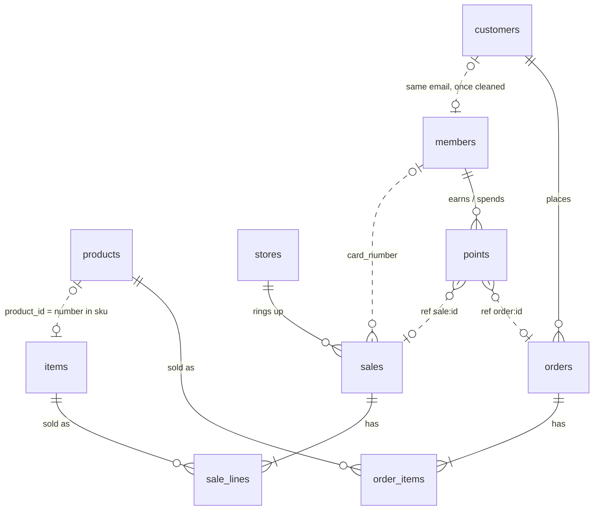

# Capstone 3 (hard): Tidewell's data platform

## 1 · About the company
**Tidewell** is a retailer of everyday products: electronics, home, office, accessories, sports
and food (18 products). It sells three ways:

- **Online**, to customers in ten countries (US, UK, DE, IN, FR, NL, SG, BR, JP, AU).
- **In five stores**, paid by card, cash or mobile:

  | Store | City | Time zone | Opened |
  |---|---|---|---|
  | `NYC-01` | New York | America/New_York | 2018-09-01 |
  | `AMS-01` | Amsterdam | Europe/Amsterdam | 2019-03-01 |
  | `LON-01` | London | Europe/London | 2020-06-15 |
  | `BLR-01` | Bengaluru | Asia/Kolkata | 2021-01-10 |
  | `SIN-01` | Singapore | Asia/Singapore | 2022-04-20 |

- **With a loyalty card**, used online and in stores: 1 point per currency unit spent, 50 welcome
  points for members who join at a till, redemptions of 100, 200 or 500 points.

How the business runs:

- Web orders go *placed → paid → shipped → delivered*. A *placed* or *paid* order can be
  cancelled: it disappears from the web shop, and its points are taken back.
- At a till, about half the customers show their card. A return is booked as a new sale with the
  item at quantity −1.
- Web and store prices are set separately and drift apart.
- Old delivered orders, old till sales and old points transactions are archived (deleted) by
  the systems themselves.

All three systems are **live**: they change every few seconds, all day. *(Tidewell is made up for
this course; its data is real and lives in the lab.)*

## 2 · The databases
Three PostgreSQL databases on `lab-db`, port `5432`, login `reader` / `reader` (read only, allowed
to replicate). 🐘 My databases and the SQL editor list them as *Tidewell web shop*, *Tidewell
stores* and *Tidewell loyalty*.

### `shop`: the web shop
| Table | Role | Key | Important columns |
|---|---|---|---|
| `customers` | one web account | `customer_id` | `email` (lower case) · `country` · `tier` (bronze, silver, gold; changes) · `created_at`, `updated_at` |
| `products` | the product catalogue and **web** price | `product_id` | `name` · `category` · `price` (numeric, changes) · `updated_at` |
| `orders` | one web order | `order_id` | `customer_id` · `status` (changes) · `total` · `created_at`, `updated_at` · **deleted** when cancelled or archived |
| `order_items` | one line of an order | `order_id`, `line` | `product_id` · `quantity` · `price` (the price **at order time**) · deleted with its order |

### `store`: the store tills
| Table | Role | Key | Important columns |
|---|---|---|---|
| `stores` | one store | `store_id` | `code` (e.g. `AMS-01`) · `city` · `country` · `timezone` (IANA name) · `opened_on` |
| `items` | the till's product list and **store** price | `sku` (`SKU-0001`) | `name` (upper case) · `category` · `price_cents` (integer, changes) · `updated_at` |
| `sales` | one till receipt | `sale_id` | `store_id` · `sold_at` (**local time of the store, no time zone**) · `card_number` (empty when no card shown) · `payment` · `total_cents` |
| `sale_lines` | one line of a receipt | `sale_id`, `line` | `sku` · `qty` (**negative = return**) · `unit_price_cents` |

### `loyalty`: the loyalty card
| Table | Role | Key | Important columns |
|---|---|---|---|
| `members` | one card holder | `member_id` | `card_number` (unique) · `full_name` · `email` (may be empty; **typed differently** from the web shop: case, spaces) · `phone` · `tier` (blue, silver, gold; changes) · `points_balance` · `joined_at`, `updated_at` |
| `points` | one points transaction | `txn_id` | `member_id` · `channel` (web, store, bonus, redeem) · `ref` (`order:<id>`, `order:<id>:cancelled`, `sale:<id>`, `welcome`, or empty) · `points` (negative = taken back or redeemed) · `created_at` |

## 3 · Database design
Solid lines are foreign keys inside one database. Dotted lines are the links **between** the
systems: no database enforces them, and they only hold after the data is cleaned.



## 4 · The archive
Before the three systems went live, Tidewell ran older ones. When it moved, the old systems
exported **two years of history**: every day from **2024-11-01** to the cut-off, **2026-10-31**.
The live systems started from that export: they contain every customer, product, store and
member, plus the orders, till sales and points of the **last two days before the cut-off**,
with the same ids. After that, the live ids carry on where the archive stopped.

**[⬇ Download the archive: tidewell-history.zip](../assets/tidewell/tidewell-history.zip)**
(1.8 MB; 130 CSV files, 7 MB unpacked)

```
tidewell-history/
  web/      customers.csv  products.csv  orders/YYYY-MM.csv   order_items/YYYY-MM.csv
  store/    stores.csv     items.csv     sales/YYYY-MM.csv    sale_lines/YYYY-MM.csv
  loyalty/  members.csv                  points/YYYY-MM.csv
```

| | |
|---|---|
| Format | CSV, comma-separated, header row, UTF-8; empty field = no value |
| Columns | the same names as the live tables (section 2) |
| Rows | each system as it was at the end of the cut-off day: an order's latest status, a member's balance then |
| Volumes | 1,604 customers · 14,311 orders · 28,758 order lines · 36,943 till sales · 90,963 till lines · 1,073 members · 26,444 points transactions |
| Times | web and loyalty with a UTC offset (`+00:00`); till `sold_at` in the store's local time, without one |

Your lab's live data begins when the lab was installed, which can be days or months after the
cut-off. Those days have no sales at all.

## Problem statement
Every Tidewell team reports from its own system, in its own units, time zones and keys. Asked
*"what did we sell yesterday?"*, the web team, the stores and the loyalty team give three
different answers, and none covers all channels. Nobody knows who shops both online and in
stores, what a customer is worth across channels, or whether the loyalty card pays off.

**Build Tidewell's data platform**: one trusted, continuously updated picture of sales, customers,
products and loyalty across the three systems, never more than **15 minutes** behind them, ending
in a dashboard for the management team.

You know the tools and the techniques. How you build it is up to you.

## Tasks
Build everything in your own lakehouse (`my` in notebooks), with exactly these names. Times are
UTC unless a column says *local*. Money is in currency with two decimals.

### Bronze: land the sources
**T1 · Load the history.** Download the archive, upload it to your bucket, and load every file
into the namespace `tw_bronze_archive`, one table per source table, named `<system>_<table>`
(`web_orders`, `store_sale_lines`, `loyalty_points`, …), with the source file's name on every row.
All 130 files, every row, typed (numbers, dates, timestamps), loaded once: loading the same file
again changes nothing.

**T2 · CDC pipeline for the web shop.** Land `shop.customers`, `shop.products`, `shop.orders` and
`shop.order_items` into the namespace `tw_bronze_web`, with change data capture, refreshed at
least every 15 minutes.

**T3 · CDC pipeline for the store tills.** Land `store.stores`, `store.items`, `store.sales` and
`store.sale_lines` into `tw_bronze_store`, with change data capture, refreshed at least every
15 minutes.

**T4 · CDC pipeline for the loyalty card.** Land `loyalty.members` and `loyalty.points` into
`tw_bronze_loyalty`, with change data capture, refreshed at least every 15 minutes.

### Silver: one company
**T5 · Create `tw_silver.order_status_history`**: one row per order per status it has been in,
including the moment it was cancelled.

| Column | Meaning |
|---|---|
| `order_id` | the web order |
| `status` | `placed`, `paid`, `shipped`, `delivered` or `cancelled` |
| `valid_from` | when the order entered this status |
| `valid_to` | when it left it (empty while current) |
| `is_current` | true for the order's latest status |

**T6 · Create `tw_silver.dim_product`**: every price each product has had, per channel.

| Column | Meaning |
|---|---|
| `product_key` | your key for one product in one channel and price period |
| `product_id` | the web shop's id |
| `sku` | the tills' code |
| `name`, `category` | from the web catalogue |
| `channel` | `web` or `store` |
| `price` | the price in that channel |
| `valid_from`, `valid_to`, `is_current` | when that price applied |

**T7 · Create `tw_silver.dim_store`**: `store_key`, `store_code`, `city`, `country`, `timezone`,
`opened_on`.

**T8 · Create `tw_silver.dim_customer`**: one row per real person across the web shop and the
loyalty card. A web account and a card member are one person when their emails match once
cleaned. `customer_key` never changes between runs.

| Column | Meaning |
|---|---|
| `customer_key` | your stable key for the person |
| `web_customer_id` | empty if they never shopped online |
| `member_id`, `card_number` | empty if they have no card |
| `name`, `country` | best known values |
| `email_hash` | SHA-256 of the cleaned email (no clear-text email) |
| `web_tier`, `card_tier` | tier in each system |
| `is_web`, `is_member` | true / false |
| `first_seen` | earliest account, membership or purchase |

**T9 · Create `tw_silver.fact_sales`**: one row per web order line and per till line, from the
archive **and** the live systems, each line once (where both have it, the live version wins).
Cancelled orders are excluded; returns are negative. Loaded incrementally; re-running a load changes
nothing.

| Column | Meaning |
|---|---|
| `sale_line_key` | unique per line, e.g. `web-1234-1`, `store-567-2` |
| `channel` | `web` or `store` |
| `sale_ref`, `line` | order id or receipt id, and line number |
| `product_key` | the `dim_product` row valid at the time of sale |
| `customer_key` | empty for store sales without a card |
| `store_key` | empty for web |
| `qty`, `unit_price`, `amount` | `amount = qty × unit_price` |
| `sold_at` | UTC |
| `local_date` | the store's local date (web: the UTC date) |
| `is_return` | true when `qty` is negative |

**T10 · Create `tw_silver.fact_points`**: `txn_id`, `customer_key`, `member_id`, `channel`,
`ref_type` (`order`, `order_cancelled`, `sale`, `welcome`, `redeem`), `ref_id`, `points`,
`created_at`.

### Gold: the answers
**T11 · Create `tw_gold.daily_sales`**: one row per day from 2024-11-01 to today for every
channel and store, **including days without sales** (zero, not missing).

| Column | Meaning |
|---|---|
| `sales_date` | the day |
| `date_basis` | `utc` or `local` (both are stored) |
| `channel`, `store_code` | `store_code` empty for web |
| `receipts` | distinct orders or till receipts |
| `items` | units sold, returns netted |
| `revenue` | net revenue |
| `returns_amount` | value of returns (positive number) |

**T12 · Create `tw_gold.store_weekly`**: `week_start`, `store_code`, `revenue`, `receipts`,
`avg_basket`, `return_rate` (returned value ÷ gross sales), `card_share` (share of revenue on
receipts with a loyalty card).

**T13 · Create `tw_gold.customer_360`**

| Column | Meaning |
|---|---|
| `customer_key`, `name`, `country` | who |
| `channels` | `web`, `store`, `both` or `none` |
| `card_tier` | empty without a card |
| `web_revenue`, `store_revenue`, `total_revenue` | net spend |
| `orders`, `receipts` | counts |
| `first_purchase`, `last_purchase` | UTC |
| `points_balance` | from the loyalty system |
| `ledger_balance` | sum of `fact_points` |
| `balance_ok` | true when the two balances are equal |

**T14 · Create `tw_gold.loyalty_daily`**: `day`, `new_members`, `points_earned`,
`points_redeemed`, `points_reversed` (cancelled orders), `active_members`, `outstanding_points`
(total balance at the end of the day).

**T15 · Create `tw_gold.data_freshness`**: `system` (`web`, `store`, `loyalty`), `table_name`,
`last_change` (newest change landed), `minutes_behind`, refreshed with every run.

### Run and trust it
**T16 · Create `tw_gold.dq_results`**: `run_at`, `rule`, `status` (`pass` / `fail`), `failed_rows`,
one row per rule per run. The rules: unique keys in every Silver and Gold table; every fact row
finds its dimension rows; Silver store revenue equals the archive's and the live source's cents ÷ 100; Silver web revenue
equals the archive's and the live source's order lines; no line counted twice where the archive
and the live systems overlap; no day missing from `daily_sales`; no `sold_at` in the future; every source within 30 minutes; every
`balance_ok` true. When a rule fails, Gold keeps its last good version.

**T17 · Create the Airflow DAG `tidewell_platform`**: every 15 minutes, Silver → Gold → quality
rules, in that order; a failed or repeated run never double-counts.

**T18 · Share Gold** read only with one other member (Tidewell's finance team). Bronze and Silver
stay private.

### Show it
**T19 · Create the Superset dashboard "Tidewell today"** on `tw_gold`, refreshing every
15 minutes, with filters for date range, channel and store, and these reports:

| Report | Shows |
|---|---|
| **Revenue today** | today's revenue, web and stores, against the same weekday last week |
| **Revenue by store** | revenue per store per local day, last 14 days |
| **Channel mix** | share of revenue web against stores, per week |
| **Return rate** | return rate per store per week |
| **Top customers** | top 20 customers by total revenue, with channels and card tier |
| **Loyalty** | points earned, redeemed and reversed per day, and outstanding points |
| **Card members vs others** | average revenue per customer, members against non-members |
| **Data health** | `data_freshness` and the latest `dq_results` |

**T20 · Hand over**: an architecture diagram of your platform, a runbook (ingestion lags, a rule
fails, a replication slot is lost), and one page for management with the five most important
things the dashboard shows.

## Done when
The archive is loaded, all tables exist with these names and columns, the DAG runs every 15 minutes on live data, the
latest `dq_results` are all `pass`, and "Tidewell today" answers the management team's questions
without anyone opening a notebook.
