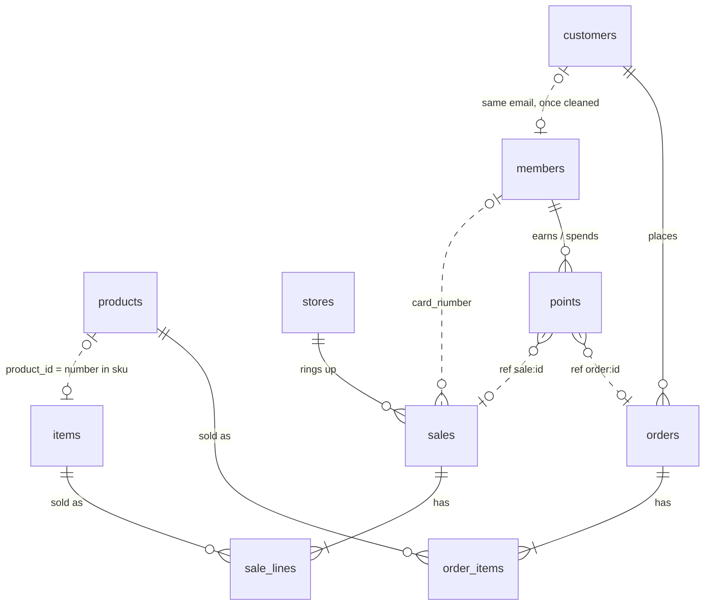

# Capstone 3 (hard): Tidewell's data platform

## 1 · About the company
**Tidewell** is a retailer of everyday products: electronics, home, office, accessories, sports
and food (18 products). It sells three ways:

- **Online**, to customers in ten countries (US, UK, DE, IN, FR, NL, SG, BR, JP, AU).
- **In five stores**, paid by card, cash or mobile:

  | Store | City | Time zone | Opened |
  |---|---|---|---|
  | `NYC-01` | New York | America/New_York | 2018-09-01 |
  | `AMS-01` | Amsterdam | Europe/Amsterdam | 2019-03-01 |
  | `LON-01` | London | Europe/London | 2020-06-15 |
  | `BLR-01` | Bengaluru | Asia/Kolkata | 2021-01-10 |
  | `SIN-01` | Singapore | Asia/Singapore | 2022-04-20 |

- **With a loyalty card**, used online and in stores: 1 point per currency unit spent, 50 welcome
  points for members who join at a till, redemptions of 100, 200 or 500 points.

How the business runs:

- Web orders go *placed → paid → shipped → delivered*. A *placed* or *paid* order can be
  cancelled: it disappears from the web shop, and its points are taken back.
- At a till, about half the customers show their card. A return is booked as a new sale with the
  item at quantity −1.
- Web and store prices are set separately and drift apart.
- Old delivered orders, old till sales and old points transactions are archived (deleted) by
  the systems themselves.

All three systems are **live**: they change every few seconds, all day. *(Tidewell is made up for
this course; its data is real and lives in the lab.)*

## 2 · The databases
Three PostgreSQL databases on `lab-db`, port `5432`, login `reader` / `reader` (read only, allowed
to replicate). 🐘 My databases and the SQL editor list them as *Tidewell web shop*, *Tidewell
stores* and *Tidewell loyalty*.

### `shop`: the web shop
| Table | Role | Key | Important columns |
|---|---|---|---|
| `customers` | one web account | `customer_id` | `email` (lower case) · `country` · `tier` (bronze, silver, gold; changes) · `created_at`, `updated_at` |
| `products` | the product catalogue and **web** price | `product_id` | `name` · `category` · `price` (numeric, changes) · `updated_at` |
| `orders` | one web order | `order_id` | `customer_id` · `status` (changes) · `total` · `created_at`, `updated_at` · **deleted** when cancelled or archived |
| `order_items` | one line of an order | `order_id`, `line` | `product_id` · `quantity` · `price` (the price **at order time**) · deleted with its order |

### `store`: the store tills
| Table | Role | Key | Important columns |
|---|---|---|---|
| `stores` | one store | `store_id` | `code` (e.g. `AMS-01`) · `city` · `country` · `timezone` (IANA name) · `opened_on` |
| `items` | the till's product list and **store** price | `sku` (`SKU-0001`) | `name` (upper case) · `category` · `price_cents` (integer, changes) · `updated_at` |
| `sales` | one till receipt | `sale_id` | `store_id` · `sold_at` (**local time of the store, no time zone**) · `card_number` (empty when no card shown) · `payment` · `total_cents` |
| `sale_lines` | one line of a receipt | `sale_id`, `line` | `sku` · `qty` (**negative = return**) · `unit_price_cents` |

### `loyalty`: the loyalty card
| Table | Role | Key | Important columns |
|---|---|---|---|
| `members` | one card holder | `member_id` | `card_number` (unique) · `full_name` · `email` (may be empty; **typed differently** from the web shop: case, spaces) · `phone` · `tier` (blue, silver, gold; changes) · `points_balance` · `joined_at`, `updated_at` |
| `points` | one points transaction | `txn_id` | `member_id` · `channel` (web, store, bonus, redeem) · `ref` (`order:<id>`, `order:<id>:cancelled`, `sale:<id>`, `welcome`, or empty) · `points` (negative = taken back or redeemed) · `created_at` |

## 3 · Database design
Solid lines are foreign keys inside one database. Dotted lines are the links **between** the
systems: no database enforces them, and they only hold after the data is cleaned.

## Problem statement
Every Tidewell team reports from its own system, in its own units, time zones and keys. Asked
*"what did we sell yesterday?"*, the web team, the stores and the loyalty team give three
different answers, and none covers all channels. Nobody knows who shops both online and in
stores, what a customer is worth across channels, or whether the loyalty card pays off.

**Build Tidewell's data platform**: one trusted, continuously updated picture of sales, customers,
products and loyalty across the three systems, never more than **15 minutes** behind them, ending
in a dashboard for the management team.

You know the tools and the techniques. How you build it is up to you.

## Tasks
Each task says **what** must be true when it's done. Not how.

### T1 · Source profile and data contract
A written contract for all ten source tables: grain, keys, how each table changes (insert, update,
delete), the cross-system links, and every data-quality issue you find, each backed by a query
and its result.

### T2 · Continuous ingestion
All ten tables land in Bronze in your lakehouse and keep landing, at most 15 minutes behind the
sources. After the first load, no run copies whole tables again.

### T3 · Full change history
Bronze keeps the current state, but the business also needs the past. Make every version of every
source row queryable, including deleted rows and when they were deleted, so that questions like
*"what was the status of order X at 10:00 yesterday?"* and *"how many orders were cancelled
yesterday?"* can be answered from the lake.

### T4 · Product dimension with price history
One product dimension that joins the web catalogue and the till items, with the web price and the
store price **over time**: every price each product has had, in each channel, and from when to
when it was valid.

### T5 · Customer identity
One row per real person across the web shop and the loyalty programme. A web account and a card
member are the same person when their emails match after cleaning. People without a match stay,
as web-only or card-only. Each person has a key of yours that **doesn't change** between runs,
and existing keys survive new customers, new members and edited emails.

### T6 · Unified sales fact
Every web order line and every till line in one fact table, at line grain: one currency (two
decimals), UTC time **and** the store's local day, product and customer keys, channel and store.
Returns are negative. Cancelled orders are not revenue. The fact is updated **incrementally**
(only what changed since the last run), and running it twice gives the same result.

### T7 · Loyalty ledger
A points ledger that ties every transaction to its customer and, where it has one, to the order or
receipt that caused it. It reconciles with each member's `points_balance`; every member whose
ledger and balance disagree is reported, with the difference.

### T8 · Gold marts
At least these, built only from your Silver layer:

- **daily sales** by day, channel and store, in UTC days and in each store's local days;
- **store performance** per store and week: revenue, receipts, average basket, return rate;
- **customer 360**: per person, spend online and in stores, first and last purchase, points
  balance, which channels they use;
- **loyalty health** per day: new members, points earned, redeemed and taken back, active members,
  and the share of store revenue made with a card.

### T9 · Data quality gate
Automated rules that run with every load: unique keys at every layer, no orphans between facts and
dimensions, Silver revenue reconciling with the sources to the cent, no timestamps in the future,
freshness within 30 minutes, and the ledger check from T7. When a rule fails, Gold is **not**
updated, and the failure is visible with the rule and the offending rows.

### T10 · Orchestration
The whole chain runs by itself every 15 minutes in the right order, survives a failed run and a
restart without double-counting, and can rebuild Silver and Gold from Bronze for any past period.

### T11 · Access and privacy
Gold is shared **read only** with one other member (Tidewell's "finance" team); Bronze and
Silver stay private to you. Gold contains no email addresses or phone numbers in clear text.

### T12 · Final visualization: "Tidewell today"
A Superset dashboard for the management team, refreshing at least every 15 minutes, with filters
for date range, channel and store, showing at least:

- today's revenue, web against stores, compared with the same weekday last week;
- revenue per store per local day over the last 14 days;
- return rate per store;
- the top 20 customers by total spend, with their channels and card tier;
- points earned against redeemed per day, and the outstanding points balance;
- data freshness: when each system was last loaded.

### T13 · Hand-over
A short package for whoever runs the platform after you: an architecture diagram, a runbook (what
to do when ingestion lags, a check fails, or a replication slot is lost), the data contract from
T1, and one page for management with the five most important things the data shows.

## Done when
All thirteen tasks are met **on live data**, the quality gate is green, and the dashboard answers
the management team's questions without anyone opening a notebook. There's no answer key: the
systems never stop changing, so your numbers are yours alone.
