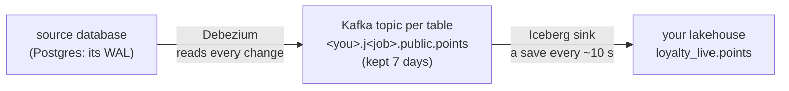

# Live data: Datastream (Debezium + Kafka)

## Concept
A **Manual** or **Cron** job copies in batches: it wakes up, catches up with the source, and stops.
Between runs the lake falls behind — up to one schedule interval. A **Datastream** job never
stops: every insert, update and delete reaches the lake a few seconds after it happened in the
source.

It's built from three parts that run all the time:



| Part | What it does |
|---|---|
| **Debezium** (a Kafka Connect *source connector*) | reads the source's change log (the WAL, through the replication slot) and turns each change into a message |
| **Kafka** | keeps the messages, one **topic** per table, for 7 days — a buffer between reading and writing, and a record you could replay |
| **Iceberg sink** (a Kafka Connect *sink connector*) | collects the messages and **commits** them to the Iceberg table every few seconds |

A **commit** is one new snapshot of the table. That's the trade: fresher data, but many small
files and snapshots — which is what [table maintenance](../unit4/table-maintenance.md) is for.

!!! info "Needs the Streaming unit"
    Kafka and Kafka Connect are the **Streaming** unit. It's off until a lab manager switches it on
    — on your laptop `make status` → **Streaming** → **s**, on a team stack **Manage → ⚙️ Settings
    → Services → Streaming** — and while it's off, the Ingestion page says so. (Jobs made before
    Ingestion ran on Debezium keep their old engine, OLake, which has no Datastream: the choice is
    greyed out for them.)

## Lab
We'll stream Tidewell's **loyalty** system: its members and their points ([Meet the live shop](live-shop.md)).

### 1 · Source and destination
- **Sources → + New source**: name `Tidewell loyalty`, host `lab-db`, port `5432`, database
  `loyalty`, user / password `reader` / `reader`, schemas `public`, CDC **on** → **Save source**.
- **Destinations → + New destination**: name `Loyalty live`, your lakehouse, namespace
  **+ New namespace…** → `loyalty_live` → **Save destination**.

### 2 · The job
**Jobs → + New job**: source **Tidewell loyalty**, destination **Loyalty live**, tables **All**
(`public.members`, `public.points`), mode **Full load + every change (history)**, and under
**Runs** choose **Datastream** → **Create & start stream**.

The job's status turns into **● streaming** — *N changes since …* — and its page gets a **Log**
card that keeps itself up to date:

```text
10:07:45 ▶ stream started — the topics hold 4508 changes

— Kafka Connect, this job's connectors (latest lines) —
[2026-11-03 10:07:46,805] INFO [cdc-24-sink|task-0] Task elected leader, starting commit coordinator
…
```

*4508 changes* is the full load: Debezium first reads every existing row (as `I` inserts), then
switches to the live changes. Every five minutes the log adds a line like *41 changes so far · 0
on the way to Iceberg* — **on the way** are changes Kafka holds that the sink hasn't committed yet.

### 3 · Watch history arrive
In the SQL editor, member 1's rows — the full load's, then each change:

```sql
SELECT member_id, tier, _cdc.op, _cdc.ts
FROM <you>_lake.loyalty_live.members WHERE member_id = 1 ORDER BY _cdc.ts;
```

```text
 member_id | tier | op |               ts
-----------+------+----+--------------------------------
         1 | gold | I  | 2026-11-03 10:07:43.828000 UTC
         1 | gold | U  | 2026-11-03 10:10:16.741000 UTC
```

History mode never overwrites: each update is a new row (`U`), each delete a row with `D`. Run
`SELECT count(*) FROM <you>_lake.loyalty_live.points` twice, half a minute apart: the count grows
while you watch — no Run now. (How fast? A change made in the source showed up in the lake **about
2 seconds** later when we measured; with a busy source or a slow commit it can take up to ~30 s.)

!!! tip "Newest change ≠ delay"
    `SELECT max(_cdc.ts), now() FROM …points` shows how long ago the **last change** happened in
    the source — on a quiet table that can be minutes, even though the stream is seconds behind.
    The delay is how long a *new* change takes to show up.

### 4 · From Datastream to Cron
On the job's page, **How it runs** → **Cron** → `*/2 * * * *` → **Save**. Within seconds:

- the stream's entry in **Runs** closes as **■ stopped** (its log stays);
- the connectors are **paused** — changes now wait in the replication slot;
- the first scheduled run starts **right away** (a cron time has passed since the stream began),
  finds nothing new and takes 3 s; the next ones follow every two minutes.

| Result | Rows | Why |
|---|---|---|
| ✓ ok | 0 | schedule |
| ■ stopped | 16 | stream |

Nothing is lost on the way: the sink records how far it has read **together with** each Iceberg
commit, so whatever it hadn't saved yet is simply read again. Switch back to **Datastream** and a
new stream starts where the scheduled runs left off.

### 5 · Mind the small files
Every commit is a snapshot with a file or two in it. After a few minutes of streaming, open the
table's panel on **🗂️ My catalogs**: `members` had **10 data files and 10 snapshots** for a few
thousand rows. Set **🧹 Maintenance → Compaction** on the namespace and **▶ Run now**: 10 files → 1
([Set it once](../unit4/table-maintenance.md)). For a stream, let it run nightly.

### 6 · Stop and clean up
**■ Stop stream** pauses it (the slot keeps the log — stop for hours, not weeks). To remove it:
**Delete** the job (its connectors and Kafka topics go with it; the tables stay), then the source
(its replication slot is dropped), then the destination — the order from
[Run it for real](operate.md).

## Check yourself
1. A Manual job runs every morning. Why is the lake up to a day behind, and what would Datastream
   change?
2. What is Kafka's job in the middle — why doesn't Debezium write to Iceberg directly?
3. Your streamed table is slow to read after a week. What happened, and what fixes it?

??? success "Answers"
    1. A batch job copies only when it runs, so the lake shows the source as it was at the last
       run. Datastream reads changes as they happen and commits every few seconds — seconds
       behind instead of hours.
    2. It decouples reading from writing: Debezium keeps reading even while the sink is slow or
       restarting, the messages wait in Kafka (7 days), and the sink commits them in batches.
       Other readers could use the same topic too.
    3. Thousands of commits left thousands of small files (and snapshots). Compaction merges
       them; snapshot expiry removes the old snapshots — 🧹 Maintenance, nightly.

## You can now…
- explain how a Datastream job flows: WAL → Debezium → Kafka topic → Iceberg sink → table;
- start a stream, read its live log, and see history arrive within seconds;
- switch a job between Datastream and Cron, and say why no change is lost;
- keep a streamed table fast with compaction.
