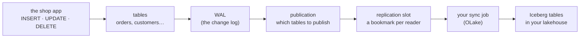

# What is change data capture (CDC)?

## Concept
A web shop's database changes all day long: new orders arrive, orders move from *placed* to
*paid* to *shipped*, a customer cancels, a price goes up. The analysts want those numbers in the
**lakehouse**, close to the live data, without slowing the shop down. Your job is to keep a
copy of the shop's tables in the lake and keep that copy up to date.

There are three ways to do it.

| Way | How it works | Good | Bad |
|---|---|---|---|
| **Full reload** | Every run copies the whole table again and replaces the copy | Simple, always right | Slow and heavy for big tables; reads every row, every time |
| **Incremental by timestamp** | Every run copies rows `WHERE updated_at > last run` | Small reads | Misses **deletes** (a deleted row has no timestamp left), and misses changes that forget to set `updated_at` |
| **Change data capture (CDC)** | Read the database's own **change log**: every insert, update and delete, in order | Small reads, sees deletes, nothing slips through, no load on the tables | Needs the database set up for it; one more moving part |

**Change data capture** means *capturing* each change the moment the database records it,
instead of comparing tables later. Every serious database already writes a change log for
its own safety (to recover after a crash, and to feed replicas). CDC reads that same log.

### How CDC works in Postgres

- **WAL** (*write-ahead log*): Postgres writes every change to this log *before* it changes
  the table. Set `wal_level = logical` and the log keeps enough detail to rebuild each changed
  row, so a reader can see "order 524 was deleted" or "order 34: status shipped → delivered".
- **Publication**: the list of tables whose changes are published. The lab's shop has one called
  `olake_pub` covering all its tables.
- **Replication slot**: a **bookmark** in the log for one reader. Postgres keeps the log
  until that reader has read it, so nothing is lost between runs. It is also why each reader
  needs **its own** slot. If two jobs shared one, each would take changes the other never sees.
- **The sync job** reads from its slot, writes the changes into Iceberg tables, and moves the
  bookmark forward.

MySQL (the *binlog*) and SQL Server (*CDC tables*) do the same thing under other names. The
**📡 Ingestion** tool handles all three.

### Snapshot first, then the stream
The change log only holds *recent* changes, not the rows that were there before. So every CDC
job starts the same way:

1. **Full load (snapshot)**: read every row of every chosen table once. In the lake these rows
   are marked `r` (*read*).
2. **Stream**: from then on, read only the changes from the slot. They are marked `c` (*create*,
   an insert), `u` (*update*) and `d` (*delete*).

Every row in the lake carries that letter in a column called **`_op_type`**. You'll use it in
every query of this unit.

### What the lab gives you
| Piece | What it is |
|---|---|
| **The live shop** (`lab-db`) | A Postgres database `shop` with `customers`, `products`, `orders`, `order_items`. A small program changes it every 2–10 seconds, like a real shop, together with the company's two other systems, `store` (tills) and `loyalty` (loyalty card). Everyone reads them with the login `reader` / `reader`, which can read but never write. |
| **📡 Ingestion** (in Tools) | Where you add a **source** (a database), a **destination** (your lakehouse + a namespace) and a **job** (which tables, full load + CDC or full reload, how often). |
| **OLake** | The open-source engine that does the copying. Each check, table list and sync runs as one short-lived OLake container. You never start it yourself. |
| **Your lakehouse** | The tables land as Iceberg tables, e.g. `my.shop_cdc.orders`. Query them with Spark, the SQL editor or Superset like any other table. |

!!! info "Where you meet CDC at work"
    Every platform has it: **Debezium** + Kafka (open source), **Fivetran** and **Airbyte**
    (managed connectors), **AWS DMS**, **Azure Data Factory** CDC, **Google Datastream**,
    **Databricks Lakeflow Connect**, **Snowflake** connectors. The words change; the WAL, the
    slot, the snapshot and the `c`/`u`/`d` stream are the same everywhere.

## Check yourself
1. A customer is deleted from the shop. Which of the three ways copies that delete to the lake?
2. Why does a CDC job always begin with a full load?
3. Two jobs read the same database with CDC. Why does each need its own replication slot?

??? success "Answers"
    1. Only **CDC** (and a full reload, which simply no longer has the row). Incremental by
       timestamp never sees it: the row is gone, so no `updated_at` points to it.
    2. The log only holds changes from *now on*. The rows that already existed have to be
       read once, as a snapshot (`r`).
    3. A slot is one reader's bookmark. Reading moves it forward, so a shared slot would hand
       each change to only one of the two jobs.

## You can now…
- explain full reload, incremental-by-timestamp and CDC, and when each one fits;
- name the Postgres pieces CDC uses: WAL, publication, replication slot;
- read `_op_type`: `r` snapshot, `c` insert, `u` update, `d` delete.
