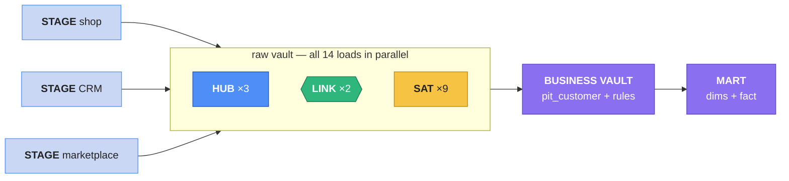

# Automate it & challenge

You've loaded a three-source vault by hand, cell by cell. In production the same SQL runs as a
pipeline — and Data Vault's hash keys give that pipeline a very particular shape.

## The pipeline shape



Three steps, and the middle one is **fourteen independent loads**. A star schema can't do that
— facts wait for dimensions to hand out surrogate keys. In the vault every load computes its
keys from staging, so they all start together. And each **source** can be staged on its own
schedule: if the CRM delivers at 02:00 and the marketplace at 05:00, each stage triggers its own
loads — the hubs simply take keys from whoever arrives first.

### As an Airflow DAG
Following [the development workflow](../unit5/dev-workflow.md) (notebook → job → DAG), each box
becomes a task; the dependencies are just the three steps:

```python
[stage_shop, stage_crm, stage_marketplace] >> [
    hub_customer, hub_product, hub_order,
    lnk_order_customer, lnk_order_product,
    sat_customer_shop, sat_customer_shop_loyalty, sat_customer_crm, sat_customer_marketplace,
    sat_product_shop, sat_product_shop_price,
    sat_order_shop, sat_order_marketplace, sat_order_line,
] >> pit_customer >> marts
```

The batch time comes from Airflow instead of a literal: the run's logical date becomes
`load_dts`, so a re-run of the same day writes the same `load_dts` — and adds nothing.

### In dbt
Each vault table is one **incremental** model ([Incremental models](../dbt/incremental.md)):
the `NOT EXISTS` / hashdiff filter goes in ``. Every hub, link and
satellite has the **same** shape, so teams write the pattern once as a **macro**
([Jinja and macros](../dbt/jinja-macros.md)) and call it per table. On Snowflake, Databricks and
BigQuery the community package **AutomateDV** provides those macros ready-made.

## Challenge
Work in the same notebook and namespaces. Hints are folded — try first.

### 1 · Day 3
Make a third batch (`load_dts = 2025-01-03 06:00`): customer 72 moves **back** to their Day 1
country in the shop; the CRM updates customer 72's country to `NL`; marketplace order MP-200001
is `DISPATCHED`. Re-run staging and the loads, rebuild the PIT and the marts.

- How many rows does each table gain?
- What does `dim_customer` now say for customer 72 — and why?
- Customer 72's shop country is back to the Day 1 value. Does the satellite **reuse** the Day 1
  row, or add a new one?

??? tip "Hint"
    The load compares with the **latest** version only (Day 2: `NL`). The Day 1 country differs
    from it, so a new row is added — history is a timeline, not a set. `dim_customer` now shows
    `NL`: the CRM (which the rule trusts first) says so.

### 2 · Change a business rule
Marketing says: **the shop** is right about country, not the CRM. Change the rule and rebuild
`dim_customer_history` and `dim_customer`. Which tables did you have to touch? Which did you
**not**?

??? tip "Hint"
    Only the `coalesce(c.country, s.country, …)` in `dim_customer_history` — swap to
    `coalesce(s.country, c.country, m.buyer_country)`. No Raw Vault table changes; nothing is
    reloaded. That's the payoff of keeping every source's opinion.

### 3 · A customer changes e-mail
Customer 100 tells the shop their new address is `c100@newmail.example`. The shop updates the
e-mail on `customer_id 100`. What happens in the vault? Is that one customer or two?

??? tip "Hint"
    The e-mail is the business key, so the new address hashes to a **new** hub row — the vault
    sees two customers. The shop *knows* they're the same person (same `customer_id`). Data Vault
    records that knowledge in a **same-as link** (`sal_customer`: the `customer_hk` of the old and
    of the new address, `record_source = 'shop.customers'`). Build it from staging: rows whose
    `shop_customer_id` already has a satellite version under a **different** `customer_hk`.
    Marts then resolve both keys to one person.

### 4 · A fourth hub: suppliers
`products.supplier_id` is a relationship we skipped. Add **`hub_supplier`**, a link
**`lnk_product_supplier`** and a satellite **`sat_supplier_shop`** (`name`, `country`,
`lead_time_days`) — from the Postgres `shopflow.suppliers` table.

??? tip "Hint"
    Read Postgres from the notebook as in [SQL from Python](../unit3/databases.md), register a
    temp view `src_shop_suppliers`, then the same steps: stage (hash key + hashdiff), hub, link
    (from `src_shop_products`: `sku` + `supplier_id`), satellite. Check: 20 suppliers, 200 links.

## Going further
| Topic | What it solves |
|---|---|
| **Ghost records** | one dummy row per satellite so PIT joins are always inner joins |
| **Same-as links** | two keys for one real thing (changed e-mail, duplicate accounts) |
| **Bridge tables** | pre-joined hub/link paths (customer → order → product) for fast marts |
| **Multi-active satellites** | several valid rows at once per key (a customer's phone numbers) |
| **Effectivity satellites** | when a relationship started and **ended** (a product changes supplier) |
| **Status tracking satellites** | detect keys that **disappeared** from a source (deletes) |

## Wrap-up
You took three systems that couldn't talk to each other — a shop, a CRM and a marketplace, with
different ids, spellings and opinions — and integrated them: **3 hubs keyed on real business
keys, 2 links, 9 satellites**, loaded insert-only and in parallel. Day 2 added history from all
three without touching an existing row. Business rules chose between sources in one visible
place, and the marts answered questions no single system could — while adding up to the cent.

That's how banks, insurers and governments integrate dozens of systems — with the same SQL
you've written all course.
