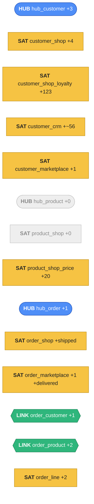

# Day 2: changes arrive, history builds up

The vault exists to **absorb change** — from every source, on its own schedule. A second batch
arrives with a mix of what real sources send: changed attributes, new people, a new order, a
customer who signs up in the shop and buys on the marketplace the same day. You'll run the
**same** staging and load cells again — not one line of them changes — and watch only the right
tables grow.

## What changes on Day 2

| Source | Change | Rows |
|---|---|---|
| shop | customer **72** moves to the Netherlands (`country = 'NL'`) | 1 |
| shop | every customer with an id divisible by 50 flips `marketing_opt_in` | 120 |
| shop | **3 new** customers sign up (6001–6003) | 3 |
| shop | every 10th product gets **10% more expensive** | 20 |
| shop | `placed` orders with an id divisible by 3 are now **`shipped`** | depends on your data |
| CRM | every 100th contact gets a **new phone number** | ~55 |
| CRM | the new shop customer **6002** is added to the CRM | 1 |
| marketplace | new customer **6001** places order **MP-200001** — typing ` Customer6001@Example.com` | 1 order, 2 lines |
| marketplace | `DISPATCHED` orders with a number divisible by 4 are now **`DELIVERED`** | depends on your data |



Grey tables get **nothing**: no new SKU, no product renamed.

## Lab

### 1 · The Day 2 batch
Replace the seven `src_*` views — the shared tables with the Day 2 changes applied on the way,
and a new `load_dts`: **`2025-01-02 06:00`**.

**Shop:**

```sql
%%sql
CREATE OR REPLACE TEMP VIEW src_shop_customers AS
SELECT customer_id, full_name, email,
       CASE WHEN customer_id = 72 THEN 'NL' ELSE country END                    AS country,
       signup_date, loyalty_tier,
       CASE WHEN customer_id % 50 = 0 THEN NOT marketing_opt_in
            ELSE marketing_opt_in END                                         AS marketing_opt_in,
       TIMESTAMP '2025-01-02 06:00:00' AS load_dts, 'shop.customers' AS record_source
FROM shared.bronze.customers
UNION ALL
SELECT customer_id, full_name, email, country, signup_date, loyalty_tier, marketing_opt_in,
       TIMESTAMP '2025-01-02 06:00:00', 'shop.customers'
FROM VALUES
  (6001, 'Customer 6001', 'customer6001@example.com', 'DE', DATE '2025-01-01', 'none', true),
  (6002, 'Customer 6002', 'customer6002@example.com', 'UK', DATE '2025-01-01', 'none', false),
  (6003, 'Customer 6003', 'customer6003@example.com', 'US', DATE '2025-01-02', 'none', true)
  AS t(customer_id, full_name, email, country, signup_date, loyalty_tier, marketing_opt_in)
```

- **`%`** — remainder: `customer_id % 50 = 0` is every 50th customer.
- **`NOT marketing_opt_in`** — flips `true` ↔ `false`.
- **`FROM VALUES (…), (…) AS t(columns)`** — a small inline table; `UNION ALL` appends it.

```sql
%%sql
CREATE OR REPLACE TEMP VIEW src_shop_products AS
SELECT product_id, name, category,
       CASE WHEN product_id % 10 = 0 THEN cast(round(price * 1.10, 2) AS decimal(10,2))
            ELSE price END                                                    AS price,
       cost, supplier_id, updated_at,
       TIMESTAMP '2025-01-02 06:00:00' AS load_dts, 'shop.products' AS record_source
FROM shared.bronze.products
```

```sql
%%sql
CREATE OR REPLACE TEMP VIEW src_shop_orders AS
SELECT order_id, customer_id, channel, order_ts,
       CASE WHEN status = 'placed' AND order_id % 3 = 0 THEN 'shipped'
            ELSE status END                                                   AS status,
       currency, promo_id,
       TIMESTAMP '2025-01-02 06:00:00' AS load_dts, 'shop.orders' AS record_source
FROM shared.bronze.orders
```

```sql
%%sql
CREATE OR REPLACE TEMP VIEW src_shop_order_items AS
SELECT *, TIMESTAMP '2025-01-02 06:00:00' AS load_dts, 'shop.order_items' AS record_source
FROM shared.bronze.order_items
```

**CRM:**

```sql
%%sql
CREATE OR REPLACE TEMP VIEW src_crm_contacts AS
SELECT crm_id, email, first_name, last_name,
       CASE WHEN cast(substr(crm_id, 3) AS int) % 100 = 0
            THEN concat('+31 20 555 ', substr(crm_id, 5)) ELSE phone END       AS phone,
       country, segment, consent_email, updated_at,
       TIMESTAMP '2025-01-02 06:00:00' AS load_dts, 'crm.contacts' AS record_source
FROM shared.crm.contacts
UNION ALL
SELECT 'C-900001', 'customer6002@example.com', 'Noah', 'Fischer', '+44 20 7946 0001',
       'UK', 'B2C', true, TIMESTAMP '2025-01-02 05:00:00',
       TIMESTAMP '2025-01-02 06:00:00', 'crm.contacts'
```

- **`substr(crm_id, 3)`** — the text from the 3rd character on: `C-000100` → `000100`.

**Marketplace:**

```sql
%%sql
CREATE OR REPLACE TEMP VIEW src_mkt_orders AS
SELECT mp_order_ref, buyer_email, buyer_name, buyer_country, ordered_at,
       CASE WHEN order_status = 'DISPATCHED'
             AND cast(substr(mp_order_ref, 4) AS int) % 4 = 0 THEN 'DELIVERED'
            ELSE order_status END                                             AS order_status,
       currency,
       TIMESTAMP '2025-01-02 06:00:00' AS load_dts, 'marketplace.orders' AS record_source
FROM shared.marketplace.orders
UNION ALL
SELECT 'MP-200001', ' Customer6001@Example.com', 'Customer 6001', 'DE',
       TIMESTAMP '2025-01-01 21:15:00', 'PAID', 'EUR',
       TIMESTAMP '2025-01-02 06:00:00', 'marketplace.orders'
```

```sql
%%sql
CREATE OR REPLACE TEMP VIEW src_mkt_order_lines AS
SELECT *, TIMESTAMP '2025-01-02 06:00:00' AS load_dts, 'marketplace.order_lines' AS record_source
FROM shared.marketplace.order_lines
UNION ALL
SELECT * FROM VALUES
  ('MP-200001', 'SKU-0005', 1, CAST(21.50 AS decimal(10,2)),
   TIMESTAMP '2025-01-02 06:00:00', 'marketplace.order_lines'),
  ('MP-200001', 'SKU-9001', 2, CAST(9.99 AS decimal(10,2)),
   TIMESTAMP '2025-01-02 06:00:00', 'marketplace.order_lines')
```

### 2 · Count the status changes you'll see

```sql
%%sql
SELECT
  (SELECT count(*) FROM shared.bronze.orders
   WHERE status = 'placed' AND order_id % 3 = 0)                                AS shop_shipped,
  (SELECT count(*) FROM shared.marketplace.orders
   WHERE order_status = 'DISPATCHED' AND cast(substr(mp_order_ref, 4) AS int) % 4 = 0) AS mkt_delivered,
  (SELECT count(*) FROM shared.crm.contacts
   WHERE cast(substr(crm_id, 3) AS int) % 100 = 0)                              AS crm_new_phones
```

Note the three numbers — `sat_order_shop` grows by `shop_shipped`, `sat_order_marketplace` by
`mkt_delivered + 1`, `sat_customer_crm` by `crm_new_phones + 1`.

### 3 · Re-run staging and every load — unchanged
Run, in this order, the cells you already have:

1. the seven **`stg_*` views** from [staging](staging.md) (steps 3–9);
2. the five **hub and link loads** from [hubs and links](hubs-links.md) (steps 2 and 5);
3. the nine **satellite loads** from [satellites](satellites.md) (steps 2–5).

!!! tip "Why re-run the `stg_*` cells?"
    They'd probably pick up the new `src_*` views on their own — but re-running them makes the
    order of a real pipeline explicit: **batch → stage → hubs & links → satellites**.

### 4 · What grew
Run the count queries from the hubs and satellites lessons again:

| Table | Grows by | Why |
|---|---|---|
| hub_customer | **3** | 6001–6003. 6001 also came from the marketplace, 6002 from the CRM — still one row each |
| hub_product | 0 | `SKU-0005`, `SKU-9001` already known |
| hub_order | **1** | MP-200001 |
| lnk_order_customer | **1** | MP-200001 → customer 6001 |
| lnk_order_product | **2** | its 2 lines |
| sat_customer_shop | **4** | 72 moved + 3 new |
| sat_customer_shop_loyalty | **123** | 120 flipped + 3 new |
| sat_customer_crm | crm_new_phones **+ 1** | new phones + 6002 |
| sat_customer_marketplace | **1** | 6001's first marketplace description |
| sat_product_shop | 0 | nothing renamed |
| sat_product_shop_price | **20** | new prices |
| sat_order_shop | shop_shipped | status moved on |
| sat_order_marketplace | mkt_delivered **+ 1** | status moved on + new order |
| sat_order_line | **2** | MP-200001's lines |

Everything else in the ~176,000-row batch was **skipped** — its hashdiff matched.

### 5 · One new customer, three sources, one hub row
Customer 6001 signed up in the shop and, the same day, bought on the marketplace with a
differently-typed e-mail. 6002 was added to the CRM:

```sql
%%sql
SELECT h.email, h.record_source AS first_seen_in,
       s.shop_customer_id IS NOT NULL AS in_shop,
       c.crm_id           IS NOT NULL AS in_crm,
       m.buyer_name       IS NOT NULL AS in_marketplace
FROM my.raw_vault.hub_customer h
LEFT JOIN my.raw_vault.sat_customer_shop        s ON s.customer_hk = h.customer_hk
LEFT JOIN my.raw_vault.sat_customer_crm         c ON c.customer_hk = h.customer_hk
LEFT JOIN my.raw_vault.sat_customer_marketplace m ON m.customer_hk = h.customer_hk
WHERE h.email IN ('customer6001@example.com', 'customer6002@example.com', 'customer6003@example.com')
ORDER BY h.email
```

| email | first_seen_in | in_shop | in_crm | in_marketplace |
|---|---|---|---|---|
| customer6001@example.com | shop.customers | true | false | true |
| customer6002@example.com | shop.customers | true | true | false |
| customer6003@example.com | shop.customers | true | false | false |

` Customer6001@Example.com` landed on the **same** hub row as the shop's
`customer6001@example.com` — normalisation and hashing did the matching, no lookup needed.

### 6 · Why the split satellites paid off
120 customers changed their opt-in, one changed country. With **one** shop customer satellite,
all 121 changes would copy name, country and sign-up date into new rows. Split,
`sat_customer_shop` took only the real change (+3 new customers):

```sql
%%sql
SELECT 'shop' AS sat, count(*) AS new_versions
FROM my.raw_vault.sat_customer_shop WHERE load_dts = TIMESTAMP '2025-01-02 06:00:00'
UNION ALL
SELECT 'shop_loyalty', count(*)
FROM my.raw_vault.sat_customer_shop_loyalty WHERE load_dts = TIMESTAMP '2025-01-02 06:00:00'
UNION ALL
SELECT 'crm', count(*)
FROM my.raw_vault.sat_customer_crm WHERE load_dts = TIMESTAMP '2025-01-02 06:00:00'
```

| sat | new_versions |
|---|---|
| shop | 4 |
| shop_loyalty | 123 |
| crm | 56 |

And because the CRM has its own satellite, 55 new phone numbers didn't touch a single shop
row. On millions of customers with marketing flags changing daily, that's the difference between
a vault that grows by megabytes and one that grows by gigabytes.

### 7 · Read the history
Customer 100's loyalty history — each version's **end** computed on read:

```sql
%%sql
SELECT h.email, l.loyalty_tier, l.marketing_opt_in,
       l.load_dts                                              AS valid_from,
       lead(l.load_dts) OVER (PARTITION BY l.customer_hk
                              ORDER BY l.load_dts)             AS valid_to
FROM my.raw_vault.sat_customer_shop_loyalty l
JOIN my.raw_vault.hub_customer h ON h.customer_hk = l.customer_hk
WHERE h.email = 'customer100@example.com'
ORDER BY valid_from
```

- **`lead(x) over (partition by … order by …)`** — the **next** row's `x` within the same
  customer; `null` for the newest. That's the version's end — no `UPDATE` needed.

| email | loyalty_tier | marketing_opt_in | valid_from | valid_to |
|---|---|---|---|---|
| customer100@example.com | gold | true | 2025-01-01 06:00:00 | 2025-01-02 06:00:00 |
| customer100@example.com | gold | false | 2025-01-02 06:00:00 | null |

### 8 · The plain join breaks
Join a customer to two satellites now — customer 100 has two loyalty versions, so you get **two**
rows, and with more sources and more days it multiplies:

```sql
%%sql
SELECT h.email, s.country, l.marketing_opt_in, l.load_dts
FROM my.raw_vault.hub_customer h
JOIN my.raw_vault.sat_customer_shop         s ON s.customer_hk = h.customer_hk
JOIN my.raw_vault.sat_customer_shop_loyalty l ON l.customer_hk = h.customer_hk
WHERE h.email = 'customer100@example.com'
```

To read "customer 100 **as of** a date" you must pick, in each of four satellites, the version
valid then. The Business Vault builds that **once**: the **PIT table**, next.

## Check yourself
1. ` Customer6001@Example.com` arrived from the marketplace. Why didn't it create a new
   customer? *(Normalised to `CUSTOMER6001@EXAMPLE.COM` before hashing — the same hash as the
   shop's row.)*
2. 55 CRM phone numbers changed. How many shop satellite rows did that add? *(None — each source
   has its own satellites.)*
3. How do you know when a version **ended**? *(The next version's `load_dts` — `lead()` on
   read.)*
