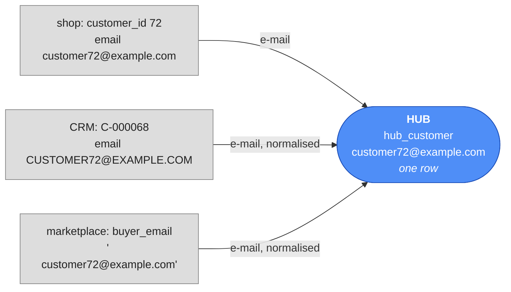
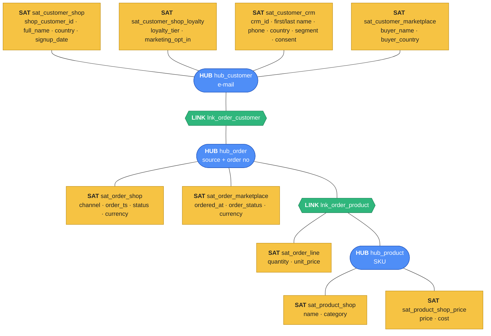
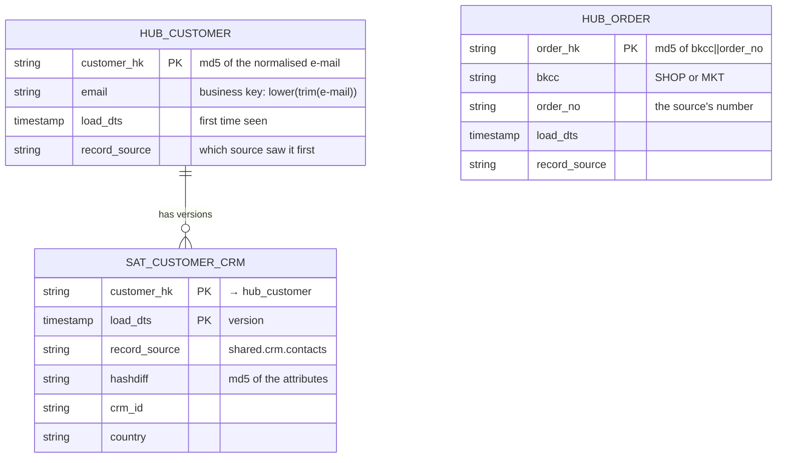

# Design the ShopFlow vault

A Data Vault is **designed on paper first**: find the business keys, the relationships, and
group the remaining columns into satellites. With three sources, the first step is the one that
matters most.

## Step 1 · Business keys that every source shares → hubs
A **business key** is how the **business** identifies a thing — across systems, on invoices, in
support calls. A database id that only one system knows is **not** a business key; it's that
system's **internal** id.

| Concept | Shop calls it | CRM calls it | Marketplace calls it | Business key | Hub |
|---|---|---|---|---|---|
| customer | `customer_id` 72 | `crm_id` C-000068 | `buyer_email` | **e-mail** | **`hub_customer`** |
| product | `product_id` 9 | — | `sku` SKU-0009 | **SKU** | **`hub_product`** |
| order | `order_id` 17 | — | `mp_order_ref` MP-100017 | **source + order number** | **`hub_order`** |

Three decisions:

- **Customer → e-mail.** All three sources have it. `customer_id` and `crm_id` don't disappear —
  they become **attributes** in their source's satellite, so you can always trace back.
- **Product → SKU.** The marketplace only knows SKUs. The shop's `product_id` 9 *is* `SKU-0009`
  (ShopFlow's labelling rule), so shop staging turns the number into the SKU.
- **Order → source + number.** Shop orders and marketplace orders are **different** orders,
  numbered by different systems — today they don't clash, but shop order `100100` and a future
  marketplace order `100100` would. Data Vault solves this with a **business key collision
  code (BKCC)**: a short code for the numbering system, part of the key — `SHOP|17`,
  `MKT|MP-100017`.



Three sources, three spellings, **one** hub row.

## Step 2 · Relationships → links

| Relationship | Found in | Link |
|---|---|---|
| an order is placed by a customer | shop `orders.customer_id`; marketplace `orders.buyer_email` | **`lnk_order_customer`** |
| an order contains a product | shop `order_items`; marketplace `order_lines` | **`lnk_order_product`** |

Both links are fed by **both** order sources. A link connects **business keys**, so the shop's
`orders.customer_id` must become an e-mail in staging (looked up in the shop's own customers
table — still within one source).

## Step 3 · Context → satellites, split by source and by rate of change
Two reasons to split satellites:

1. **Source** — every source gets its **own** satellites. The CRM's country never overwrites
   the shop's country; both are kept, each with its `record_source`.
2. **Rate of change** — within a source, columns that change often go in their own satellite.

| Satellite | Source | Columns | On |
|---|---|---|---|
| **`sat_customer_shop`** | shop | `shop_customer_id`, `full_name`, `country`, `signup_date` | hub_customer |
| **`sat_customer_shop_loyalty`** | shop | `loyalty_tier`, `marketing_opt_in` — change often | hub_customer |
| **`sat_customer_crm`** | CRM | `crm_id`, `first_name`, `last_name`, `phone`, `country`, `segment`, `consent_email` | hub_customer |
| **`sat_customer_marketplace`** | marketplace | `buyer_name`, `buyer_country` | hub_customer |
| **`sat_product_shop`** | shop | `name`, `category` | hub_product |
| **`sat_product_shop_price`** | shop | `price`, `cost` — change often | hub_product |
| **`sat_order_shop`** | shop | `channel`, `order_ts`, `status`, `currency` | hub_order |
| **`sat_order_marketplace`** | marketplace | `ordered_at`, `order_status`, `currency` | hub_order |
| **`sat_order_line`** | shop **and** marketplace | `quantity`, `unit_price` | lnk_order_product |

!!! question "Why may `sat_order_line` take both sources?"
    The rule "one satellite per source" exists so two sources never fight over the **same
    key**. An order line belongs to exactly **one** order, from exactly **one** system — the
    BKCC is part of its key — so the two sources never write the same line. Both describe a line
    the same way (quantity, price), so one satellite is enough; `record_source` still says who
    delivered each row. Customers are different: one customer **is** described by three systems
    at once.

## The model



**3 hubs, 2 links, 9 satellites.** Read it from the hubs out: the hubs are the business's
stable vocabulary (customers, products, orders); links say how they relate; satellites say what
each **source** says about them, over time.

## Standard columns
Every vault table has the same technical columns, so every load looks the same:



| Column | In | What |
|---|---|---|
| **`<name>_hk`** | all | the **hash key**: `md5` of the business key (hub) or of all its business keys (link) |
| **business key** | hubs | readable: `email`, `sku`, `bkcc` + `order_no` |
| **`load_dts`** | all | when **this load** brought the row — the same for every row of one batch |
| **`record_source`** | all | where the row came from, e.g. `shared.crm.contacts` |
| **`hashdiff`** | satellites | `md5` of **all** the satellite's attribute columns |

A satellite's key is **(hash key, `load_dts`)**: one row per thing **per version**.

!!! note "No `valid_to`, no `is_current`"
    Data Vault 2.0 satellites store only when a version **started** (`load_dts`). Its end is the
    start of the next version, computed on read (`lead(load_dts) over (…)`). Storing `valid_to`
    would need an `UPDATE` — and the vault is insert-only.

## Hashing rules
A hash key must be **identical** for the same business key from **every** source. So normalise
before hashing:

| Rule | Why | Example |
|---|---|---|
| `trim` | `' a@b.com'` = `'a@b.com'` | `trim(email)` |
| `upper` | `'A@B.COM'` = `'a@b.com'` | `upper(trim(email))` |
| cast to string | md5 takes text | `cast(order_id AS string)` |
| a separator between parts | `SHOP`+`17` must differ from `SHO`+`P17` | `concat_ws('\|\|', …)` |
| `coalesce(…, '')` in hashdiffs | `concat_ws` skips nulls, which shifts the other values | `coalesce(phone, '')` |

```
customer_hk       = md5( upper(trim(email)) )
product_hk        = md5( upper(trim(sku)) )
order_hk          = md5( concat_ws('||', bkcc, upper(trim(order_no))) )
order_customer_hk = md5( concat_ws('||', bkcc, upper(trim(order_no)), upper(trim(email))) )
order_product_hk  = md5( concat_ws('||', bkcc, upper(trim(order_no)), upper(trim(sku))) )
```

For `customer72@example.com`: `customer_hk = md5('CUSTOMER72@EXAMPLE.COM')` — whichever source
it came from, however it was typed.

!!! info "md5 or sha-256?"
    The standard allows either. `md5` (32 hex characters) is plenty at this scale; very large
    vaults often use `sha2(…, 256)`. Pick one and never mix them.

## Where the tables live
All in **your** lakehouse, `my`:

| Namespace | Holds |
|---|---|
| `my.raw_vault` | the 3 hubs, 2 links, 9 satellites |
| `my.business_vault` | the PIT table and business rules |
| `my.info_mart` | the star schema built from the vault |

Staging is **temporary views** in your notebook session — no storage.

## Check yourself
1. Why is `crm_id` an attribute in `sat_customer_crm` and not the hub's key? *(Only the CRM knows
   it. The hub's key must be shared by every source — the e-mail.)*
2. Why does the order hub need a BKCC? *(Two systems number orders independently; the same
   number could mean two different orders.)*
3. The CRM and the shop disagree on a customer's country. Where does each value go?
   *(`sat_customer_crm` and `sat_customer_shop` — both kept, each with its source.)*
