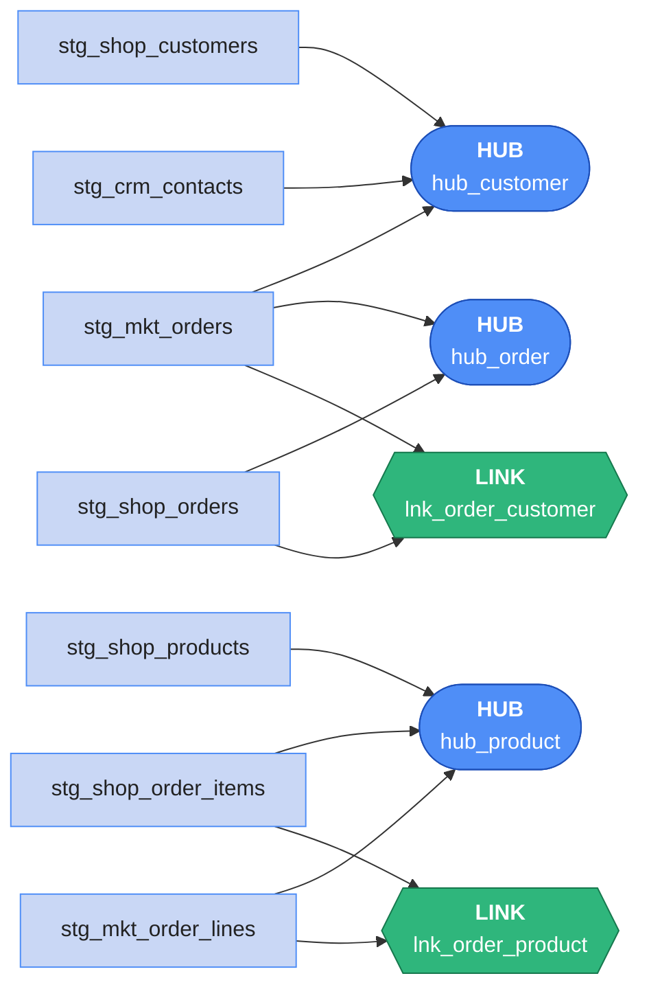

# Load the hubs and links

Hubs and links are the vault's **skeleton**. Their load rule:

> **Insert the keys you haven't seen before — from every source that has them. Never change a
> row that's there.**



Every load reads only staging — none needs another vault table first. They can run in **any
order, or all at once**.

## Lab
Same notebook as [staging](staging.md) — the `stg_*` views must exist.

### 1 · Create the hubs

```sql
%%sql
CREATE TABLE IF NOT EXISTS my.raw_vault.hub_customer (
  customer_hk   string    COMMENT 'md5 of upper(trim(e-mail))',
  email         string    COMMENT 'business key, lower(trim(e-mail))',
  load_dts      timestamp COMMENT 'first loaded',
  record_source string    COMMENT 'the source that saw it first'
)
```

- **`COMMENT '…'`** — documentation stored with the column; shows in `DESCRIBE`, Trino and the
  Polaris Console.

```sql
%%sql
CREATE TABLE IF NOT EXISTS my.raw_vault.hub_product (
  product_hk    string COMMENT 'md5 of upper(trim(sku))',
  sku           string COMMENT 'business key',
  load_dts      timestamp,
  record_source string
)
```

```sql
%%sql
CREATE TABLE IF NOT EXISTS my.raw_vault.hub_order (
  order_hk      string COMMENT 'md5 of bkcc||order_no',
  bkcc          string COMMENT 'business key collision code: SHOP or MKT',
  order_no      string COMMENT 'the order number in that system',
  load_dts      timestamp,
  record_source string
)
```

### 2 · Load a hub from three sources
The same customer can arrive from the shop, the CRM **and** the marketplace in the same batch —
and the marketplace sends one row per **order**, so a buyer appears many times. The hub must get
each person **once**:

```sql
%%sql
INSERT INTO my.raw_vault.hub_customer
SELECT customer_hk, email, load_dts, record_source
FROM (
  SELECT *, row_number() OVER (PARTITION BY customer_hk
                               ORDER BY load_dts, priority) AS rn
  FROM (
    SELECT customer_hk, email, load_dts, record_source, 1 AS priority FROM stg_shop_customers
    UNION ALL
    SELECT customer_hk, email, load_dts, record_source, 2 AS priority FROM stg_crm_contacts
    UNION ALL
    SELECT customer_hk, email, load_dts, record_source, 3 AS priority FROM stg_mkt_orders
  )
) s
WHERE rn = 1
  AND NOT EXISTS (SELECT 1 FROM my.raw_vault.hub_customer h
                  WHERE h.customer_hk = s.customer_hk)
```

Read it from the inside out:

1. **`UNION ALL`** — every customer key from every source, duplicates included.
2. **`row_number() over (partition by customer_hk order by load_dts, priority)`** — numbers the
   rows of each customer; `rn = 1` is the earliest, and on a tie the source with the lowest
   `priority` (shop, then CRM, then marketplace). That row's `record_source` says **who saw the
   customer first**.
3. **`where rn = 1`** — one row per customer.
4. **`not exists (…)`** — skip customers the hub already has. That's what makes the load
   **insert-only and re-runnable**.

The same pattern for products (shop products, shop order items, marketplace lines) and orders:

```sql
%%sql
INSERT INTO my.raw_vault.hub_product
SELECT product_hk, sku, load_dts, record_source
FROM (
  SELECT *, row_number() OVER (PARTITION BY product_hk ORDER BY load_dts, priority) AS rn
  FROM (
    SELECT product_hk, sku, load_dts, record_source, 1 AS priority FROM stg_shop_products
    UNION ALL
    SELECT product_hk, sku, load_dts, record_source, 2 AS priority FROM stg_shop_order_items
    UNION ALL
    SELECT product_hk, sku, load_dts, record_source, 3 AS priority FROM stg_mkt_order_lines
  )
) s
WHERE rn = 1
  AND NOT EXISTS (SELECT 1 FROM my.raw_vault.hub_product h WHERE h.product_hk = s.product_hk)
```

```sql
%%sql
INSERT INTO my.raw_vault.hub_order
SELECT order_hk, bkcc, order_no, load_dts, record_source
FROM (
  SELECT *, row_number() OVER (PARTITION BY order_hk ORDER BY load_dts, priority) AS rn
  FROM (
    SELECT order_hk, bkcc, order_no, load_dts, record_source, 1 AS priority FROM stg_shop_orders
    UNION ALL
    SELECT order_hk, bkcc, order_no, load_dts, record_source, 2 AS priority FROM stg_mkt_orders
  )
) s
WHERE rn = 1
  AND NOT EXISTS (SELECT 1 FROM my.raw_vault.hub_order h WHERE h.order_hk = s.order_hk)
```

### 3 · Who saw whom first?

```sql
%%sql
SELECT record_source, count(*) AS customers
FROM my.raw_vault.hub_customer
GROUP BY record_source
ORDER BY customers DESC
```

Example output:

| record_source | customers |
|---|---|
| shop.customers | 6000 |
| marketplace.orders | 1813 |
| crm.contacts | 500 |

All 6,000 shop customers came from the shop (it has priority). The CRM added its **500 leads**
— nobody else knew them; the marketplace added the buyers **only it** knows. One hub, every
person ShopFlow has ever met, from all three systems.

Run the `hub_customer` load **again** and count — nothing changes. Every key already exists.

### 4 · Create the links

```sql
%%sql
CREATE TABLE IF NOT EXISTS my.raw_vault.lnk_order_customer (
  order_customer_hk string COMMENT 'md5 of bkcc||order_no||e-mail',
  order_hk          string COMMENT '→ hub_order',
  customer_hk       string COMMENT '→ hub_customer',
  load_dts          timestamp,
  record_source     string
)
```

```sql
%%sql
CREATE TABLE IF NOT EXISTS my.raw_vault.lnk_order_product (
  order_product_hk string COMMENT 'md5 of bkcc||order_no||sku',
  order_hk         string COMMENT '→ hub_order',
  product_hk       string COMMENT '→ hub_product',
  load_dts         timestamp,
  record_source    string
)
```

### 5 · Load the links from both order systems

```sql
%%sql
INSERT INTO my.raw_vault.lnk_order_customer
SELECT order_customer_hk, order_hk, customer_hk, load_dts, record_source
FROM (
  SELECT *, row_number() OVER (PARTITION BY order_customer_hk ORDER BY load_dts) AS rn
  FROM (
    SELECT order_customer_hk, order_hk, customer_hk, load_dts, record_source FROM stg_shop_orders
    UNION ALL
    SELECT order_customer_hk, order_hk, customer_hk, load_dts, record_source FROM stg_mkt_orders
  )
) s
WHERE rn = 1
  AND NOT EXISTS (SELECT 1 FROM my.raw_vault.lnk_order_customer l
                  WHERE l.order_customer_hk = s.order_customer_hk)
```

```sql
%%sql
INSERT INTO my.raw_vault.lnk_order_product
SELECT order_product_hk, order_hk, product_hk, load_dts, record_source
FROM (
  SELECT *, row_number() OVER (PARTITION BY order_product_hk ORDER BY load_dts) AS rn
  FROM (
    SELECT order_product_hk, order_hk, product_hk, load_dts, record_source FROM stg_shop_order_items
    UNION ALL
    SELECT order_product_hk, order_hk, product_hk, load_dts, record_source FROM stg_mkt_order_lines
  )
) s
WHERE rn = 1
  AND NOT EXISTS (SELECT 1 FROM my.raw_vault.lnk_order_product l
                  WHERE l.order_product_hk = s.order_product_hk)
```

### 6 · Check the skeleton

```sql
%%sql
SELECT 'hub_customer' AS tbl, count(*) AS rows_ FROM my.raw_vault.hub_customer
UNION ALL SELECT 'hub_product',        count(*) FROM my.raw_vault.hub_product
UNION ALL SELECT 'hub_order',          count(*) FROM my.raw_vault.hub_order
UNION ALL SELECT 'lnk_order_customer', count(*) FROM my.raw_vault.lnk_order_customer
UNION ALL SELECT 'lnk_order_product',  count(*) FROM my.raw_vault.lnk_order_product
```

| tbl | rows_ |
|---|---|
| hub_customer | 8313 |
| hub_product | 203 |
| hub_order | 48000 |
| lnk_order_customer | 48000 |
| lnk_order_product | 116000 |

- **hub_product 203** — the shop's 200 SKUs plus **3 SKUs only the marketplace sells**.
- **hub_order 48,000** — 40,000 shop + 8,000 marketplace orders, kept apart by the BKCC.
- **hub_customer** — your number differs a little; it's everyone in at least one system.

Every link must point to hub rows that exist — **orphans** would mean a key was lost:

```sql
%%sql
SELECT count(*) AS orphan_links
FROM my.raw_vault.lnk_order_product l
LEFT JOIN my.raw_vault.hub_order   o ON o.order_hk   = l.order_hk
LEFT JOIN my.raw_vault.hub_product p ON p.product_hk = l.product_hk
WHERE o.order_hk IS NULL OR p.product_hk IS NULL
```

`0`.

### 7 · The first cross-source answer
How many customers buy in **both** the shop and the marketplace? Before the vault, nobody could
say — the systems didn't share an id. Now it's a join on the skeleton:

```sql
%%sql
SELECT count(*) AS customers_in_both_channels
FROM (
  SELECT l.customer_hk
  FROM my.raw_vault.lnk_order_customer l
  JOIN my.raw_vault.hub_order o ON o.order_hk = l.order_hk
  GROUP BY l.customer_hk
  HAVING count(DISTINCT o.bkcc) = 2
)
```

- **`having count(distinct o.bkcc) = 2`** — customers with orders from both systems.

Example output: `1373`.

## Check yourself
1. A customer is in the shop **and** the CRM. How many `hub_customer` rows? *(One — same
   normalised e-mail, same hash. `rn = 1` keeps one; `record_source` says the shop saw them
   first.)*
2. Why does `hub_order` have 48,000 rows and not fewer? *(Shop and marketplace orders are
   different orders; the BKCC keeps their keys apart.)*
3. Could you load `lnk_order_product` before `hub_product`? *(Yes — both read staging only.
   The orphan check passes once both have loaded.)*
