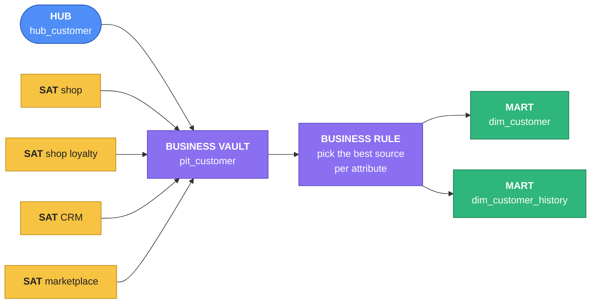
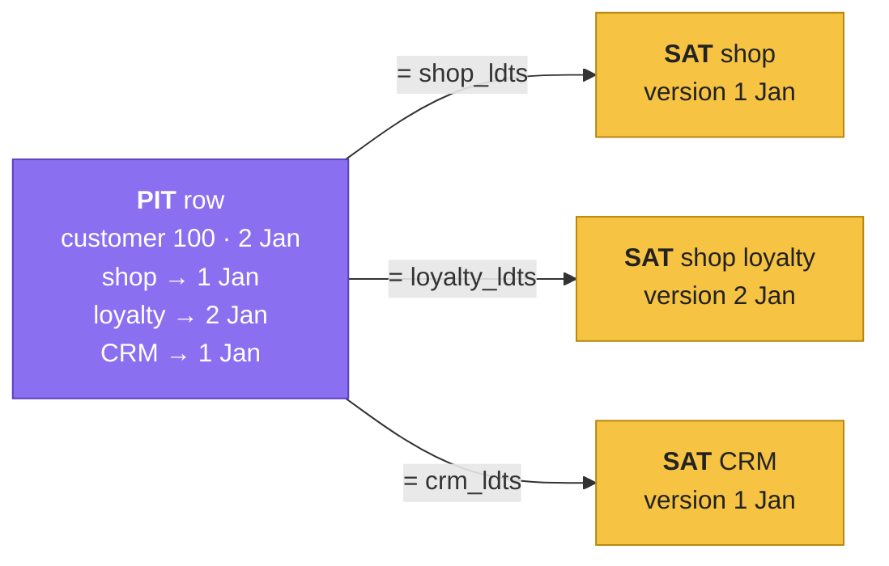

# Business Vault & information marts

The Raw Vault keeps **everything, from everyone** — exactly as each source said it. That's
perfect for auditing and terrible for a dashboard. The last two layers turn it into answers:

- **Business Vault** — built from the Raw Vault: **PIT tables** that make "as of" reads fast,
  and **business rules** that decide between sources ("which country is right?").
- **Information marts** — the star schema people query
  ([Dimensional modeling](../unit1/dimensional-modeling.md)), built from both.



## Concept

### The PIT table
For every customer and every **snapshot date**, a PIT row stores **which version** of each
satellite was valid then — as that version's `load_dts`, or `null` if the source didn't know
the customer yet:

| customer | snapshot_dts | shop_ldts | loyalty_ldts | crm_ldts | mkt_ldts |
|---|---|---|---|---|---|
| customer100@… | 2025-01-01 06:00 | 2025-01-01 | 2025-01-01 | 2025-01-01 | null |
| customer100@… | 2025-01-02 06:00 | 2025-01-01 | **2025-01-02** | 2025-01-01 | null |
| customer6001@… | 2025-01-02 06:00 | 2025-01-02 | 2025-01-02 | null | 2025-01-02 |

With it, "customer 100 as of 2 January" is **equality joins** — `sat.customer_hk =
pit.customer_hk and sat.load_dts = pit.loyalty_ldts` — instead of a `max(load_dts) <= date`
search in four satellites. The hard work happens **once**.



### Business rules
The Raw Vault never decides. The business does, once, in writing — and the rule lives in **one**
place everyone can read:

| Attribute | Rule | Why |
|---|---|---|
| name | CRM, else shop, else marketplace | sales keeps real names in the CRM; the shop and marketplace only have display names |
| country | CRM, else shop, else marketplace | the CRM is checked by the sales team |
| order status | marketplace words → shop words: `PAID`→`placed`, `DISPATCHED`→`shipped`, `DELIVERED`→`delivered`, `REFUNDED`→`cancelled` | one status list for every report |

Change a rule tomorrow and you rebuild the marts — the Raw Vault doesn't move.

## Lab

### 1 · Build the PIT
Snapshot dates = every load date any customer satellite has. For each customer and snapshot,
take the latest `load_dts` at or before it, per satellite:

```sql
%%sql
CREATE OR REPLACE TABLE my.business_vault.pit_customer AS
WITH snapshots AS (
  SELECT load_dts AS snapshot_dts FROM my.raw_vault.sat_customer_shop
  UNION SELECT load_dts FROM my.raw_vault.sat_customer_shop_loyalty
  UNION SELECT load_dts FROM my.raw_vault.sat_customer_crm
  UNION SELECT load_dts FROM my.raw_vault.sat_customer_marketplace
),
grid AS (
  SELECT h.customer_hk, s.snapshot_dts
  FROM my.raw_vault.hub_customer h
  CROSS JOIN snapshots s
  WHERE h.load_dts <= s.snapshot_dts
),
versions AS (
  SELECT customer_hk, load_dts, 'shop'    AS sat FROM my.raw_vault.sat_customer_shop
  UNION ALL SELECT customer_hk, load_dts, 'loyalty' FROM my.raw_vault.sat_customer_shop_loyalty
  UNION ALL SELECT customer_hk, load_dts, 'crm'     FROM my.raw_vault.sat_customer_crm
  UNION ALL SELECT customer_hk, load_dts, 'mkt'     FROM my.raw_vault.sat_customer_marketplace
)
SELECT g.customer_hk, g.snapshot_dts,
       max(CASE WHEN v.sat = 'shop'    THEN v.load_dts END) AS shop_ldts,
       max(CASE WHEN v.sat = 'loyalty' THEN v.load_dts END) AS loyalty_ldts,
       max(CASE WHEN v.sat = 'crm'     THEN v.load_dts END) AS crm_ldts,
       max(CASE WHEN v.sat = 'mkt'     THEN v.load_dts END) AS mkt_ldts
FROM grid g
LEFT JOIN versions v
  ON v.customer_hk = g.customer_hk AND v.load_dts <= g.snapshot_dts
GROUP BY g.customer_hk, g.snapshot_dts
```

- **`WITH name AS (…)`** — CTEs ([CTEs & complex analytics](../unit2/ctes.md)).
- **`UNION`** — combines the lists and removes duplicates: every date any satellite loaded.
- **`grid`** — every customer × every snapshot since the customer first appeared.
- **`versions`** — every version of every customer satellite, tagged with its satellite.
- **`v.load_dts <= g.snapshot_dts`** + **`max(CASE WHEN v.sat = '…' THEN v.load_dts END)`** —
  per satellite, the newest version that already existed at the snapshot; `null` when that
  source didn't know the customer yet. (A **pivot**: one column per satellite.)

```sql
%%sql
SELECT snapshot_dts, count(*) AS customers,
       count(shop_ldts) AS in_shop, count(crm_ldts) AS in_crm, count(mkt_ldts) AS in_marketplace
FROM my.business_vault.pit_customer
GROUP BY snapshot_dts
ORDER BY snapshot_dts
```

- **`count(column)`** — counts non-null values: customers each source knew at that snapshot.

!!! info "Ghost records"
    Standard Data Vault fills the `null`s differently: each satellite gets one **ghost record**
    (hash key of zeros, `load_dts = 1900-01-01`), and the PIT points at it when a source has no
    version — so every mart join is an inner join. Here the PIT keeps `null` and the marts use
    left joins: simpler to learn, same answers.

### 2 · The customer dimension, as of every snapshot
Join the PIT to each satellite on **equality**, then apply the business rules with
`coalesce` — the first non-null value wins:

```sql
%%sql
CREATE OR REPLACE TABLE my.info_mart.dim_customer_history AS
SELECT p.snapshot_dts,
       h.email,
       coalesce(concat(c.first_name, ' ', c.last_name), s.full_name, m.buyer_name) AS name,
       coalesce(c.country, s.country, m.buyer_country)                             AS country,
       s.shop_customer_id,
       c.crm_id,
       c.segment,
       l.loyalty_tier,
       l.marketing_opt_in,
       s.customer_hk IS NOT NULL AS in_shop,
       c.customer_hk IS NOT NULL AS in_crm,
       m.customer_hk IS NOT NULL AS in_marketplace
FROM my.business_vault.pit_customer p
JOIN my.raw_vault.hub_customer h
  ON h.customer_hk = p.customer_hk
LEFT JOIN my.raw_vault.sat_customer_shop s
  ON s.customer_hk = p.customer_hk AND s.load_dts = p.shop_ldts
LEFT JOIN my.raw_vault.sat_customer_shop_loyalty l
  ON l.customer_hk = p.customer_hk AND l.load_dts = p.loyalty_ldts
LEFT JOIN my.raw_vault.sat_customer_crm c
  ON c.customer_hk = p.customer_hk AND c.load_dts = p.crm_ldts
LEFT JOIN my.raw_vault.sat_customer_marketplace m
  ON m.customer_hk = p.customer_hk AND m.load_dts = p.mkt_ldts
```

- **`coalesce(crm, shop, marketplace)`** — the business rule, in one line: the CRM if it has a
  value, else the shop, else the marketplace.
- **`concat(…)`** returns `null` if any part is null, so a customer missing from the CRM falls
  through to the shop's name.

Ask it about customer 72 (moved country in the shop on Day 2):

```sql
%%sql
SELECT snapshot_dts, email, name, country, in_shop, in_crm, in_marketplace
FROM my.info_mart.dim_customer_history
WHERE email = 'customer72@example.com'
ORDER BY snapshot_dts
```

Example output:

| snapshot_dts | email | name | country | in_shop | in_crm | in_marketplace |
|---|---|---|---|---|---|---|
| 2025-01-01 06:00:00 | customer72@example.com | Ravi Jones | IN | true | true | false |
| 2025-01-02 06:00:00 | customer72@example.com | Ravi Jones | IN | true | true | false |

Customer 72 moved to `NL` **in the shop** — but the dimension still says the CRM's country,
because the rule trusts the **CRM** first, and the CRM wasn't updated. That's not a bug: it's
the rule working, visibly. The shop's `NL` is still in the vault; if the business decides the
shop wins for country, change one `coalesce` and rebuild. (If customer 72 isn't in your CRM,
the shop's `NL` shows on Day 2 — the rule falls through.)

### 3 · The current customer dimension

```sql
%%sql
CREATE OR REPLACE TABLE my.info_mart.dim_customer AS
SELECT email, name, country, shop_customer_id, crm_id, segment, loyalty_tier,
       marketing_opt_in, in_shop, in_crm, in_marketplace
FROM my.info_mart.dim_customer_history
WHERE snapshot_dts = (SELECT max(snapshot_dts) FROM my.business_vault.pit_customer)
```

One row per person ShopFlow knows — from any system:

```sql
%%sql
SELECT in_shop, in_crm, in_marketplace, count(*) AS customers
FROM my.info_mart.dim_customer
GROUP BY 1, 2, 3
ORDER BY customers DESC
```

The same table you produced by hand in [Meet the sources](sources.md) — now as a governed,
historised dimension.

### 4 · A product dimension — latest version, no PIT
With one question ("what's the product **now**"), pick each satellite's latest version
directly:

```sql
%%sql
CREATE OR REPLACE TABLE my.info_mart.dim_product AS
SELECT h.sku,
       coalesce(d.name, 'Marketplace-only product') AS name,
       coalesce(d.category, 'Unknown')              AS category,
       p.price, p.cost
FROM my.raw_vault.hub_product h
LEFT JOIN (SELECT *, row_number() OVER (PARTITION BY product_hk ORDER BY load_dts DESC) AS rn
           FROM my.raw_vault.sat_product_shop) d
  ON d.product_hk = h.product_hk AND d.rn = 1
LEFT JOIN (SELECT *, row_number() OVER (PARTITION BY product_hk ORDER BY load_dts DESC) AS rn
           FROM my.raw_vault.sat_product_shop_price) p
  ON p.product_hk = h.product_hk AND p.rn = 1
```

`203` rows. The 3 marketplace-only SKUs get a label instead of disappearing — a mart decision,
made visibly.

### 5 · The fact table: order lines from both channels
The grain is the link `lnk_order_product` — one row per product per order, shop **and**
marketplace. Each order's latest status comes from **its** source's satellite, harmonised by the
status rule:

```sql
%%sql
CREATE OR REPLACE TABLE my.info_mart.fact_order_line AS
SELECT ho.bkcc                                             AS channel_source,
       ho.order_no,
       hc.email                                            AS customer_email,
       hp.sku,
       coalesce(os.order_ts, om.ordered_at)                AS order_ts,
       cast(coalesce(os.order_ts, om.ordered_at) AS date)  AS order_date,
       coalesce(os.status,
                CASE om.order_status
                  WHEN 'PAID'       THEN 'placed'
                  WHEN 'DISPATCHED' THEN 'shipped'
                  WHEN 'DELIVERED'  THEN 'delivered'
                  WHEN 'REFUNDED'   THEN 'cancelled' END)  AS status,
       sol.quantity,
       sol.unit_price,
       sol.quantity * sol.unit_price                       AS line_revenue
FROM my.raw_vault.lnk_order_product lop
JOIN my.raw_vault.hub_order   ho ON ho.order_hk   = lop.order_hk
JOIN my.raw_vault.hub_product hp ON hp.product_hk = lop.product_hk
JOIN my.raw_vault.lnk_order_customer loc ON loc.order_hk = lop.order_hk
JOIN my.raw_vault.hub_customer hc ON hc.customer_hk = loc.customer_hk
JOIN (SELECT *, row_number() OVER (PARTITION BY order_product_hk ORDER BY load_dts DESC) AS rn
      FROM my.raw_vault.sat_order_line) sol
  ON sol.order_product_hk = lop.order_product_hk AND sol.rn = 1
LEFT JOIN (SELECT *, row_number() OVER (PARTITION BY order_hk ORDER BY load_dts DESC) AS rn
           FROM my.raw_vault.sat_order_shop) os
  ON os.order_hk = lop.order_hk AND os.rn = 1
LEFT JOIN (SELECT *, row_number() OVER (PARTITION BY order_hk ORDER BY load_dts DESC) AS rn
           FROM my.raw_vault.sat_order_marketplace) om
  ON om.order_hk = lop.order_hk AND om.rn = 1
```

- **`CASE om.order_status WHEN … THEN …`** — the status rule: marketplace words → shop words.
- **`coalesce(os.…, om.…)`** — a shop order has a shop satellite, a marketplace order a
  marketplace one; take whichever exists.

`116002` rows: 100,000 shop lines + 16,002 marketplace lines.

### 6 · Prove it: nothing lost, nothing doubled

```sql
%%sql
SELECT channel_source, count(*) AS lines, sum(line_revenue) AS from_vault
FROM my.info_mart.fact_order_line
GROUP BY channel_source
ORDER BY channel_source
```

```sql
%%sql
SELECT 'MKT' AS channel_source, sum(qty * item_price) AS from_source FROM my.marketplace.order_lines
UNION ALL
SELECT 'SHOP', sum(quantity * unit_price) FROM shared.bronze.order_items
```

`SHOP` matches Bronze **exactly**. `MKT` is the source total **plus 41.48** — MP-200001's two
Day 2 lines (1 × 21.50 + 2 × 9.99). Two order systems, one fact table, every cent accounted for.

### 7 · Questions only the vault can answer
Revenue by channel, for customers who buy in **both**:

```sql
%%sql
WITH both_channels AS (
  SELECT customer_email
  FROM my.info_mart.fact_order_line
  GROUP BY customer_email
  HAVING count(DISTINCT channel_source) = 2
)
SELECT f.channel_source,
       count(DISTINCT f.customer_email) AS customers,
       count(DISTINCT f.order_no)       AS orders,
       sum(f.line_revenue)              AS revenue
FROM my.info_mart.fact_order_line f
JOIN both_channels b ON b.customer_email = f.customer_email
GROUP BY f.channel_source
```

And by CRM segment — a CRM attribute on marketplace revenue, joined through the e-mail that no
single system shared before:

```sql
%%sql
SELECT coalesce(c.segment, 'not in CRM') AS segment, f.channel_source,
       sum(f.line_revenue) AS revenue
FROM my.info_mart.fact_order_line f
JOIN my.info_mart.dim_customer c ON c.email = f.customer_email
GROUP BY 1, 2
ORDER BY revenue DESC
```

Nobody querying these tables needs to know a vault exists. That's the point: the vault is for
**integrating and keeping**; marts are for **reading** — and every mart can be dropped and
rebuilt from the vault at any time, in any shape, with any rule.

!!! tip "Marts as views"
    Many teams build information marts as **views** on the vault and PIT instead of tables —
    always current, no extra storage. Tables are faster for big dashboards. Both are fine.

## Check yourself
1. Customer 72 is `NL` in the shop but the CRM's country in `dim_customer`. Bug? *(No — the
   business rule prefers the CRM. Both values are in the vault; the rule is one `coalesce` away
   from changing.)*
2. Why are business rules in the Business Vault / marts and not in the satellite loads?
   *(The Raw Vault keeps what each source said. Rules change; history mustn't.)*
3. Where would you add a fourth source — say, a support desk with customer e-mails?
   *(Staging for it, its own satellite on `hub_customer`, one more column in the PIT, one more
   argument in each `coalesce`. Nothing existing changes.)*
