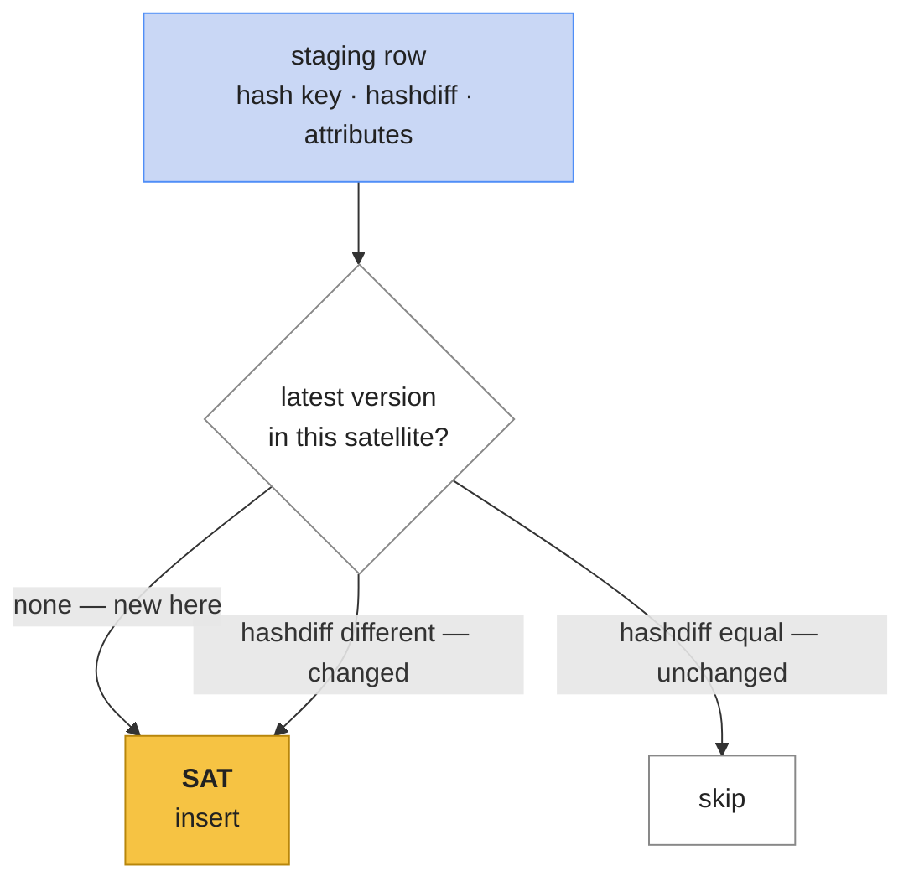
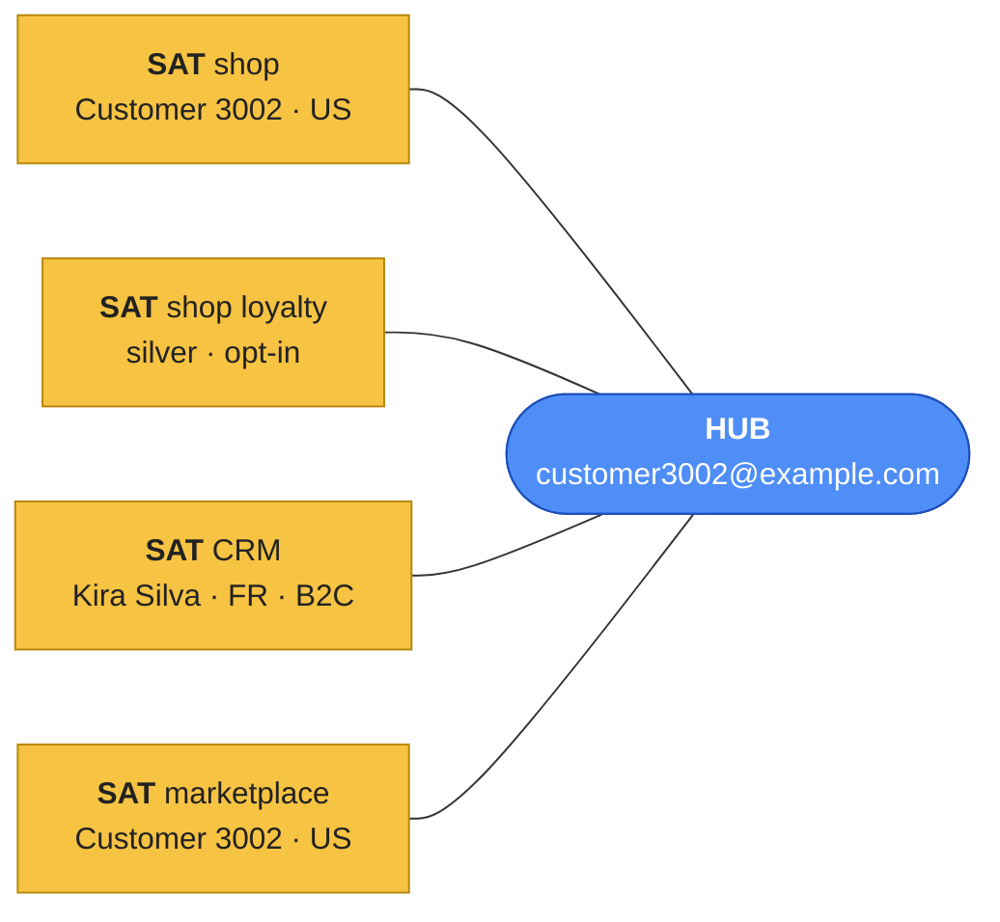

# Load the satellites

Satellites hold everything that **changes** — and, with three sources, **who said it**. Their
load rule:

> **Insert a row when the thing is new to this satellite, or when its attributes differ from its
> latest version here.**

The **hashdiff** turns "differ" into one comparison: same hashdiff as the latest stored version
→ nothing in this satellite's columns changed → skip.



Here is where the vault keeps the sources apart. One customer, four satellites:



Nothing is merged. If the CRM and the shop disagree, both versions are there, each with its
`record_source` — deciding who's right is a **business rule**, later.

## Lab

### 1 · Create the nine satellites
Every satellite: the parent's **hash key**, **`load_dts`**, **`record_source`**, **`hashdiff`**,
then its attributes.

```sql
%%sql
CREATE TABLE IF NOT EXISTS my.raw_vault.sat_customer_shop (
  customer_hk string, load_dts timestamp, record_source string, hashdiff string,
  shop_customer_id int, full_name string, country string, signup_date date
)
```

```sql
%%sql
CREATE TABLE IF NOT EXISTS my.raw_vault.sat_customer_shop_loyalty (
  customer_hk string, load_dts timestamp, record_source string, hashdiff string,
  loyalty_tier string, marketing_opt_in boolean
)
```

```sql
%%sql
CREATE TABLE IF NOT EXISTS my.raw_vault.sat_customer_crm (
  customer_hk string, load_dts timestamp, record_source string, hashdiff string,
  crm_id string, first_name string, last_name string, phone string,
  country string, segment string, consent_email boolean
)
```

```sql
%%sql
CREATE TABLE IF NOT EXISTS my.raw_vault.sat_customer_marketplace (
  customer_hk string, load_dts timestamp, record_source string, hashdiff string,
  buyer_name string, buyer_country string
)
```

```sql
%%sql
CREATE TABLE IF NOT EXISTS my.raw_vault.sat_product_shop (
  product_hk string, load_dts timestamp, record_source string, hashdiff string,
  shop_product_id int, name string, category string
)
```

```sql
%%sql
CREATE TABLE IF NOT EXISTS my.raw_vault.sat_product_shop_price (
  product_hk string, load_dts timestamp, record_source string, hashdiff string,
  price decimal(10,2), cost decimal(10,2)
)
```

```sql
%%sql
CREATE TABLE IF NOT EXISTS my.raw_vault.sat_order_shop (
  order_hk string, load_dts timestamp, record_source string, hashdiff string,
  channel string, order_ts timestamp, status string, currency string
)
```

```sql
%%sql
CREATE TABLE IF NOT EXISTS my.raw_vault.sat_order_marketplace (
  order_hk string, load_dts timestamp, record_source string, hashdiff string,
  ordered_at timestamp, order_status string, currency string
)
```

```sql
%%sql
CREATE TABLE IF NOT EXISTS my.raw_vault.sat_order_line (
  order_product_hk string, load_dts timestamp, record_source string, hashdiff string,
  quantity int, unit_price decimal(10,2)
)
```

### 2 · The load pattern, step by step
`sat_customer_crm` first. Read it from the inside out:

```sql
%%sql
INSERT INTO my.raw_vault.sat_customer_crm
SELECT s.customer_hk, s.load_dts, s.record_source, s.hd_customer_crm,
       s.crm_id, s.first_name, s.last_name, s.phone, s.country, s.segment, s.consent_email
FROM stg_crm_contacts s
LEFT JOIN (
    SELECT customer_hk, hashdiff
    FROM (SELECT customer_hk, hashdiff,
                 row_number() OVER (PARTITION BY customer_hk
                                    ORDER BY load_dts DESC) AS rn
          FROM my.raw_vault.sat_customer_crm)
    WHERE rn = 1
) cur ON cur.customer_hk = s.customer_hk
WHERE cur.hashdiff IS NULL                  -- new: no version yet
   OR cur.hashdiff <> s.hd_customer_crm     -- changed: differs from the latest
```

1. **Innermost** — `row_number() over (partition by customer_hk order by load_dts desc)`
   numbers each customer's versions, newest = 1 ([Window functions](../unit2/window-functions.md)).
2. **`where rn = 1`** — only the **latest version** per customer: `cur`.
3. **`left join cur`** — attaches that latest hashdiff to each staging row (null if none).
4. **`where …`** — keep the row only if it's **new** or **different**.

The first time, the satellite is empty: every CRM contact is new.

### 3 · The shop satellites
The same shape — only the table, the key and the hashdiff change:

```sql
%%sql
INSERT INTO my.raw_vault.sat_customer_shop
SELECT s.customer_hk, s.load_dts, s.record_source, s.hd_customer_shop,
       s.shop_customer_id, s.full_name, s.country, s.signup_date
FROM stg_shop_customers s
LEFT JOIN (
    SELECT customer_hk, hashdiff
    FROM (SELECT customer_hk, hashdiff,
                 row_number() OVER (PARTITION BY customer_hk ORDER BY load_dts DESC) AS rn
          FROM my.raw_vault.sat_customer_shop)
    WHERE rn = 1
) cur ON cur.customer_hk = s.customer_hk
WHERE cur.hashdiff IS NULL OR cur.hashdiff <> s.hd_customer_shop
```

```sql
%%sql
INSERT INTO my.raw_vault.sat_customer_shop_loyalty
SELECT s.customer_hk, s.load_dts, s.record_source, s.hd_customer_shop_loyalty,
       s.loyalty_tier, s.marketing_opt_in
FROM stg_shop_customers s
LEFT JOIN (
    SELECT customer_hk, hashdiff
    FROM (SELECT customer_hk, hashdiff,
                 row_number() OVER (PARTITION BY customer_hk ORDER BY load_dts DESC) AS rn
          FROM my.raw_vault.sat_customer_shop_loyalty)
    WHERE rn = 1
) cur ON cur.customer_hk = s.customer_hk
WHERE cur.hashdiff IS NULL OR cur.hashdiff <> s.hd_customer_shop_loyalty
```

```sql
%%sql
INSERT INTO my.raw_vault.sat_product_shop
SELECT s.product_hk, s.load_dts, s.record_source, s.hd_product_shop,
       s.shop_product_id, s.name, s.category
FROM stg_shop_products s
LEFT JOIN (
    SELECT product_hk, hashdiff
    FROM (SELECT product_hk, hashdiff,
                 row_number() OVER (PARTITION BY product_hk ORDER BY load_dts DESC) AS rn
          FROM my.raw_vault.sat_product_shop)
    WHERE rn = 1
) cur ON cur.product_hk = s.product_hk
WHERE cur.hashdiff IS NULL OR cur.hashdiff <> s.hd_product_shop
```

```sql
%%sql
INSERT INTO my.raw_vault.sat_product_shop_price
SELECT s.product_hk, s.load_dts, s.record_source, s.hd_product_shop_price,
       s.price, s.cost
FROM stg_shop_products s
LEFT JOIN (
    SELECT product_hk, hashdiff
    FROM (SELECT product_hk, hashdiff,
                 row_number() OVER (PARTITION BY product_hk ORDER BY load_dts DESC) AS rn
          FROM my.raw_vault.sat_product_shop_price)
    WHERE rn = 1
) cur ON cur.product_hk = s.product_hk
WHERE cur.hashdiff IS NULL OR cur.hashdiff <> s.hd_product_shop_price
```

```sql
%%sql
INSERT INTO my.raw_vault.sat_order_shop
SELECT s.order_hk, s.load_dts, s.record_source, s.hd_order_shop,
       s.channel, s.order_ts, s.status, s.currency
FROM stg_shop_orders s
LEFT JOIN (
    SELECT order_hk, hashdiff
    FROM (SELECT order_hk, hashdiff,
                 row_number() OVER (PARTITION BY order_hk ORDER BY load_dts DESC) AS rn
          FROM my.raw_vault.sat_order_shop)
    WHERE rn = 1
) cur ON cur.order_hk = s.order_hk
WHERE cur.hashdiff IS NULL OR cur.hashdiff <> s.hd_order_shop
```

### 4 · The marketplace satellites
`sat_order_marketplace` is the usual shape:

```sql
%%sql
INSERT INTO my.raw_vault.sat_order_marketplace
SELECT s.order_hk, s.load_dts, s.record_source, s.hd_order_marketplace,
       s.ordered_at, s.order_status, s.currency
FROM stg_mkt_orders s
LEFT JOIN (
    SELECT order_hk, hashdiff
    FROM (SELECT order_hk, hashdiff,
                 row_number() OVER (PARTITION BY order_hk ORDER BY load_dts DESC) AS rn
          FROM my.raw_vault.sat_order_marketplace)
    WHERE rn = 1
) cur ON cur.order_hk = s.order_hk
WHERE cur.hashdiff IS NULL OR cur.hashdiff <> s.hd_order_marketplace
```

`sat_customer_marketplace` needs one extra step. The marketplace describes its buyer **on every
order** — a buyer with 5 orders appears 5 times in one batch. A satellite may hold only **one
version per customer per load**, so first keep each buyer's **latest order** in the batch:

```sql
%%sql
INSERT INTO my.raw_vault.sat_customer_marketplace
SELECT s.customer_hk, s.load_dts, s.record_source, s.hd_customer_marketplace,
       s.buyer_name, s.buyer_country
FROM (SELECT *, row_number() OVER (PARTITION BY customer_hk
                                   ORDER BY ordered_at DESC) AS latest
      FROM stg_mkt_orders) s
LEFT JOIN (
    SELECT customer_hk, hashdiff
    FROM (SELECT customer_hk, hashdiff,
                 row_number() OVER (PARTITION BY customer_hk ORDER BY load_dts DESC) AS rn
          FROM my.raw_vault.sat_customer_marketplace)
    WHERE rn = 1
) cur ON cur.customer_hk = s.customer_hk
WHERE s.latest = 1
  AND (cur.hashdiff IS NULL OR cur.hashdiff <> s.hd_customer_marketplace)
```

- **`latest = 1`** — one row per buyer in this batch: the description from their most recent
  order.

### 5 · The link satellite, from both order systems
`sat_order_line` takes lines from the shop **and** the marketplace — every line belongs to
exactly one system, so they never collide:

```sql
%%sql
INSERT INTO my.raw_vault.sat_order_line
SELECT s.order_product_hk, s.load_dts, s.record_source, s.hd_order_line,
       s.quantity, s.unit_price
FROM (SELECT order_product_hk, load_dts, record_source, hd_order_line, quantity, unit_price
      FROM stg_shop_order_items
      UNION ALL
      SELECT order_product_hk, load_dts, record_source, hd_order_line, quantity, unit_price
      FROM stg_mkt_order_lines) s
LEFT JOIN (
    SELECT order_product_hk, hashdiff
    FROM (SELECT order_product_hk, hashdiff,
                 row_number() OVER (PARTITION BY order_product_hk ORDER BY load_dts DESC) AS rn
          FROM my.raw_vault.sat_order_line)
    WHERE rn = 1
) cur ON cur.order_product_hk = s.order_product_hk
WHERE cur.hashdiff IS NULL OR cur.hashdiff <> s.hd_order_line
```

### 6 · Check

```sql
%%sql
SELECT 'sat_customer_shop' AS tbl, count(*) AS rows_ FROM my.raw_vault.sat_customer_shop
UNION ALL SELECT 'sat_customer_shop_loyalty', count(*) FROM my.raw_vault.sat_customer_shop_loyalty
UNION ALL SELECT 'sat_customer_crm',          count(*) FROM my.raw_vault.sat_customer_crm
UNION ALL SELECT 'sat_customer_marketplace',  count(*) FROM my.raw_vault.sat_customer_marketplace
UNION ALL SELECT 'sat_product_shop',          count(*) FROM my.raw_vault.sat_product_shop
UNION ALL SELECT 'sat_product_shop_price',    count(*) FROM my.raw_vault.sat_product_shop_price
UNION ALL SELECT 'sat_order_shop',            count(*) FROM my.raw_vault.sat_order_shop
UNION ALL SELECT 'sat_order_marketplace',     count(*) FROM my.raw_vault.sat_order_marketplace
UNION ALL SELECT 'sat_order_line',            count(*) FROM my.raw_vault.sat_order_line
```

| tbl | rows_ |
|---|---|
| sat_customer_shop | 6000 |
| sat_customer_shop_loyalty | 6000 |
| sat_customer_crm | 5628 |
| sat_customer_marketplace | 5106 |
| sat_product_shop | 200 |
| sat_product_shop_price | 200 |
| sat_order_shop | 40000 |
| sat_order_marketplace | 8000 |
| sat_order_line | 116000 |

One row per key per source — the first version of everything. The 3 marketplace-only products
have **no** shop satellite: the shop knows nothing about them, and the vault doesn't pretend.

### 7 · One customer, three opinions

```sql
%%sql
SELECT h.email,
       s.full_name  AS shop_name,  s.country AS shop_country,
       concat(c.first_name, ' ', c.last_name) AS crm_name, c.country AS crm_country,
       m.buyer_name AS marketplace_name, m.buyer_country AS marketplace_country
FROM my.raw_vault.hub_customer h
LEFT JOIN my.raw_vault.sat_customer_shop        s ON s.customer_hk = h.customer_hk
LEFT JOIN my.raw_vault.sat_customer_crm         c ON c.customer_hk = h.customer_hk
LEFT JOIN my.raw_vault.sat_customer_marketplace m ON m.customer_hk = h.customer_hk
WHERE c.country <> s.country
LIMIT 3
```

- **`left join`** — a customer may be missing from a source; keep them anyway.

Example output:

| email | shop_name | shop_country | crm_name | crm_country | marketplace_name | marketplace_country |
|---|---|---|---|---|---|---|
| customer2@example.com | Customer 2 | DE | Kira Silva | FR | null | null |
| customer3@example.com | Customer 3 | DE | Priya Brown | AU | null | null |
| customer10@example.com | Customer 10 | UK | Daniel Brown | US | null | null |

The shop and the CRM give the same person different names and different countries (these three
never bought on the marketplace, so its columns are `null`) — all kept, all traceable. Which one
does a report show? That's a **business rule**, decided in the [Business Vault](pit-marts.md)
— not by whichever load ran last.

## Check yourself
1. The CRM and the shop disagree on a country. Which satellite is "right"? *(Neither — the
   Raw Vault keeps both, with sources. A business rule decides later.)*
2. Why does `sat_customer_marketplace` keep only `latest = 1`? *(The buyer appears once per
   order; a satellite gets one version per key per load.)*
3. Why do 3 products have no `sat_product_shop` row? *(They're marketplace-only SKUs — the shop
   never described them.)*
