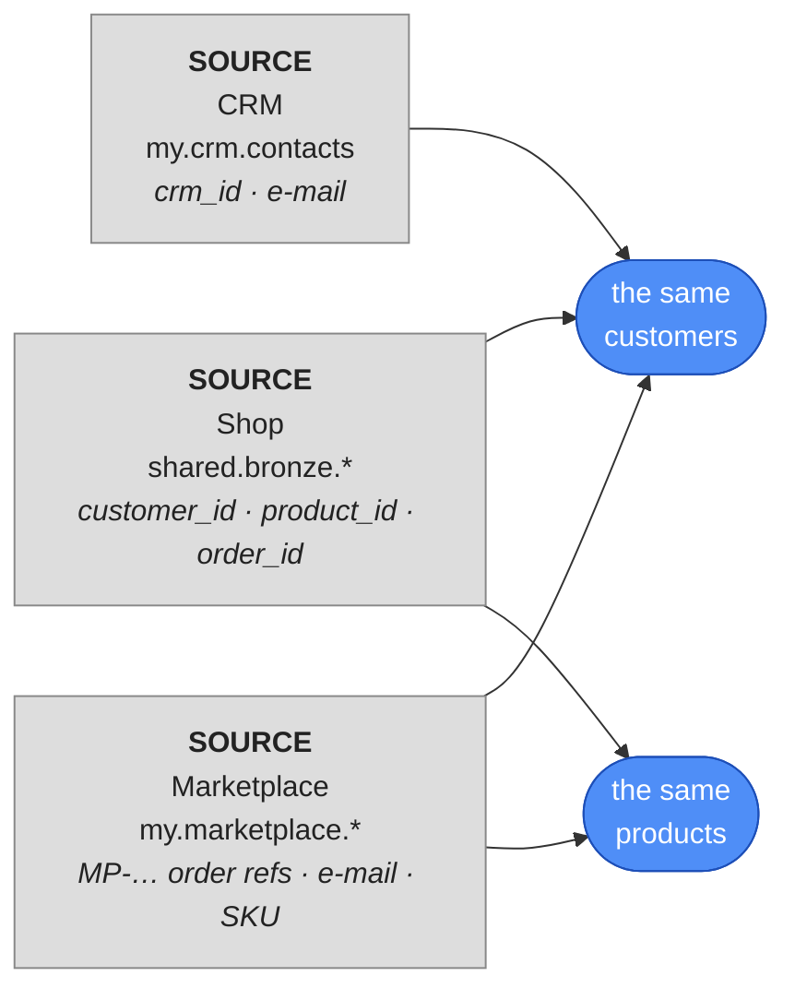

# Meet ShopFlow's three sources

All course long ShopFlow had one source: the **shop** database. Now two more systems join. Their
data reaches you the way new sources usually arrive in a real company: as **files** someone
exports for you. You land them in your lakehouse (`my`) first, then explore them:



| Source | System | Tables | What it knows |
|---|---|---|---|
| **Shop** | ShopFlow's own web shop (Postgres) | `shared.bronze.customers`, `products`, `orders`, `order_items` | everything you've used so far |
| **CRM** | the sales & marketing tool | `my.crm.contacts` (from `crm_contacts.csv`) | contacts — most shop customers, plus **leads** who never bought |
| **Marketplace** | MarketHub, where ShopFlow also sells | `my.marketplace.orders`, `order_lines` (from `marketplace_orders.csv`, `marketplace_order_lines.csv`) | marketplace orders — some by shop customers, many by people the shop has never seen |

Each system was built by different people, for a different job. Before modelling anything, look
at how they **identify** things — that decides the whole vault.

## Lab

### 1 · Download the files
Download the three exports to your computer:

- [`crm_contacts.csv`](../assets/datavault/crm_contacts.csv): 5,628 CRM contacts
- [`marketplace_orders.csv`](../assets/datavault/marketplace_orders.csv): 8,000 marketplace orders
- [`marketplace_order_lines.csv`](../assets/datavault/marketplace_order_lines.csv): 16,000 order lines

### 2 · Upload them to your bucket
On the landing page open **📁 My files** → **files** → **source**, create a folder
**`datavault`** and upload the three files into it. They're now at
`s3a://<you>-lake/files/source/datavault/`, e.g.
`s3a://demouser-lake/files/source/datavault/crm_contacts.csv`.

### 3 · Load them into your lakehouse
In a notebook (replace `demouser` with your username):

```python
base = "s3a://demouser-lake/files/source/datavault/"     # your own bucket

sources = {
    "my.crm.contacts": ("crm_contacts.csv",
        "crm_id STRING, email STRING, first_name STRING, last_name STRING, phone STRING, "
        "country STRING, segment STRING, consent_email BOOLEAN, updated_at TIMESTAMP"),
    "my.marketplace.orders": ("marketplace_orders.csv",
        "mp_order_ref STRING, buyer_email STRING, buyer_name STRING, buyer_country STRING, "
        "ordered_at TIMESTAMP, order_status STRING, currency STRING"),
    "my.marketplace.order_lines": ("marketplace_order_lines.csv",
        "mp_order_ref STRING, sku STRING, qty INT, item_price DECIMAL(10,2)"),
}

spark.sql("CREATE NAMESPACE IF NOT EXISTS my.crm")
spark.sql("CREATE NAMESPACE IF NOT EXISTS my.marketplace")

for table, (file, schema) in sources.items():
    df = spark.read.option("header", True).schema(schema).csv(base + file)
    df.writeTo(table).createOrReplace()
    print(table, spark.table(table).count())
```

- **`sources = {key: (file, schema), …}`**: a dictionary. Each target table maps to a pair (a
  *tuple*): the file to read and the columns it has.
- **`.schema("crm_id STRING, …")`**: the column names and types, written like SQL. With a schema
  Spark doesn't guess types (as `inferSchema` would): `item_price` stays an exact
  `DECIMAL(10,2)` and `updated_at` a `TIMESTAMP`. `option("header", True)` still skips row 1.
- **`for table, (file, schema) in sources.items():`**: loops over the dictionary; each round
  gets one key and unpacks its pair into `file` and `schema`.
- **`writeTo(table).createOrReplace()`**: writes the table into `my`, replacing it on a rerun,
  as in [Upload a file & register it](../unit3/upload-register.md).

Output:

```
my.crm.contacts 5628
my.marketplace.orders 8000
my.marketplace.order_lines 16000
```

!!! info "Which numbers match yours exactly?"
    The three files are the same for everyone, so everything counted from them matches the
    examples exactly. The shop's data is generated when your lab is installed, so results that
    use the shop's countries, loyalty tiers, prices or order statuses differ a little, as in the
    rest of the course.

Now explore them with `%%sql`.

### 4 · The CRM

```sql
%%sql
SELECT * FROM my.crm.contacts ORDER BY crm_id LIMIT 3
```

Example output:

| crm_id | email | first_name | last_name | phone | country | segment | consent_email | updated_at |
|---|---|---|---|---|---|---|---|---|
| C-000001 | customer1@example.com | Daniel | Martin | +54636058503 | US | B2C | false | 2024-08-21 11:01:10 |
| C-000002 | customer2@example.com | Kira | Silva | +25139840863 | FR | B2C | false | 2024-01-26 15:08:26 |
| C-000003 | customer3@example.com | Priya | Brown | +21803551108 | AU | B2C | false | 2024-04-23 06:28:27 |

The CRM has its **own id** (`crm_id`) — it has never heard of the shop's `customer_id`. What
it shares with the shop is the **e-mail address**. And it has its own **names**: the shop
calls customer 1 `Customer 1`, the CRM calls them `Daniel Martin`.

### 5 · The marketplace

```sql
%%sql
SELECT * FROM my.marketplace.orders ORDER BY mp_order_ref LIMIT 3
```

```sql
%%sql
SELECT * FROM my.marketplace.order_lines ORDER BY mp_order_ref, sku LIMIT 3
```

Example output:

| mp_order_ref | buyer_email | buyer_name | buyer_country | ordered_at | order_status | currency |
|---|---|---|---|---|---|---|
| MP-100001 | buyer1234@markethub.example | Buyer 1234 | UK | 2024-04-25 02:56:05 | DELIVERED | EUR |
| MP-100002 | customer3815@example.com | Customer 3815 | CA | 2025-01-21 13:07:19 | DELIVERED | USD |
| MP-100003 | buyer178@markethub.example | Buyer 178 | NL | 2024-10-06 06:04:15 | DELIVERED | EUR |

| mp_order_ref | sku | qty | item_price |
|---|---|---|---|
| MP-100001 | SKU-0029 | 3 | 138.62 |
| MP-100001 | SKU-0067 | 2 | 57.57 |
| MP-100001 | SKU-0191 | 3 | 413.19 |

Three differences from the shop:

- **Orders** are `MP-100001`, not numbers — and they're **different orders** from the shop's.
- **Customers** are e-mail addresses — some belong to shop customers, many don't.
- **Products** are **SKUs** (`SKU-0029`). ShopFlow prints the SKU on every label: `SKU-0029`
  is shop product `29`. The shop's database simply stores only the number.
- **Status** has its own words: `PAID`, `DISPATCHED`, `DELIVERED`, `REFUNDED`.

### 6 · How much do they overlap?

```sql
%%sql
SELECT
  (SELECT count(*) FROM shared.bronze.customers)                              AS shop_customers,
  (SELECT count(*) FROM my.crm.contacts)                                  AS crm_contacts,
  (SELECT count(DISTINCT buyer_email) FROM my.marketplace.orders)         AS marketplace_buyers_raw,
  (SELECT count(DISTINCT lower(trim(buyer_email))) FROM my.marketplace.orders) AS marketplace_buyers
```

- **`lower(trim(…))`** — the same e-mail, however it was typed.

Example output:

| shop_customers | crm_contacts | marketplace_buyers_raw | marketplace_buyers |
|---|---|---|---|
| 6000 | 5628 | 5459 | 5106 |

`marketplace_buyers_raw` is **higher** than `marketplace_buyers`: the same buyer typed their
e-mail differently on different orders.

```sql
%%sql
SELECT buyer_email FROM my.marketplace.orders
WHERE buyer_email <> lower(trim(buyer_email))
LIMIT 3
```

```
 CUSTOMER3076@EXAMPLE.COM
 CUSTOMER1672@EXAMPLE.COM
 CUSTOMER5791@EXAMPLE.COM
```

Leading spaces and capitals — from people typing by hand. The CRM has the same problem:

```sql
%%sql
SELECT count(*) AS upper_case_emails
FROM my.crm.contacts
WHERE email <> lower(email)
```

Output: `582`.

### 7 · Who is known where?

```sql
%%sql
WITH shop AS (SELECT DISTINCT lower(trim(email)) AS email FROM shared.bronze.customers),
     crm  AS (SELECT DISTINCT lower(trim(email)) AS email FROM my.crm.contacts),
     mkt  AS (SELECT DISTINCT lower(trim(buyer_email)) AS email FROM my.marketplace.orders),
     everyone AS (SELECT email FROM shop UNION SELECT email FROM crm UNION SELECT email FROM mkt)
SELECT e.email IN (SELECT email FROM shop) AS in_shop,
       e.email IN (SELECT email FROM crm)  AS in_crm,
       e.email IN (SELECT email FROM mkt)  AS in_marketplace,
       count(*)                            AS people
FROM everyone e
GROUP BY 1, 2, 3
ORDER BY people DESC
```

- **`UNION`** (without `ALL`) — combines the lists and removes duplicates: every person once.

Example output:

| in_shop | in_crm | in_marketplace | people |
|---|---|---|---|
| true | true | true | 2839 |
| true | true | false | 2289 |
| false | false | true | 1795 |
| false | true | false | 500 |
| true | false | true | 472 |
| true | false | false | 400 |

Every combination exists. Some people are in all three systems; 500 CRM leads never bought;
~1,800 marketplace buyers exist **only** on the marketplace. A star schema built on the shop's
`customer_id` would lose all of those.

### 8 · Do the sources agree?

```sql
%%sql
SELECT count(*) AS different_country
FROM shared.bronze.customers s
JOIN my.crm.contacts c ON lower(trim(c.email)) = lower(trim(s.email))
WHERE c.country <> s.country
```

Example output: `458`, roughly 1 in 11 customers the two share has a **different country** in
the CRM than in the shop (yours differs a little: the shop's countries come from your install). Which
one is right? The vault's answer: **keep both**, with where each came from — and decide later,
with a rule everyone can see.

## What this means for the vault

| Finding | Consequence |
|---|---|
| The shop's `customer_id` means nothing to the CRM or the marketplace | the customer hub needs a key **all three** share: the **e-mail** |
| The same e-mail is typed differently | **normalise** it (`upper(trim(…))`) before hashing |
| Marketplace products are SKUs | the product hub's key is the **SKU**; the shop's `product_id` becomes `SKU-0009` in staging |
| Shop order `100` and marketplace order `MP-100100` are different orders, numbered by different systems | the order hub's key needs the **source system** too |
| The sources disagree on names and countries | **one satellite per source** — never overwrite one source with another |

The next lesson turns these findings into the vault design.

## Check yourself
1. Why can't `customer_id` be the customer hub's business key any more? *(Only the shop knows
   it. The CRM and the marketplace identify people by e-mail.)*
2. A buyer typed ` Customer88@Example.com`. Is that a new customer? *(No — after
   `lower(trim(…))` it's `customer88@example.com`, an existing shop customer.)*
