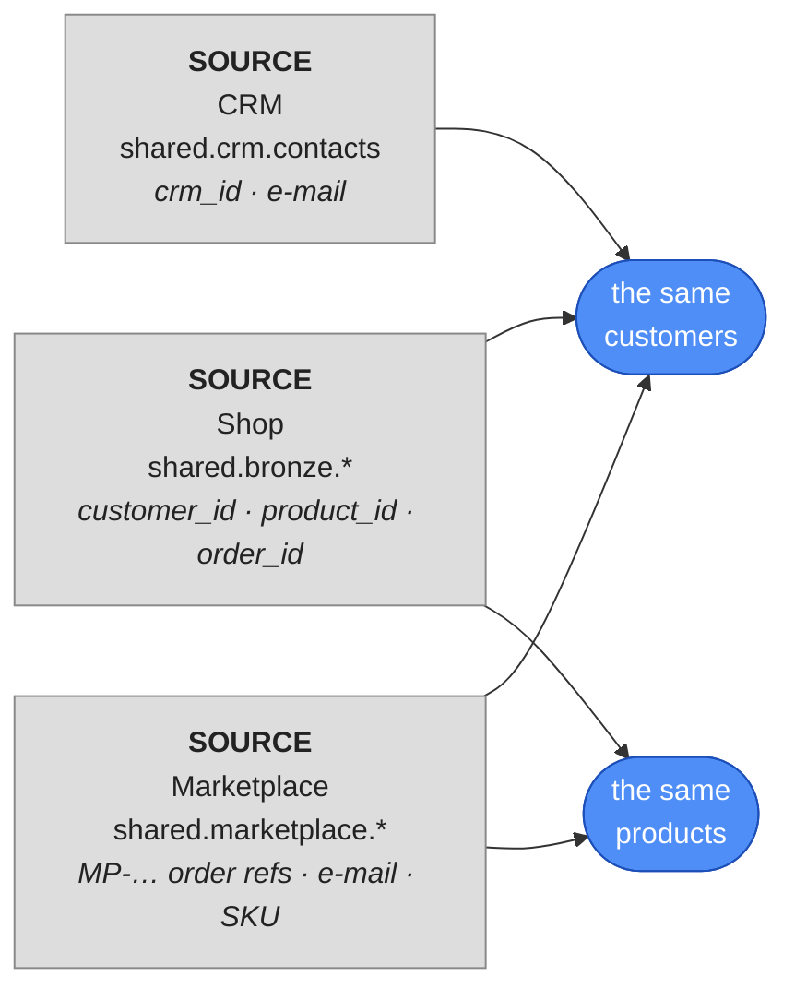

# Meet ShopFlow's three sources

All course long ShopFlow had one source: the **shop** database. Now two more systems join, and
they're ready in the course lake (`shared`):



| Source | System | Tables | What it knows |
|---|---|---|---|
| **Shop** | ShopFlow's own web shop (Postgres) | `shared.bronze.customers`, `products`, `orders`, `order_items` | everything you've used so far |
| **CRM** | the sales & marketing tool | `shared.crm.contacts` | contacts — most shop customers, plus **leads** who never bought |
| **Marketplace** | MarketHub, where ShopFlow also sells | `shared.marketplace.orders`, `order_lines` | marketplace orders — some by shop customers, many by people the shop has never seen |

Each system was built by different people, for a different job. Before modelling anything, look
at how they **identify** things — that decides the whole vault.

## Lab
Open a notebook and explore with `%%sql`.

### 1 · The CRM

```sql
%%sql
SELECT * FROM shared.crm.contacts ORDER BY crm_id LIMIT 3
```

Example output:

| crm_id | email | first_name | last_name | phone | country | segment | consent_email | updated_at |
|---|---|---|---|---|---|---|---|---|
| C-000001 | customer1@example.com | Tom | Brown | +52533796328 | US | B2C | false | 2024-05-24 01:17:30 |
| C-000002 | customer2@example.com | Ben | Fischer | +39582737715 | IN | B2C | false | 2024-06-26 14:06:19 |
| C-000003 | customer3@example.com | Ben | Jones | +44785020285 | IN | B2C | true | 2024-04-16 20:22:53 |

The CRM has its **own id** (`crm_id`) — it has never heard of the shop's `customer_id`. What
it shares with the shop is the **e-mail address**. And it has its own **names**: the shop
calls customer 1 `Customer 1`, the CRM calls them `Tom Brown`.

### 2 · The marketplace

```sql
%%sql
SELECT * FROM shared.marketplace.orders ORDER BY mp_order_ref LIMIT 3
```

```sql
%%sql
SELECT * FROM shared.marketplace.order_lines ORDER BY mp_order_ref, sku LIMIT 3
```

Example output:

| mp_order_ref | buyer_email | buyer_name | buyer_country | ordered_at | order_status | currency |
|---|---|---|---|---|---|---|
| MP-100001 | buyer1234@markethub.example | Buyer 1234 | UK | 2024-04-25 05:56:05 | DELIVERED | EUR |
| MP-100002 | customer3815@example.com | Customer 3815 | US | 2025-01-21 15:07:19 | DELIVERED | USD |
| MP-100003 | buyer178@markethub.example | Buyer 178 | NL | 2024-10-06 09:04:15 | DELIVERED | EUR |

| mp_order_ref | sku | qty | item_price |
|---|---|---|---|
| MP-100001 | SKU-0009 | 1 | 132.02 |
| MP-100001 | SKU-0057 | 1 | 372.92 |
| MP-100001 | SKU-0161 | 1 | 144.90 |

Three differences from the shop:

- **Orders** are `MP-100001`, not numbers — and they're **different orders** from the shop's.
- **Customers** are e-mail addresses — some belong to shop customers, many don't.
- **Products** are **SKUs** (`SKU-0009`). ShopFlow prints the SKU on every label: `SKU-0009`
  is shop product `9`. The shop's database simply stores only the number.
- **Status** has its own words: `PAID`, `DISPATCHED`, `DELIVERED`, `REFUNDED`.

### 3 · How much do they overlap?

```sql
%%sql
SELECT
  (SELECT count(*) FROM shared.bronze.customers)                              AS shop_customers,
  (SELECT count(*) FROM shared.crm.contacts)                                  AS crm_contacts,
  (SELECT count(DISTINCT buyer_email) FROM shared.marketplace.orders)         AS marketplace_buyers_raw,
  (SELECT count(DISTINCT lower(trim(buyer_email))) FROM shared.marketplace.orders) AS marketplace_buyers
```

- **`lower(trim(…))`** — the same e-mail, however it was typed.

Example output:

| shop_customers | crm_contacts | marketplace_buyers_raw | marketplace_buyers |
|---|---|---|---|
| 6000 | 5577 | 5440 | 5130 |

`marketplace_buyers_raw` is **higher** than `marketplace_buyers`: the same buyer typed their
e-mail differently on different orders.

```sql
%%sql
SELECT buyer_email FROM shared.marketplace.orders
WHERE buyer_email <> lower(trim(buyer_email))
LIMIT 3
```

```
 CUSTOMER3078@EXAMPLE.COM
 CUSTOMER3748@EXAMPLE.COM
 CUSTOMER1585@EXAMPLE.COM
```

Leading spaces and capitals — from people typing by hand. The CRM has the same problem:

```sql
%%sql
SELECT count(*) AS upper_case_emails
FROM shared.crm.contacts
WHERE email <> lower(email)
```

### 4 · Who is known where?

```sql
%%sql
WITH shop AS (SELECT DISTINCT lower(trim(email)) AS email FROM shared.bronze.customers),
     crm  AS (SELECT DISTINCT lower(trim(email)) AS email FROM shared.crm.contacts),
     mkt  AS (SELECT DISTINCT lower(trim(buyer_email)) AS email FROM shared.marketplace.orders),
     everyone AS (SELECT email FROM shop UNION SELECT email FROM crm UNION SELECT email FROM mkt)
SELECT e.email IN (SELECT email FROM shop) AS in_shop,
       e.email IN (SELECT email FROM crm)  AS in_crm,
       e.email IN (SELECT email FROM mkt)  AS in_marketplace,
       count(*)                            AS people
FROM everyone e
GROUP BY 1, 2, 3
ORDER BY people DESC
```

- **`UNION`** (without `ALL`) — combines the lists and removes duplicates: every person once.

Example output:

| in_shop | in_crm | in_marketplace | people |
|---|---|---|---|
| true | true | true | 2817 |
| true | true | false | 2260 |
| false | false | true | 1813 |
| true | false | true | 500 |
| false | true | false | 500 |
| true | false | false | 423 |

Every combination exists. Some people are in all three systems; 500 CRM leads never bought;
~1,800 marketplace buyers exist **only** on the marketplace. A star schema built on the shop's
`customer_id` would lose all of those.

### 5 · Do the sources agree?

```sql
%%sql
SELECT count(*) AS different_country
FROM shared.bronze.customers s
JOIN shared.crm.contacts c ON lower(trim(c.email)) = lower(trim(s.email))
WHERE c.country <> s.country
```

Example output: `393` — roughly 1 in 13 shared customers has a **different country** in the CRM
than in the shop. Which
one is right? The vault's answer: **keep both**, with where each came from — and decide later,
with a rule everyone can see.

## What this means for the vault

| Finding | Consequence |
|---|---|
| The shop's `customer_id` means nothing to the CRM or the marketplace | the customer hub needs a key **all three** share: the **e-mail** |
| The same e-mail is typed differently | **normalise** it (`upper(trim(…))`) before hashing |
| Marketplace products are SKUs | the product hub's key is the **SKU**; the shop's `product_id` becomes `SKU-0009` in staging |
| Shop order `100` and marketplace order `MP-100100` are different orders, numbered by different systems | the order hub's key needs the **source system** too |
| The sources disagree on names and countries | **one satellite per source** — never overwrite one source with another |

The next lesson turns these findings into the vault design.

## Check yourself
1. Why can't `customer_id` be the customer hub's business key any more? *(Only the shop knows
   it. The CRM and the marketplace identify people by e-mail.)*
2. A buyer typed ` Customer88@Example.com`. Is that a new customer? *(No — after
   `lower(trim(…))` it's `customer88@example.com`, an existing shop customer.)*
