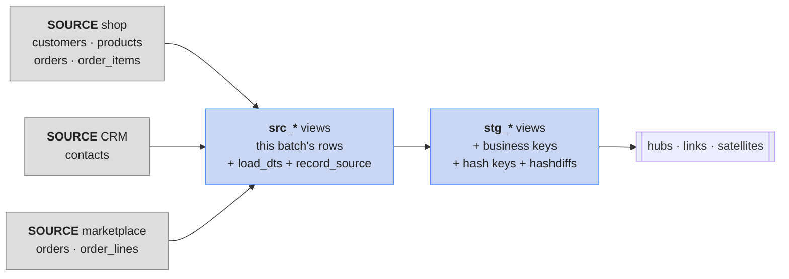

# Stage the sources: business keys & hashes

Every Data Vault load starts in **staging**: each source table as it arrived, plus the columns
every vault table needs — the **business keys** in their agreed form, **hash keys**,
**hashdiffs**, **`load_dts`** and **`record_source`**. Compute them **once**, here; every hub,
link and satellite load then just selects them.



Two layers of **temporary views**, one per source table:

- **`src_*`** — "what arrived in this batch": today the shared tables as they are. On Day 2 you'll
  replace these views with a changed batch — nothing after them changes.
- **`stg_*`** — the same rows, with keys and hashes added.

!!! info "Temporary views"
    `create or replace temp view` lives only in your notebook's Spark session — no storage, gone
    when the kernel restarts. After a restart, re-run this lesson's cells before loading.

## Lab
Open a notebook (**Python 3**). Every cell is `%%sql` — one statement per cell, no trailing `;`
([Query tables with %%sql](../unit3/sql-magic.md)).

### 1 · The namespaces

```sql
%%sql
CREATE NAMESPACE IF NOT EXISTS my.raw_vault
```

```sql
%%sql
CREATE NAMESPACE IF NOT EXISTS my.business_vault
```

```sql
%%sql
CREATE NAMESPACE IF NOT EXISTS my.info_mart
```

### 2 · The batch: seven `src_*` views
Every row of a batch gets the **same `load_dts`** — the time the batch was loaded. Here it's a
fixed time, `2025-01-01 06:00`, so your results match the lesson; a scheduled pipeline passes the
run's time instead. `record_source` names the system and table.

```sql
%%sql
CREATE OR REPLACE TEMP VIEW src_shop_customers AS
SELECT *, TIMESTAMP '2025-01-01 06:00:00' AS load_dts, 'shop.customers' AS record_source
FROM shared.bronze.customers
```

```sql
%%sql
CREATE OR REPLACE TEMP VIEW src_shop_products AS
SELECT *, TIMESTAMP '2025-01-01 06:00:00' AS load_dts, 'shop.products' AS record_source
FROM shared.bronze.products
```

```sql
%%sql
CREATE OR REPLACE TEMP VIEW src_shop_orders AS
SELECT *, TIMESTAMP '2025-01-01 06:00:00' AS load_dts, 'shop.orders' AS record_source
FROM shared.bronze.orders
```

```sql
%%sql
CREATE OR REPLACE TEMP VIEW src_shop_order_items AS
SELECT *, TIMESTAMP '2025-01-01 06:00:00' AS load_dts, 'shop.order_items' AS record_source
FROM shared.bronze.order_items
```

```sql
%%sql
CREATE OR REPLACE TEMP VIEW src_crm_contacts AS
SELECT *, TIMESTAMP '2025-01-01 06:00:00' AS load_dts, 'crm.contacts' AS record_source
FROM my.crm.contacts
```

```sql
%%sql
CREATE OR REPLACE TEMP VIEW src_mkt_orders AS
SELECT *, TIMESTAMP '2025-01-01 06:00:00' AS load_dts, 'marketplace.orders' AS record_source
FROM my.marketplace.orders
```

```sql
%%sql
CREATE OR REPLACE TEMP VIEW src_mkt_order_lines AS
SELECT *, TIMESTAMP '2025-01-01 06:00:00' AS load_dts, 'marketplace.order_lines' AS record_source
FROM my.marketplace.order_lines
```

- **`TIMESTAMP '…'`** — a timestamp literal.
- **`SELECT *, …`** — all source columns plus the new ones.

### 3 · Shop customers
The business key is the **e-mail**. The shop's `customer_id` becomes an ordinary attribute
(`shop_customer_id`) in the shop satellite:

```sql
%%sql
CREATE OR REPLACE TEMP VIEW stg_shop_customers AS
SELECT
  md5(upper(trim(email)))                                      AS customer_hk,
  lower(trim(email))                                           AS email,
  md5(concat_ws('||',
        cast(customer_id AS string),
        coalesce(trim(full_name), ''),
        coalesce(trim(country), ''),
        coalesce(cast(signup_date AS string), '')))            AS hd_customer_shop,
  md5(concat_ws('||',
        coalesce(trim(loyalty_tier), ''),
        coalesce(cast(marketing_opt_in AS string), '')))       AS hd_customer_shop_loyalty,
  customer_id AS shop_customer_id, full_name, country, signup_date,
  loyalty_tier, marketing_opt_in,
  load_dts, record_source
FROM src_shop_customers
```

- **`md5(text)`** — the 32-character hex fingerprint of the text.
- **`upper(trim(email))`** — the normalised business key: every source and every spelling
  hashes the same.
- **`concat_ws(sep, a, b, …)`** — joins the values with `sep` between them.
- **`coalesce(x, '')`** — `''` when `x` is null, so a null never shifts the other values.
- Hash **keys** use `upper(trim(…))`. Hash**diffs** use only `trim` — a name changing from `ada`
  to `Ada` **is** a change worth keeping.

```sql
%%sql
SELECT shop_customer_id, email, customer_hk FROM stg_shop_customers
ORDER BY shop_customer_id LIMIT 2
```

| shop_customer_id | email | customer_hk |
|---|---|---|
| 1 | customer1@example.com | 30b1ec7d93f64ca56f64093f8be96205 |
| 2 | customer2@example.com | fff378b44431bfd65ebc278798b91430 |

`customer_hk` is `md5('CUSTOMER1@EXAMPLE.COM')` — the CRM and the marketplace will compute the
very same value for this person.

### 4 · CRM contacts

```sql
%%sql
CREATE OR REPLACE TEMP VIEW stg_crm_contacts AS
SELECT
  md5(upper(trim(email)))                                      AS customer_hk,
  lower(trim(email))                                           AS email,
  md5(concat_ws('||',
        coalesce(trim(crm_id), ''),
        coalesce(trim(first_name), ''),
        coalesce(trim(last_name), ''),
        coalesce(trim(phone), ''),
        coalesce(trim(country), ''),
        coalesce(trim(segment), ''),
        coalesce(cast(consent_email AS string), '')))          AS hd_customer_crm,
  crm_id, first_name, last_name, phone, country, segment, consent_email,
  load_dts, record_source
FROM src_crm_contacts
```

### 5 · Shop products: the number becomes a SKU

```sql
%%sql
CREATE OR REPLACE TEMP VIEW stg_shop_products AS
SELECT
  md5(upper(trim(sku)))                                        AS product_hk,
  sku,
  md5(concat_ws('||',
        cast(product_id AS string),
        coalesce(trim(name), ''),
        coalesce(trim(category), '')))                         AS hd_product_shop,
  md5(concat_ws('||',
        coalesce(cast(price AS string), ''),
        coalesce(cast(cost AS string), '')))                   AS hd_product_shop_price,
  product_id AS shop_product_id, name, category, price, cost,
  load_dts, record_source
FROM (SELECT *, concat('SKU-', lpad(cast(product_id AS string), 4, '0')) AS sku
      FROM src_shop_products)
```

- **`lpad(text, 4, '0')`** — pad on the left to 4 characters: `9` → `0009`, so product 9 is
  `SKU-0009` — ShopFlow's labelling rule, applied once, here.

### 6 · Shop orders: from `customer_id` to e-mail
A link connects **business keys**. The shop's order only has `customer_id`, so staging looks up
the e-mail in the shop's **own** customer table:

```sql
%%sql
CREATE OR REPLACE TEMP VIEW stg_shop_orders AS
SELECT
  md5(concat_ws('||', bkcc, upper(trim(order_no))))                     AS order_hk,
  md5(upper(trim(email)))                                               AS customer_hk,
  md5(concat_ws('||', bkcc, upper(trim(order_no)), upper(trim(email)))) AS order_customer_hk,
  md5(concat_ws('||',
        coalesce(trim(channel), ''),
        coalesce(cast(order_ts AS string), ''),
        coalesce(trim(status), ''),
        coalesce(trim(currency), '')))                                  AS hd_order_shop,
  bkcc, order_no, lower(trim(email)) AS email,
  channel, order_ts, status, currency,
  load_dts, record_source
FROM (SELECT o.*, 'SHOP' AS bkcc, cast(o.order_id AS string) AS order_no, c.email
      FROM src_shop_orders o
      JOIN src_shop_customers c ON c.customer_id = o.customer_id)
```

- **`'SHOP' AS bkcc`** — the business key collision code: these numbers come from the shop's
  numbering.

### 7 · Shop order items

```sql
%%sql
CREATE OR REPLACE TEMP VIEW stg_shop_order_items AS
SELECT
  md5(concat_ws('||', bkcc, upper(trim(order_no))))                     AS order_hk,
  md5(upper(trim(sku)))                                                 AS product_hk,
  md5(concat_ws('||', bkcc, upper(trim(order_no)), upper(trim(sku))))   AS order_product_hk,
  md5(concat_ws('||',
        coalesce(cast(quantity AS string), ''),
        coalesce(cast(unit_price AS string), '')))                      AS hd_order_line,
  bkcc, order_no, sku, quantity, unit_price,
  load_dts, record_source
FROM (SELECT *, 'SHOP' AS bkcc, cast(order_id AS string) AS order_no,
             concat('SKU-', lpad(cast(product_id AS string), 4, '0')) AS sku
      FROM src_shop_order_items)
```

### 8 · Marketplace orders: an order **and** a customer description

```sql
%%sql
CREATE OR REPLACE TEMP VIEW stg_mkt_orders AS
SELECT
  md5(concat_ws('||', bkcc, upper(trim(order_no))))                     AS order_hk,
  md5(upper(trim(buyer_email)))                                         AS customer_hk,
  md5(concat_ws('||', bkcc, upper(trim(order_no)),
                      upper(trim(buyer_email))))                        AS order_customer_hk,
  md5(concat_ws('||',
        coalesce(cast(ordered_at AS string), ''),
        coalesce(trim(order_status), ''),
        coalesce(trim(currency), '')))                                  AS hd_order_marketplace,
  md5(concat_ws('||',
        coalesce(trim(buyer_name), ''),
        coalesce(trim(buyer_country), '')))                             AS hd_customer_marketplace,
  bkcc, order_no, lower(trim(buyer_email)) AS email,
  buyer_name, buyer_country, ordered_at, order_status, currency,
  load_dts, record_source
FROM (SELECT *, 'MKT' AS bkcc, mp_order_ref AS order_no FROM src_mkt_orders)
```

One marketplace row feeds **five** vault tables: `hub_order`, `hub_customer`,
`lnk_order_customer`, `sat_order_marketplace` and `sat_customer_marketplace`.

### 9 · Marketplace order lines
Quantity and price get the **same names** as the shop's (`quantity`, `unit_price`) — both feed
`sat_order_line`:

```sql
%%sql
CREATE OR REPLACE TEMP VIEW stg_mkt_order_lines AS
SELECT
  md5(concat_ws('||', bkcc, upper(trim(order_no))))                     AS order_hk,
  md5(upper(trim(sku)))                                                 AS product_hk,
  md5(concat_ws('||', bkcc, upper(trim(order_no)), upper(trim(sku))))   AS order_product_hk,
  md5(concat_ws('||',
        coalesce(cast(quantity AS string), ''),
        coalesce(cast(unit_price AS string), '')))                      AS hd_order_line,
  bkcc, order_no, sku, quantity, unit_price,
  load_dts, record_source
FROM (SELECT mp_order_ref AS order_no, 'MKT' AS bkcc, sku,
             qty AS quantity, item_price AS unit_price, load_dts, record_source
      FROM src_mkt_order_lines)
```

### 10 · Check: keys per staging view

```sql
%%sql
SELECT 'shop_customers' AS stage, count(*) AS rows_, count(DISTINCT customer_hk) AS keys FROM stg_shop_customers
UNION ALL SELECT 'crm_contacts',     count(*), count(DISTINCT customer_hk)      FROM stg_crm_contacts
UNION ALL SELECT 'shop_products',    count(*), count(DISTINCT product_hk)       FROM stg_shop_products
UNION ALL SELECT 'shop_orders',      count(*), count(DISTINCT order_hk)         FROM stg_shop_orders
UNION ALL SELECT 'shop_order_items', count(*), count(DISTINCT order_product_hk) FROM stg_shop_order_items
UNION ALL SELECT 'mkt_orders',       count(*), count(DISTINCT order_hk)         FROM stg_mkt_orders
UNION ALL SELECT 'mkt_order_lines',  count(*), count(DISTINCT order_product_hk) FROM stg_mkt_order_lines
```

| stage | rows_ | keys |
|---|---|---|
| shop_customers | 6000 | 6000 |
| crm_contacts | 5628 | 5628 |
| shop_products | 200 | 200 |
| shop_orders | 40000 | 40000 |
| shop_order_items | 100000 | 100000 |
| mkt_orders | 8000 | 8000 |
| mkt_order_lines | 16000 | 16000 |

`rows_ = keys` everywhere: no business key appears twice within a source table. (The column
is `rows_` because `rows` is a reserved word.)

## Check yourself
1. Why does shop staging join orders to customers? *(The link needs the customer's **business
   key** — the e-mail — and the shop's order only has its internal `customer_id`.)*
2. Shop product `42` and marketplace SKU `SKU-0042` — same hash key? *(Yes: staging turns the
   shop's `42` into `SKU-0042`; both hash `md5('SKU-0042')`.)*
3. Why is `'SHOP'` part of the order hash key? *(It's the BKCC — shop and marketplace number
   orders independently.)*
