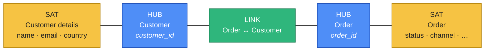
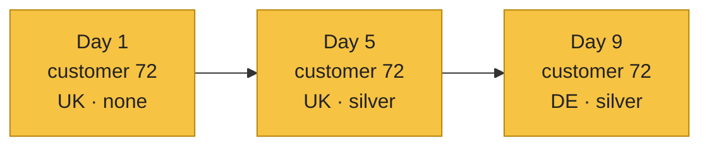
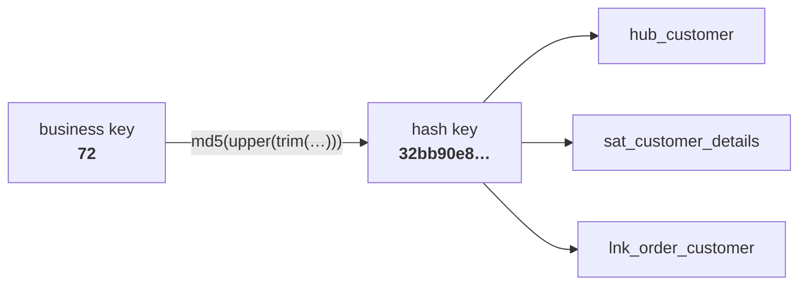
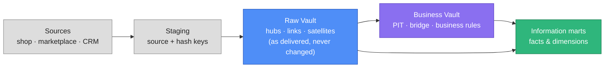
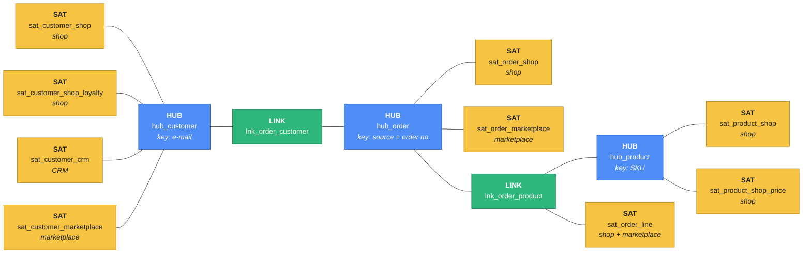

# What is Data Vault 2.0?

You've built a full pipeline: Bronze → Silver → Gold, a star schema with facts and dimensions,
SCD2 history, dbt models, Airflow schedules. That works well for **one** source with a stable
shape — ShopFlow's Postgres. Now imagine ShopFlow grows:

- a **marketplace** sends its own orders, with its own customer ids;
- a **CRM** holds better customer addresses than the shop;
- the shop's developers **rename columns** every few months;
- **auditors** ask "what exactly did we know about this customer on 3 March, and where did it
  come from?"

Every one of those breaks a star schema: dimensions get rebuilt, history gets lost, one new
source means changing tables everybody depends on. **Data Vault 2.0** is a modelling method made
for exactly this. It sits **between** the raw data and your star schemas, as the layer that
**integrates** many sources and **keeps everything, forever**.

## The idea in one picture
Data Vault splits every business concept into three kinds of tables:

| Table | Colour | Holds | Changes? |
|---|---|---|---|
| **Hub** | blue | the **business key** — the id the business uses (`customer_id`) | never — one row per key, forever |
| **Link** | green | a **relationship** between hubs (this order belongs to that customer) | never — one row per relationship |
| **Satellite** | yellow | the **descriptive attributes** (name, status, price) **with their full history** | a new row each time something changes |

That's the whole vocabulary. Everything else is rules for loading them.

### Hubs — "what exists"
A hub is a list of **business keys**: every customer id the company has ever seen, with when and
where it was first seen. Nothing descriptive — no name, no country. Business keys are the most
stable thing in a company: a customer's email changes, the customer doesn't.

### Links — "what is related"
A link records that business keys **belong together**: order 17 was placed by customer 72;
order 17 contains product 5. A link is always **many-to-many** in shape, even when the business
says one-to-many today — so when the rules change, the model doesn't have to.

### Satellites — "what it looked like, and when"
A satellite holds the **context** of one hub (or link) and **its history**. When customer 72
moves from the UK to Germany, the satellite gets a **new row**; the old one stays. You've seen
this in [the SCD2 recipe](../recipes/scd2.md) — a satellite is SCD2 by default, without the
`UPDATE`.

## Three rules that make it work

### 1 · Insert-only
Nothing in the vault is ever **updated** or **deleted**. Loads only **add rows**. That gives you:

- **full history**, for free — every version of every attribute is kept;
- **auditability** — every row says **when** it was loaded (`load_dts`) and **from where**
  (`record_source`);
- **safe re-runs** — a load that runs twice adds nothing the second time.

One satellite, three rows for the same customer — the newest is the current state; the older
ones answer "what did we know then?".

### 2 · Hash keys
Every hub and link row gets a **hash key**: a fixed-length fingerprint of its business key,
e.g. `md5('72')` → `32bb90e8976aab5298d5da10fe66f21d`. Satellites and links point to hubs with that hash —
not with an auto-increment number.

Why that matters: anyone can compute the hash from the source row **alone**. The hub, the link
and the satellite don't need to look each other up first — so **all of them load in parallel**,
from any number of sources.

### 3 · Split by what changes together
Attributes go into **separate satellites** when they change at different speeds or come from
different sources. A customer's name and email rarely change; their loyalty tier changes often.
Keep them together and every loyalty change copies the name and email again. Split them and each
satellite only grows when **its** columns change.

## Where it sits: Raw Vault, Business Vault, marts

| Layer | What | In medallion terms |
|---|---|---|
| **Staging** | the source as it arrived, plus hash keys and hashdiffs | Bronze |
| **Raw Vault** | hubs, links, satellites — the source's facts, **no business rules** | Silver |
| **Business Vault** | helper tables (PIT, bridge) and derived data with business rules applied | Silver |
| **Information marts** | the star schemas people query | Gold |

Users and dashboards **never query the vault directly** — it's built for loading and keeping,
not for reading. They query the marts, which you can rebuild from the vault at any time.

## Data Vault vs a star schema (Kimball)

| | Star schema | Data Vault |
|---|---|---|
| Built for | **querying** — few joins, fast BI | **integrating and keeping** — many sources, full history |
| New source | change the dimensions everybody uses | add a satellite (or a hub/link); nothing existing changes |
| History | SCD2 per dimension, designed up front | every attribute, always |
| Loading | dimensions before facts (surrogate key lookups) | everything in parallel (hash keys) |
| Tables | few, wide | many, narrow |
| Queries on it | simple | many joins — that's why marts exist |

They're **not competitors**: Data Vault is the integration layer; star schemas are still how
people read the data. You'll build both in this unit.

## When it's worth it — and when not

| Use Data Vault when | Skip it when |
|---|---|
| several sources describe the same customers, products, orders | one source with a stable schema |
| you need a full, auditable history of everything | SCD2 on a few dimensions is enough |
| sources change often and the model must absorb it | a small team needs results fast |
| many teams load in parallel | the data is small and simple |

Until now ShopFlow had **one** source — and a star schema was enough. In this unit ShopFlow gets
the problem Data Vault was made for: a **CRM** and a **marketplace** join the shop, with their
own ids, their own spellings and their own opinions about the same customers. The shop data is
still the one you know, so you can check every number against what you built before.

## What you'll build in this unit
ShopFlow now has **three sources** — the shop you've used all course, plus a **CRM** and a
**marketplace** — and they describe the same customers, products and orders in different ways.
You'll integrate all three into one vault:

| Label | Colour | Count |
|---|---|---|
| **HUB** | blue | 3 — customer, product, order |
| **LINK** | green | 2 — order ↔ customer, order ↔ product |
| **SAT** | yellow | 9 — under each, the source that feeds it |

The customer hub gets **four** satellites — two from the shop (split by how often they change),
one from the CRM, one from the marketplace — so you'll see both reasons to split a satellite:
**rate of change** and **source**.

## Check yourself
1. A customer changes their e-mail address. Which table gets a new row — hub, link or
   satellite? *(The satellite. The hub row for the customer never changes.)*
2. Why can a hub and its satellite be loaded at the same time? *(Both compute the same hash key
   from the source row — neither needs the other's id.)*
3. Why don't dashboards query the vault directly? *(It's many narrow tables with full history —
   built for integration. Marts reshape it for reading.)*
