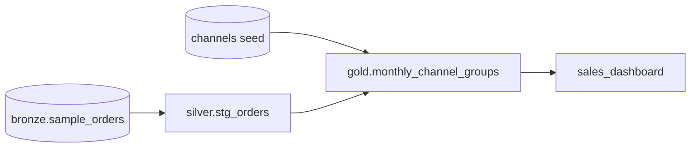

# Challenge: a tested Gold mart in dbt

## Concept
You've met every piece: sources and staging, `ref()`, seeds, tests, macros, packages, docs and
Airflow. This challenge puts them together as one ticket, the kind a data engineer gets on a
dbt team: *a new mart, tested, documented, and in the daily run*.

The business question: **"Each month, how do our *direct* channels (web, app) compare with our
*partner* channels (marketplace, wholesale): how many orders, how many cancelled, how many
customers?"** The `channels` seed from [Tests and seeds](tests.md) already knows which channel
belongs to which group.



## Lab
### The brief
Build **`gold.monthly_channel_groups`** in your `dbt/shop` project: one row per **month** and
**channel group**, with:

| Column | Meaning |
|---|---|
| `month` | the first day of the month (a date) |
| `channel_group` | `direct` or `partner`, from the `channels` seed |
| `orders` | number of orders |
| `cancelled` | number of cancelled orders |
| `cancelled_pct` | cancelled as a percentage of orders, one decimal |
| `customers` | number of distinct customers |

### Requirements
1. A model in **`models/marts/`**, built from **`stg_orders`** and the **`channels`** seed with
   `ref()`. No table names typed by hand.
2. Count the cancelled orders with your **`count_if`** macro from
   [Jinja and macros](jinja-macros.md).
3. **Tests**, in `models/marts/schema.yml`:
    - each `month` + `channel_group` pair appears **once**: one test on the **model**, using
      `dbt_utils.unique_combination_of_columns`;
    - `month` is never NULL;
    - `channel_group` is only `direct` or `partner`;
    - `cancelled_pct` is between 0 and 100: `dbt_utils.accepted_range`.
4. A **description** for the model and its columns.
5. Add the mart to the **`sales_dashboard`** exposure.
6. It runs in your **Airflow** DAG from [Run dbt from Airflow](airflow.md), with no change to
   the DAG.

**Done when** `dbt build -s +monthly_channel_groups` passes, and this query works in SQLPad:

```sql
SELECT month, channel_group, orders, cancelled_pct
FROM <you>_lake.gold.monthly_channel_groups
WHERE month >= DATE '2025-04-01'
ORDER BY month DESC, channel_group
```

| month | channel_group | orders | cancelled_pct |
|---|---|---|---|
| 2025-05-01 | direct | 18 | 5.6 |
| 2025-05-01 | partner | 10 | 0.0 |
| 2025-04-01 | direct | 27 | 7.4 |
| 2025-04-01 | partner | 10 | 10.0 |

### Hints
- **`trunc(order_date, 'MM')`** is the first day of that date's month, still a date
  (`2025-05-29` → `2025-05-01`). Group by it.
- Join the seed like any table: `join {{ ref('channels') }} as c on o.channel = c.channel`.
  **`as o`** / **`as c`** are short names (*aliases*) for the two inputs.
- A **model-level** test goes under `data_tests:` directly below the model's `name`, not under
  a column. `unique_combination_of_columns` takes `combination_of_columns: [month, channel_group]`
  under `arguments:`; `accepted_range` takes `min_value` and `max_value`.
- A percentage of integers: multiply by **`100.0`** first, so the division isn't rounded to a
  whole number; then **`round(x, 1)`**.
- Requirement 6 is free if your DAG's marts task selects `-s marts`: a new file in
  `models/marts/` is in it. Save the files in Jupyter's **editor**, so they reach your bucket.

## Challenge

??? note "Solution"
    **`models/marts/monthly_channel_groups.sql`**:

    ```sql
    select
        trunc(o.order_date, 'MM')                                         as month,
        c.channel_group,
        count(*)                                                          as orders,
        {{ count_if("o.status = 'cancelled'") }}                          as cancelled,
        round({{ count_if("o.status = 'cancelled'") }} * 100.0 / count(*), 1) as cancelled_pct,
        count(distinct o.customer_id)                                     as customers
    from {{ ref('stg_orders') }} as o
    join {{ ref('channels') }} as c
        on o.channel = c.channel
    group by trunc(o.order_date, 'MM'), c.channel_group
    ```

    **`models/marts/schema.yml`**:

    ```yaml
    version: 2

    models:
      - name: monthly_channel_groups
        description: Orders, cancellations and customers per month and channel group (direct / partner).
        data_tests:
          - dbt_utils.unique_combination_of_columns:
              arguments:
                combination_of_columns: [month, channel_group]
        columns:
          - name: month
            description: First day of the month.
            data_tests: [not_null]
          - name: channel_group
            description: direct (web, app) or partner (marketplace, wholesale), from the channels seed.
            data_tests:
              - accepted_values:
                  arguments:
                    values: ['direct', 'partner']
          - name: cancelled_pct
            description: Cancelled orders as a percentage of all orders, one decimal.
            data_tests:
              - dbt_utils.accepted_range:
                  arguments:
                    min_value: 0
                    max_value: 100
    ```

    **`models/marts/exposures.yml`**: add one line under `depends_on`:

    ```yaml
          - ref('monthly_channel_groups')
    ```

    ```bash
    dbt build -s +monthly_channel_groups
    ```
    ```text
    16:32:49  1 of 13 OK created sql view model silver.stg_orders ............................ [OK in 0.28s]
    16:32:50  2 of 13 OK loaded seed file silver.channels .................................... [INSERT 4 in 1.22s]
    16:32:51  3 of 13 PASS accepted_values_stg_orders_channel__web__app__marketplace__wholesale  [PASS in 0.95s]
    16:32:51  4 of 13 PASS no_future_orders .................................................. [PASS in 0.41s]
    16:32:52  5 of 13 PASS not_null_stg_orders_customer_id ................................... [PASS in 0.38s]
    16:32:52  6 of 13 PASS not_null_stg_orders_order_id ...................................... [PASS in 0.41s]
    16:32:53  7 of 13 PASS unique_stg_orders_order_id ........................................ [PASS in 0.69s]
    16:32:53  8 of 13 PASS relationships_stg_orders_channel__channel__ref_channels_ .......... [PASS in 0.77s]
    16:32:56  9 of 13 OK created sql table model gold.monthly_channel_groups ................. [OK in 2.44s]
    16:32:56  10 of 13 PASS accepted_values_monthly_channel_groups_channel_group__direct__partner  [PASS in 0.53s]
    16:32:57  11 of 13 PASS dbt_utils_accepted_range_monthly_channel_groups_cancelled_pct__100__0  [PASS in 0.26s]
    16:32:57  12 of 13 PASS dbt_utils_unique_combination_of_columns_monthly_channel_groups_month__channel_group  [PASS in 0.52s]
    16:32:57  13 of 13 PASS not_null_monthly_channel_groups_month ............................ [PASS in 0.20s]
    16:32:58  Done. PASS=13 WARN=0 ERROR=0 SKIP=0 NO-OP=0 REUSED=0 TOTAL=13
    ```

    **Check the totals**: 24 months × 2 groups = **48 rows**, and the orders add up to all
    **1,000**. A mart that loses or doubles rows in a join fails this check:

    ```sql
    SELECT count(*) AS rows, min(month) AS first, max(month) AS last, sum(orders) AS orders
    FROM <you>_lake.gold.monthly_channel_groups
    ```

    | rows | first | last | orders |
    |---|---|---|---|
    | 48 | 2023-06-01 | 2025-05-01 | 1000 |

## 🎯 This runs unchanged on Azure, Databricks, Snowflake & Fabric
This is a complete dbt deliverable: model, tests, docs and exposure. It moves to any platform by
changing `profiles.yml`, and at most one function: Databricks runs Spark SQL, so `trunc` works
as is; Snowflake writes the month as `date_trunc('month', order_date)`.

## You can now…
- Turn a business question into a tested, documented dbt mart
- Join a model and a seed with `ref()`, and reuse your own macro
- Use **model-level** tests and package tests (`unique_combination_of_columns`, `accepted_range`)
- Check a mart's totals against its source
