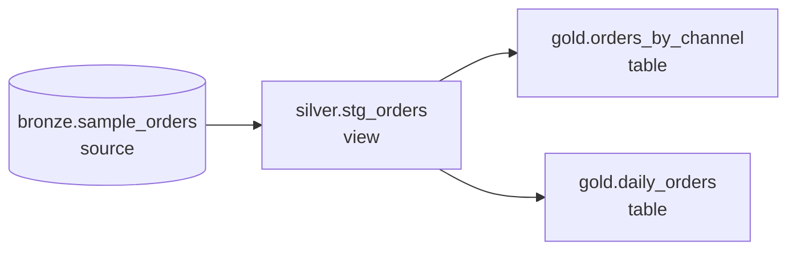
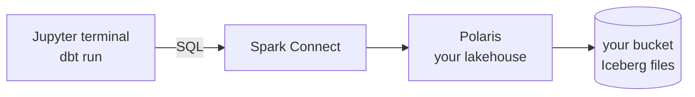

# Why dbt

## Concept
In [Unit 4](../unit4/fundamentals.md) you built Silver and Gold with Spark: a notebook cell per
table, `CREATE TABLE … AS SELECT`, and you had to remember to run Bronze before Silver before Gold.
In [Unit 5](../unit5/basics.md) Airflow took over the *order* and the *schedule*. What's still by
hand: writing the `CREATE` statements, checking the data is right, and explaining to colleagues
which table comes from where.

**dbt** (data build tool) handles exactly that part: the **T** in **ELT**
([ELT vs ETL](../unit1/what-is-de.md#etl-vs-elt-where-does-the-transform-happen)). The data is already loaded (Bronze); dbt
**transforms** it inside the lakehouse, using the engine you already have (here: Spark).

You write each table as **one `SELECT` in its own `.sql` file**. dbt does the rest:

| You write | dbt does |
|---|---|
| `select … from {{ ref('stg_orders') }}` | works out that this model needs `stg_orders` first, and builds them **in that order** |
| nothing about `CREATE TABLE` | wraps your `SELECT` in the right `CREATE TABLE … AS` / `CREATE VIEW … AS` |
| `unique`, `not_null` next to a column | turns each into a SQL **test** query and runs it |
| a one-line description | builds a **documentation site** with the lineage graph |

Each `.sql` file is a **model**: a table or view dbt builds from a `SELECT`. Models that read
other models form a **DAG**, the same idea as Airflow's DAG
([Airflow basics](../unit5/basics.md)): arrows point one way, no loops. The difference is
that **dbt draws the DAG for you**, from the `ref()`s in your SQL.

This is the project you build in the next lessons: one **source** (the raw table), one
**staging** model that cleans it, and two **marts**, the Gold tables a dashboard reads.

### dbt, Spark and Airflow — who does what

| Tool | Job |
|---|---|
| **Spark** | the **engine** — actually reads files and computes the results |
| **dbt** | the **SQL project** — your models, their order, tests and docs; it sends the SQL to Spark |
| **Airflow** | the **scheduler** — runs `dbt build` every morning, after the Bronze load |

dbt doesn't replace Spark: every model runs **on** Spark. And it doesn't replace Airflow:
dbt has no schedule. It's the layer in between that keeps SQL transformations tidy.

!!! info "When dbt, when a Spark notebook or job?"
    - **dbt**: the transformation is **SQL**: joins, filters, aggregates. Most Silver and
      Gold tables are.
    - **Spark (Python)**: reading APIs or odd files, machine learning, logic SQL can't express.
      Bronze ingestion ([Read the lake](../unit4/read-bronze.md)) stays a Spark job.

### dbt Core and dbt Cloud
**dbt Core** is the free, open-source command-line tool, the one you use here. **dbt Cloud**
is the company's paid web version (editor, scheduler, hosted docs) around the same Core. Projects
are the same files in both.

### How dbt runs in this lab

- You type `dbt` commands in a **Jupyter terminal**. dbt is already installed.
- dbt sends each model's SQL to **Spark Connect**, like your notebooks do, **as you**: it
  reads and writes only **your** lakehouse (`<you>_lake`), with your login. Another member's
  catalog or the shared lake is refused, as everywhere else.
- Your project lives in Jupyter's **`my_files/dbt/`** folder, mirrored to your bucket like `my_files/notebooks/`
  and `my_files/dags/` ([Your files](../setup/workspace.md#your-files-notebooks-dags-data)).

## 🎯 This runs unchanged on Azure, Databricks, Snowflake & Fabric
dbt is the same tool everywhere; only the **adapter** (the plugin that talks to the engine)
changes: `dbt-spark` here, `dbt-databricks`, `dbt-snowflake` or `dbt-fabric` on the platforms.
Your models, tests and docs stay the same files. Databricks Jobs, Snowflake and Fabric can also
run dbt projects themselves.

## You can now…
- Explain what dbt does: the **T** of ELT, as SQL `SELECT` models inside the lakehouse
- Name a **model**, a **source** and the **DAG** dbt builds from `ref()`
- Say what Spark, dbt and Airflow each do, and when a Spark job fits better than dbt
- Tell dbt Core from dbt Cloud
