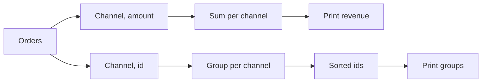

# Apache Beam basics: write and run pipelines

Before Dataflow runs your pipeline on Google's VMs, learn to **write** one. This lesson runs
small Beam scripts in **Cloud Shell** with the local runner: free, quick, and nothing to clean
up.

## Concept

### What Beam is
**Apache Beam** is an open-source library for data-processing pipelines (Python, Java, Go). You
describe **what** happens to the data, step by step. A **runner** decides **where** it happens:

| Runner | Runs the pipeline | Used for |
|---|---|---|
| **DirectRunner** (default) | on the machine where you start it | learning, testing, small data |
| **DataflowRunner** | on Google Cloud's VMs | real data, production |
| Flink / Spark runners | on a Flink or Spark cluster | outside Google Cloud |

The code is the same for all of them. That's Beam's point: write once, choose the runner when you
start it.

### Three words
- **Pipeline**: the whole job, from reading to writing.
- **PCollection**: a dataset flowing between steps (a "parallel collection"). It's like a
  Spark DataFrame, but its elements can be anything: strings, tuples, dicts.
- **PTransform**: a step that takes a PCollection and gives a new one: `Map`, `Filter`,
  `CombinePerKey`, `ReadFromText`, …

A PCollection is **never changed**. Each step makes a new one, the same way each Spark
transformation gives a new DataFrame.

### The shape of every Beam script
```python
import apache_beam as beam

with beam.Pipeline() as p:
    (
        p
        | "Step name" >> beam.Create([...])       # where the data comes from
        | "Next step" >> beam.Map(some_function)  # what happens to each element
        | "Last step" >> beam.Map(print)          # where it goes
    )
```

- **`import apache_beam as beam`**: the library, by its usual short name.
- **`with beam.Pipeline() as p:`** creates the pipeline. Nothing runs while the lines inside
  are read: they only **describe** the steps. When the `with` block ends, Beam hands the whole
  plan to the runner and **runs it**.
- **`|`** ("pipe") applies a step to what's on its left.
- **`"Name" >> step`** gives the step a name, shown in logs and in the Dataflow graph. Names
  must be **unique** in a pipeline.
- The outer **`( … )`** lets the chain span several lines.

## Lab

### 1 · Install Beam in Cloud Shell
```bash
python3 -m venv ~/beam
source ~/beam/bin/activate
pip install -q 'apache-beam[gcp]'
```

- **`python3 -m venv ~/beam`** makes a private Python environment in `~/beam`, so Beam's
  packages don't clash with Cloud Shell's own.
- **`source ~/beam/bin/activate`** switches to it: your prompt starts with `(beam)`. After a
  Cloud Shell restart, **run this line again** before any Beam script.
- **`pip install 'apache-beam[gcp]'`** installs Beam plus its Google Cloud connectors (`[gcp]`:
  Cloud Storage, BigQuery, Dataflow). It takes 2–3 minutes.

!!! question "Dataflow is a Google Cloud service. Why install Beam?"
    **Dataflow** is the engine that **runs** a pipeline. **Apache Beam** is the library your code
    is **written with**. You need the library on the machine that **starts** the job:

    1. **Cloud Shell:** `python my_pipeline.py` starts. Its first line, `import apache_beam`,
       needs Beam installed, and Cloud Shell doesn't have it. Beam then builds the pipeline's
       plan.
    2. **Submit:** with `--runner DataflowRunner`, Beam uploads the plan and your code to
       Dataflow.
    3. **Google Cloud:** Dataflow starts VMs, which already have Beam, and processes the data
       there.

    Without step 1 the command stops with *No module named 'apache_beam'* before anything
    reaches Google Cloud. It's the same as the lab: a notebook needs `pyspark` installed to send
    work to the Spark cluster, even though the cluster does the work.

Get this lesson's scripts:

```bash
mkdir -p ~/beam-basics && cd ~/beam-basics
for f in hello map_filter flatmap by_key status_counts dofn; do
  curl -sLO https://maarthala.github.io/data-engineering-lab/assets/gcp/beam/$f.py
done
ls
```

- **`mkdir -p DIR && cd DIR`**: make the folder (no error if it exists), then go into it.
- The **`for` loop** downloads the six files with the `curl -sLO` you know from the
  [Cloud Storage lesson](storage.md).

```
by_key.py  dofn.py  flatmap.py  hello.py  map_filter.py  status_counts.py
```

To read or change a script: **Open Editor** (Cloud Shell's top bar) → `beam-basics`, or
`cat hello.py`.

!!! note "Log lines"
    When a script runs, Beam prints several `INFO` / `WARNING` lines: it starts a small local
    runner (*Prism*) and stops it again. Your own output is the plain lines between them. To
    hide the log lines, add `2>/dev/null` to the command, but leave it off when something goes
    wrong, because the error is in those lines.

### 2 · Hello, Beam: `Create` and `Map`
`hello.py`:

```python
import apache_beam as beam

with beam.Pipeline() as p:
    (
        p
        | "Channels" >> beam.Create(["web", "app", "web", "marketplace"])
        | "Upper case" >> beam.Map(str.upper)
        | "Print" >> beam.Map(print)
    )
```

- **`beam.Create(list)`** makes a PCollection from a Python list. Good for examples and tests.
  Real pipelines read files or tables instead.
- **`beam.Map(fn)`** calls `fn` on **each element** and keeps the result: exactly one output per
  input.
- **`str.upper`** is Python's own "make upper case" function, passed without `()` because Beam
  calls it for you.
- **`beam.Map(print)`** prints each element. It's handy for learning, but on Dataflow the prints
  go to the workers' logs, not your screen.

```bash
python hello.py
```

```
WEB
APP
WEB
MARKETPLACE
```

!!! warning "The order isn't guaranteed"
    A PCollection has **no order**. Beam may process elements in parallel, so your lines can come
    out in a different order. That's normal. Never write a pipeline that relies on order.

### 3 · Keep some, change each: `Filter` and `Map`
`map_filter.py`:

```python
ORDERS = [
    # (order_id, channel, status, amount)
    (1, "web", "delivered", 120.0),
    (2, "app", "cancelled", 35.5),
    (3, "web", "delivered", 80.0),
    (4, "marketplace", "shipped", 15.0),
    (5, "app", "delivered", 42.5),
]

with beam.Pipeline() as p:
    (
        p
        | "Orders" >> beam.Create(ORDERS)
        | "Only delivered" >> beam.Filter(lambda o: o[2] == "delivered")
        | "Id and amount" >> beam.Map(lambda o: f"order {o[0]}: {o[3]:.2f}")
        | "Print" >> beam.Map(print)
    )
```

- Each element is a **tuple**; `o[0]` is its first value (the id), `o[2]` the status, `o[3]` the
  amount.
- **`lambda o: …`** is a one-line function with no name: `o` in, the expression out.
- **`beam.Filter(fn)`** keeps the elements where `fn` gives `True`, like SQL's `WHERE`.
- **`f"…{o[3]:.2f}"`** is an f-string: `{…}` puts a value in the text, and `:.2f` shows it with 2
  decimals.

```bash
python map_filter.py
```

```
order 1: 120.00
order 3: 80.00
order 5: 42.50
```

### 4 · One in, many out: `FlatMap`
`flatmap.py`:

```python
BASKETS = ["laptop,mouse", "desk", "pen,paper,stapler"]

with beam.Pipeline() as p:
    (
        p
        | "Baskets" >> beam.Create(BASKETS)
        | "One per product" >> beam.FlatMap(lambda basket: basket.split(","))
        | "Print" >> beam.Map(print)
    )
```

- **`basket.split(",")`** turns `"laptop,mouse"` into the list `["laptop", "mouse"]`.
- **`beam.FlatMap(fn)`**: `fn` gives back a **list** (or any iterable), and every item becomes its
  own element. 3 baskets in, 6 products out. With `Map` you'd get 3 lists instead.

```
laptop
mouse
desk
pen
paper
stapler
```

`FlatMap` can also give back an **empty list**, which drops the element. That makes it a
filter and a map in one step. The Dataflow lesson's `clean` function uses it.

### 5 · Group and sum by key: `CombinePerKey`, `GroupByKey`
Beam's version of `GROUP BY` works on **key-value pairs**: 2-tuples `(key, value)`.

`by_key.py` (same `ORDERS` as above):

```python
with beam.Pipeline() as p:
    orders = p | "Orders" >> beam.Create(ORDERS)

    (
        orders
        | "Channel, amount" >> beam.Map(lambda o: (o[1], o[3]))
        | "Sum per channel" >> beam.CombinePerKey(sum)
        | "Print revenue" >> beam.Map(print)
    )
    (
        orders
        | "Channel, id" >> beam.Map(lambda o: (o[1], o[0]))
        | "Group per channel" >> beam.GroupByKey()
        | "Sorted ids" >> beam.MapTuple(lambda channel, ids: (channel, sorted(ids)))
        | "Print groups" >> beam.Map(print)
    )
```

- **`orders = p | …`** keeps a PCollection in a variable, so **two branches** can read it. A
  pipeline is a graph, not just a line.
- **`beam.Map(lambda o: (o[1], o[3]))`** makes pairs `(channel, amount)`: the channel is the
  **key**.
- **`beam.CombinePerKey(sum)`** adds up the values of each key, like
  `select channel, sum(amount) … group by channel`.
- **`beam.GroupByKey()`** collects **all** values of each key into one list,
  `(key, [v1, v2, …])`, without adding them up.
- **`beam.MapTuple(fn)`** is `Map` for pairs: `fn` gets the key and the value as two arguments
  instead of one tuple.
- **`sorted(ids)`**: the grouped values come in no particular order, so sort them for a stable
  printout.

The pipeline has **two separate branches**, and each prints its own lines. Nothing is merged:
the revenue branch and the groups branch only share the input, `orders`.



Output of the **revenue** branch (`Print revenue`):

```
('app', 78.0)
('marketplace', 15.0)
('web', 200.0)
```

Output of the **groups** branch (`Print groups`):

```
('marketplace', [4])
('web', [1, 3])
('app', [2, 5])
```

On your screen they appear as one list of six lines, because both branches print to the same
terminal. The branches run **in parallel**, so the lines can come out mixed, e.g. a group line
between two revenue lines. You can tell them apart by shape: a number (`78.0`) is a revenue
line, a list (`[2, 5]`) is a group line.

!!! tip "Prefer `CombinePerKey` to `GroupByKey` + sum"
    `CombinePerKey(sum)` adds up **inside each worker first** and only sends the small partial
    sums across the network. `GroupByKey` sends **every** value. On big data, combining is much
    faster. It's the same idea as Spark's partial aggregation.

### 6 · A real file in Cloud Storage: read, count, write
`status_counts.py` counts the ShopFlow orders per status, from the raw file you landed in the
[Cloud Storage lesson](storage.md):

```python
import argparse
import csv

import apache_beam as beam
from apache_beam.options.pipeline_options import PipelineOptions


def status_of(line):
    """The 5th CSV value, trimmed and lower-cased: ' Delivered ' -> 'delivered'."""
    return next(csv.reader([line]))[4].strip().lower()


parser = argparse.ArgumentParser()
parser.add_argument("--input", required=True)
parser.add_argument("--output", required=True)
args, beam_args = parser.parse_known_args()

with beam.Pipeline(options=PipelineOptions(beam_args)) as p:
    (
        p
        | "Read" >> beam.io.ReadFromText(args.input, skip_header_lines=1)
        | "Status" >> beam.Map(status_of)
        | "Count" >> beam.combiners.Count.PerElement()
        | "Format" >> beam.MapTuple(lambda status, n: f"{status},{n}")
        | "Write" >> beam.io.WriteToText(args.output, file_name_suffix=".csv",
                                         header="status,lines", num_shards=1)
    )
```

- **`def status_of(line):`** is an ordinary named function; a step can call it like a lambda.
  **`next(csv.reader([line]))`** splits one CSV line into its values (respecting quotes), and
  **`[4]`** is the 5th value, `status`.
- **`argparse`** reads options from the command line. **`add_argument("--input",
  required=True)`** defines one. **`parse_known_args()`** returns your options (`args.input`,
  `args.output`) and **the rest** (`beam_args`), which go to Beam as
  **`PipelineOptions(beam_args)`**. That's how the same script later takes `--runner
  DataflowRunner`.
- **`beam.io.ReadFromText(path, skip_header_lines=1)`**: one element per line of every file
  matching `path`, skipping each file's header. It reads `gs://…` paths as well as local
  files.
- **`beam.combiners.Count.PerElement()`** counts how often each element occurs and gives
  `(element, count)` pairs.
- **`beam.io.WriteToText(prefix, …)`** writes the elements as lines. **`header`** is the first
  line, and **`num_shards=1`** asks for a single output file (Beam normally splits output into
  several **shards**).

Run it: the input is in Cloud Storage, the output in a local folder `out/`:

```bash
python status_counts.py --input "gs://$BUCKET/shopflow/orders/*.csv" --output out/status_counts
ls out
cat out/status_counts-00000-of-00001.csv
```

```
status_counts-00000-of-00001.csv
status,lines
placed,4128
delivered,28188
cancelled,3914
shipped,3920
```

Twelve spellings became four statuses: 4,128 + 28,188 + 3,914 + 3,920 = **40,150**, every line
of the file. (The rows can come in another order.) Duplicates are still counted here; the
Dataflow lesson removes them. The file name ends in `-00000-of-00001`: shard 0 of 1.

!!! info "DirectRunner, cloud data"
    The pipeline ran **in Cloud Shell** but read **from Cloud Storage**: Beam's `[gcp]`
    connectors used your Cloud Shell login. Where it runs (the runner) and where the data lives
    are separate choices.

### 7 · Your own step class and a second output: `DoFn`, `ParDo`
`Map` and `FlatMap` are shortcuts. The general form is a **`DoFn`** class run by
**`beam.ParDo`**. Use it when a step needs more than one line of logic, or more than one output.

`dofn.py`:

```python
LINES = ["1,web,delivered", "2,app,DELIVERED", "x,web,shipped", "4,app,lost"]
STATUSES = {"placed", "shipped", "delivered", "cancelled"}


class ParseOrder(beam.DoFn):
    def process(self, line):
        order_id, channel, status = line.split(",")
        status = status.lower()
        if order_id.isdigit() and status in STATUSES:
            yield {"order_id": int(order_id), "channel": channel, "status": status}
        else:
            yield beam.pvalue.TaggedOutput("bad", line)


with beam.Pipeline() as p:
    parsed = (
        p
        | "Lines" >> beam.Create(LINES)
        | "Parse" >> beam.ParDo(ParseOrder()).with_outputs("bad", main="good")
    )
    parsed.good | "Print good" >> beam.Map(lambda row: print("good:", row))
    parsed.bad | "Print bad" >> beam.Map(lambda line: print("bad: ", line))
```

- **`class ParseOrder(beam.DoFn):`** defines a step as a class. Beam calls its **`process`**
  method once per element.
- **`a, b, c = line.split(",")`** puts the three values into three names at once.
- **`{"placed", …}`** is a **set**; **`x in STATUSES`** checks membership.
- **`"x".isdigit()`** is `True` only if the text is all digits, so `"x"` fails.
- **`yield`** hands back a result, and a `process` may `yield` zero, one or many times. That's
  how `FlatMap` works too.
- **`beam.pvalue.TaggedOutput("bad", line)`** sends this result to a **second output** named
  `bad`.
- **`beam.ParDo(ParseOrder())`** runs the class on every element ("parallel do").
  **`.with_outputs("bad", main="good")`** gives back both outputs: `parsed.good` (the normal
  yields) and `parsed.bad`.

```bash
python dofn.py
```

```
good: {'order_id': 1, 'channel': 'web', 'status': 'delivered'}
good: {'order_id': 2, 'channel': 'app', 'status': 'delivered'}
bad:  x,web,shipped
bad:  4,app,lost
```

This is the pattern the Dataflow lesson uses on the real orders: **clean rows to BigQuery, bad
lines to a `rejected/` folder**. Nothing is dropped without being seen.

### 8 · A common mistake: the same step name twice
Change the last line of `dofn.py` from `"Print bad"` to `"Print good"` and run it again:

```
RuntimeError: A transform with label "Print good" already exists in the pipeline. ...
```

Every step needs its **own name**. When this error appears, look for a name you copied and pasted.

## Learn more: where Beam's methods live
`beam.Map`, `beam.Distinct` and the rest are short names. Each one lives in a **module** of the
`apache_beam` package, and each module's reference page lists every method with its arguments
and examples:

| Module | What's in it | Examples you met, and more to try |
|---|---|---|
| [`apache_beam.transforms.core`](https://beam.apache.org/releases/pydoc/current/apache_beam.transforms.core.html) | the building blocks | `Create`, `Map`, `MapTuple`, `FlatMap`, `Filter`, `ParDo`, `DoFn`, `GroupByKey`, `CombinePerKey`; also `Flatten` (merge PCollections into one), `Partition` (split one into several) |
| [`apache_beam.transforms.combiners`](https://beam.apache.org/releases/pydoc/current/apache_beam.transforms.combiners.html) | ready-made aggregations | `Count.PerElement`; also `Count.Globally`, `Count.PerKey`, `Mean.PerKey`, `Top.Largest`, `Top.PerKey`, `Sample`, `ToList`, `Latest` |
| [`apache_beam.transforms.util`](https://beam.apache.org/releases/pydoc/current/apache_beam.transforms.util.html) | handy helpers | `Distinct`; also `Keys`, `Values`, `KvSwap`, `WithKeys`, `Reshuffle` |
| [`apache_beam.io`](https://beam.apache.org/releases/pydoc/current/apache_beam.io.textio.html) | reading and writing | `ReadFromText`, `WriteToText`; also `ReadFromCsv`, `ReadFromJson`, `ReadFromParquet` / `WriteToParquet`, `ReadFromAvro`, `ReadFromBigQuery` / `WriteToBigQuery` |
| [`apache_beam.transforms.window`](https://beam.apache.org/releases/pydoc/current/apache_beam.transforms.window.html) | time windows for streaming | `FixedWindows`, `SlidingWindows`, `Sessions` |

From Python itself: `help(beam.combiners.Top)` prints the same documentation in Cloud Shell, and
`beam.Map.__module__` tells you which module a name comes from.

Guides and places to practise:

- [**Python transform catalog**](https://beam.apache.org/documentation/transforms/python/overview/)
  lists every built-in transform, each with a short runnable example. **Start here** when you
  look for "is there a step that does X?".
- [**Beam programming guide**](https://beam.apache.org/documentation/programming-guide/) is the
  full explanation of pipelines, PCollections, transforms, windows and triggers.
- [**I/O connectors**](https://beam.apache.org/documentation/io/connectors/) lists every source
  and sink: files, BigQuery, Pub/Sub, Kafka, JDBC databases, …
- [**Beam DataFrames**](https://beam.apache.org/documentation/dsls/dataframes/overview/) lets you
  write pandas-style code that runs as a Beam pipeline.
- [**Tour of Beam**](https://tour.beam.apache.org/) and [**Beam Playground**](https://play.beam.apache.org/)
  let you learn and run Beam in the browser, with nothing to install.
- [**Dataflow documentation**](https://cloud.google.com/dataflow/docs/overview) covers running
  Beam on Google Cloud: options, monitoring, templates and cost.

## Check yourself
1. In `with beam.Pipeline() as p:`, when does the data actually move? *(When the `with` block
   ends. Until then, the lines only describe the steps.)*
2. You have 3 baskets with 6 products in total. Which gives 6 elements, `Map` or `FlatMap`?
   *(`FlatMap`. `Map` gives 3 lists.)*
3. Why prefer `CombinePerKey(sum)` over `GroupByKey()` followed by a sum? *(It sums inside each
   worker first and only sends partial sums across the network.)*
4. What changes to run `status_counts.py` on Dataflow instead of Cloud Shell? *(Only the
   command: add `--runner DataflowRunner --region … --temp_location gs://…`. The code stays.)*
