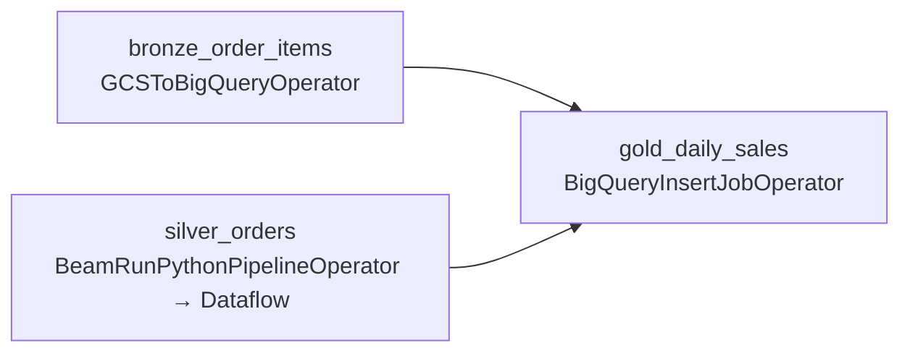

# Composer: orchestrate the pipeline

## Concept

### Cloud Composer is managed Airflow
**Cloud Composer** is **Apache Airflow** run by Google. The DAGs are the same Python files you
wrote in the lab's [Orchestration unit](../unit5/basics.md): tasks, `>>`, schedules, retries.
Google runs everything around them: the scheduler, the web UI, the workers and the Airflow
database. A Composer **environment** is one Airflow installation. Its DAGs live in a
`dags/` folder in a Cloud Storage bucket that the environment creates.

For a pipeline on Google Cloud, Airflow uses **operators** from the Google provider, which come
installed in Composer:

| Step | Operator | What it does |
|---|---|---|
| files → Bronze | `GCSToBigQueryOperator` | a BigQuery load job, like `bq load` |
| Bronze → Silver | `BeamRunPythonPipelineOperator` | starts your Beam file on Dataflow and waits for it |
| Silver → Gold | `BigQueryInsertJobOperator` | runs SQL in BigQuery |

The worker only **starts and watches** each job: the data work happens in BigQuery and
Dataflow. That's the same split as in the lab, where a task calls Spark and Spark does the work.

!!! danger "Composer costs money every hour it exists"
    An environment runs all the time (scheduler, web server, database, workers), **even when no
    DAG runs**. The smallest one costs roughly **US$10 or more a day**, so a forgotten
    environment eats the US$300 trial in weeks. Check *Cloud Composer pricing* for today's
    numbers.

    So this lesson has two paths:

    - **Practise in the lab (recommended):** read the Composer DAG here, then build the same DAG
      in the lab's Airflow, which is free and already running for you.
    - **Run it on Composer (optional):** create the environment, run the DAG, and **delete the
      environment the same day**.

### The ShopFlow DAG


`bronze_order_items` and `silver_orders` don't depend on each other, so they run **at the same
time**. Gold waits for both: `[bronze_items, silver_orders] >> gold`.

[:material-download: **shopflow_dag.py**](../assets/gcp/shopflow_dag.py){: download="shopflow_dag.py" }

```python
bronze_items = GCSToBigQueryOperator(
    task_id="bronze_order_items",
    bucket=BUCKET,
    source_objects=["shopflow/order_items/*.csv"],
    destination_project_dataset_table=f"{PROJECT}.shopflow_bronze.order_items",
    source_format="CSV", skip_leading_rows=1, autodetect=True,
    write_disposition="WRITE_TRUNCATE",
    location=REGION,
)

silver_orders = BeamRunPythonPipelineOperator(
    task_id="silver_orders",
    runner="DataflowRunner",
    py_file=f"gs://{BUCKET}/code/silver_orders.py",
    pipeline_options={
        "input": f"gs://{BUCKET}/shopflow/orders/*.csv",
        "output_table": f"{PROJECT}:shopflow_silver.orders",
        "rejected": f"gs://{BUCKET}/rejected/orders",
        "temp_location": f"gs://{BUCKET}/tmp",
    },
    dataflow_config=DataflowConfiguration(job_name="silver-orders", project_id=PROJECT, location=REGION),
)

gold = BigQueryInsertJobOperator(
    task_id="gold_daily_sales",
    configuration={"query": {"query": GOLD_SQL, "useLegacySql": False}},
    project_id=PROJECT,
    location=REGION,
)

[bronze_items, silver_orders] >> gold
```

- **`GCSToBigQueryOperator`**: the arguments are `bq load`'s flags from the
  [BigQuery lesson](bigquery.md): `source_objects` (paths inside `bucket`), `skip_leading_rows`,
  `autodetect`. **`WRITE_TRUNCATE`** is `--replace`.
- **`BeamRunPythonPipelineOperator`**: **`py_file`** is the Beam file (Composer reads it from the
  bucket). **`pipeline_options`** become the `--input`, `--output_table`, … options you typed in
  Cloud Shell. **`DataflowConfiguration`** sets the job name, project and region, and makes the
  task **wait** until the Dataflow job ends.
- **`BigQueryInsertJobOperator`** runs `GOLD_SQL`, the `daily_sales` query from the
  [notebook lesson](notebook.md). `useLegacySql: False` means standard SQL (BigQuery's
  pre-2016 dialect is still the API default).
- **`[a, b] >> c`**: a list on the left means `c` waits for **both**.
- The DAG itself (`schedule="0 6 * * *"`, `start_date`, `catchup=False`) is plain Airflow, as in
  the lab: every day at 06:00 UTC, no back-filling of past days.

## Path A · Practise in the lab (recommended)
The lab's Airflow runs the same kind of DAG on your own data: free, and already running. The
pieces map one to one:

| Composer DAG | Lab DAG ([Build the medallion DAG](../unit5/medallion-dag.md)) |
|---|---|
| files in `gs://<bucket>/shopflow/` | files in **My files** (`files/…`) |
| `GCSToBigQueryOperator` → `shopflow_bronze` | `@task bronze()`: Spark reads the files → `my.bronze.*` |
| `BeamRunPythonPipelineOperator` (Dataflow) | `@task silver()`: Spark cleans → `my.silver.orders` |
| `BigQueryInsertJobOperator` | `@task gold()`: `spark.sql("create or replace table my.gold.daily_sales …")` |
| `[bronze, silver] >> gold` | the same `>>` |
| Composer's Airflow UI | the lab's Airflow UI |

**Exercise:**

1. Upload the four ShopFlow CSV folders from `shopflow_gcp_files.zip` to **My files** →
   `files/source/shopflow/`.
2. In Jupyter `my_files/dags/`, write `shopflow_files.py`: a DAG with three tasks shaped like the
   Composer one. Bronze loads the files into `my.bronze`, Silver applies **the same cleaning rules**
   as `silver_orders.py` (dedupe, trim + lower case, `USD` default, rejects to their own table),
   Gold builds `my.gold.daily_sales`.
3. Trigger it in Airflow and compare with BigQuery: Silver should have **39,900** orders, and Gold
   **28,005** delivered orders over **2,919** rows.

## Path B · Run it on Composer (optional, costs money)

### 1 · Turn on Composer and give it permissions
```bash
gcloud services enable composer.googleapis.com
PROJECT_NUMBER=$(gcloud projects describe $PROJECT --format='value(projectNumber)')
SA=${PROJECT_NUMBER}-compute@developer.gserviceaccount.com
gcloud projects add-iam-policy-binding $PROJECT --condition=None --quiet \
    --member=serviceAccount:service-${PROJECT_NUMBER}@cloudcomposer-accounts.iam.gserviceaccount.com \
    --role=roles/composer.ServiceAgentV2Ext > /dev/null
gcloud projects add-iam-policy-binding $PROJECT --condition=None --quiet \
    --member=serviceAccount:$SA --role=roles/composer.worker > /dev/null
```

- **`service-…@cloudcomposer-accounts…`** is Composer's own **service agent**, the account
  Google uses to build the environment in your project. **`ServiceAgentV2Ext`** lets it set up the
  environment's service account.
- **`$SA`**, the same Compute Engine default service account Dataflow uses, will run your
  DAG's tasks. **`composer.worker`** lets it run Composer's workers. It already has BigQuery,
  Storage and Dataflow roles from the [Dataflow lesson](dataflow.md).

### 2 · Create the environment
```bash
gcloud composer environments create shopflow-airflow \
    --location=$REGION --image-version=composer-3-airflow-2 \
    --environment-size=small --service-account=$SA
```

- **`--image-version=composer-3-airflow-2`**: Composer 3 with the newest Airflow 2 it offers.
- **`--environment-size=small`**: the cheapest size, plenty for one DAG.
- **`--service-account`**: the account the tasks run as.

This takes **about 25 minutes**. Meanwhile, Console → **Composer** shows it with a spinner.

### 3 · Put the code in place
```bash
gcloud storage cp silver_orders.py gs://$BUCKET/code/
curl -sLO https://maarthala.github.io/data-engineering-lab/assets/gcp/shopflow_dag.py
sed -i "s/your-project-id/$PROJECT/; s/us-central1/$REGION/" shopflow_dag.py
grep -E "^(PROJECT|BUCKET|REGION)" shopflow_dag.py
gcloud composer environments storage dags import \
    --environment=shopflow-airflow --location=$REGION --source=shopflow_dag.py
```

- **`gcloud storage cp silver_orders.py gs://$BUCKET/code/`**: the Beam file from the
  [Dataflow lesson](dataflow.md) goes where `py_file` points.
- **`sed -i "s/old/new/; …"`** edits the file in place: it replaces `your-project-id` (in
  `PROJECT` and `BUCKET`) with your project ID, and the region with yours.
- **`grep -E "^(…)"`** shows the three lines, so you can check them:

```
PROJECT = "shopflow-de-4821"            # gcloud config get-value project
BUCKET = "shopflow-de-4821-shopflow"    # the bucket from the Cloud Storage lesson
REGION = "us-central1"                 # the region you use everywhere
```

- **`gcloud composer environments storage dags import`** copies the DAG into the environment's
  `dags/` folder. Airflow picks it up within a minute or two.

### 4 · Run it
Console → **Composer** → `shopflow-airflow` → **Open Airflow UI**. Find `shopflow_gcp`, switch it
**on**, and click **▶ Trigger DAG**. In the **Graph** view, `bronze_order_items` and
`silver_orders` run side by side, then `gold_daily_sales`. The Silver task takes the longest:
its log shows the Dataflow job starting, and the job also appears in Console → **Dataflow**.

### 5 · A new day arrives
Upload the next day's files to the same folders:

```bash
curl -sLO https://maarthala.github.io/data-engineering-lab/assets/gcp/shopflow_new_day.zip
unzip -o shopflow_new_day.zip
gcloud storage cp --recursive shopflow gs://$BUCKET/
```

[:material-download: shopflow_new_day.zip](../assets/gcp/shopflow_new_day.zip){: download="shopflow_new_day.zip" }:
800 orders and 2,000 lines from 2026-06-01. Trigger the DAG again (or wait for 06:00), then in
BigQuery:

```sql
select * from shopflow_gold.daily_sales
where order_date = '2026-06-01'
order by channel;
```

| order_date | channel | orders | revenue | units |
|---|---|---|---|---|
| 2026-06-01 | app | 157 | 331461.74 | 1257 |
| 2026-06-01 | marketplace | 87 | 173005.86 | 669 |
| 2026-06-01 | web | 245 | 472591.13 | 1800 |
| 2026-06-01 | wholesale | 82 | 149532.91 | 587 |

No code changed: the loads read `folder/*.csv`, so the new files were simply picked up. Silver
now has **40,700** orders (39,900 + 800).

### 6 · Delete the environment (the same day)
```bash
gcloud composer environments delete shopflow-airflow --location=$REGION --quiet
```

- **`--quiet`** skips the "are you sure?" question. Deleting takes 10–15 minutes.

Composer leaves **its own bucket** behind (`<region>-shopflow-airflow-…-bucket`, holding the
DAGs and logs). Find it and delete it:

```bash
gcloud storage ls | grep shopflow-airflow
gcloud storage rm --recursive gs://THAT-BUCKET-NAME
```

- **`gcloud storage rm --recursive`** deletes a bucket and everything in it.

!!! tip "If a task fails"
    Click the red task → **Logs**. The common causes are a typo in `PROJECT`/`BUCKET`, a
    missing role (*403 … does not have … permission*: recheck step 1 and the Dataflow lesson's
    roles), or the Beam file not in `gs://$BUCKET/code/`. If the log says *No module named
    apache_beam*, add the PyPI package `apache-beam[gcp]` on the environment's **PyPI
    packages** tab.

## Check yourself
1. Where does the Silver work run when Composer triggers it? *(On Dataflow. The Airflow worker
   only starts the job and waits for it.)*
2. What does `[bronze_items, silver_orders] >> gold` mean? *(The first two run in parallel, and
   `gold` starts after both succeed.)*
3. Why delete the Composer environment the same day? *(It bills every hour it exists, even
   with no DAG running.)*
