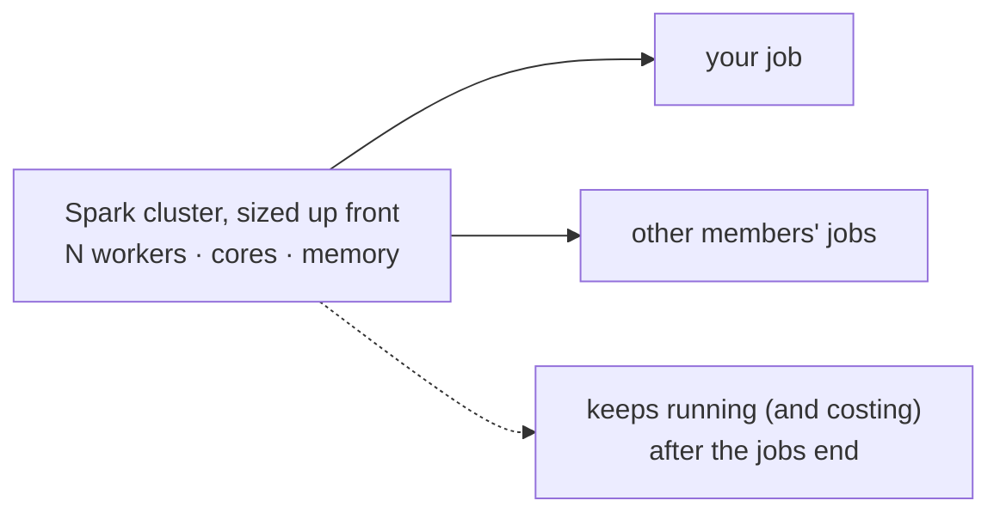
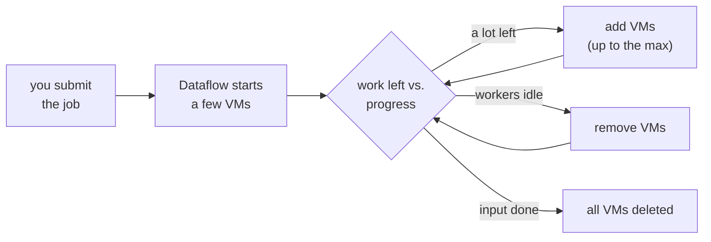
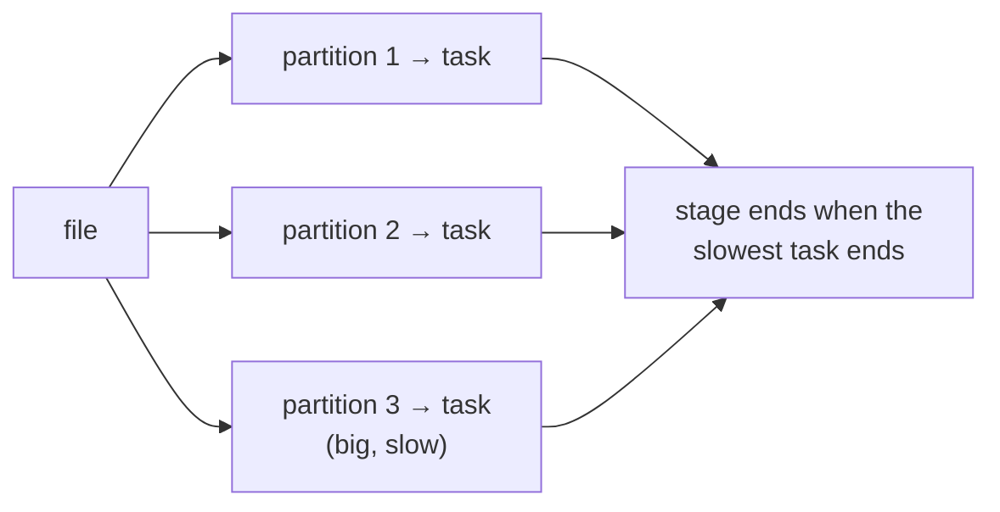
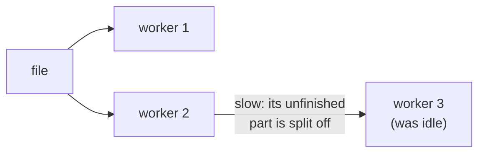
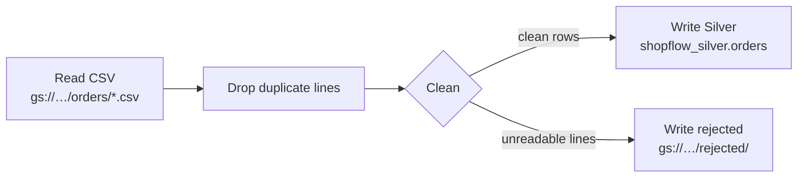

# Dataflow: clean orders into Silver

## Concept

### Dataflow and Apache Beam
**Dataflow** is Google's managed service for data-processing jobs. You don't write "Dataflow
code": you write an **Apache Beam** pipeline (open source, in Python or Java), and Dataflow runs
it. Dataflow starts the VMs, splits the work across them, retries failed pieces, scales the
number of VMs and shuts them down when the job ends. You wrote and ran small Beam pipelines in
[Apache Beam basics](beam-basics.md); this lesson runs a real one on Dataflow.

In the lab, a Spark job does this work. The ideas map one to one:

| Spark (lab) | Beam / Dataflow |
|---|---|
| DataFrame | **PCollection**: a dataset flowing through the pipeline |
| a transformation (`filter`, `dropDuplicates`, …) | **PTransform**: a step, such as `Map`, `FlatMap`, `Distinct` |
| the Spark cluster | the **runner**: `DirectRunner` (your shell) or `DataflowRunner` (Google's VMs) |
| `spark.read.csv(...)` / `df.write...` | **I/O connectors**: `ReadFromText`, `WriteToBigQuery`, … |

The same Beam file runs on either runner. You test it on **DirectRunner** in Cloud Shell, which
is free, quick and prints errors straight away. Then you run it on **DataflowRunner**, where it
scales and shows up in the console.

### Batch and streaming
Beam handles **batch** (a fixed set of files, like here) and **streaming** (endless events, e.g.
from Pub/Sub) with the same transforms. This lesson is batch. A batch job stops by itself when the
input is done.

### Dataflow vs Spark: who decides the machines
This is where Dataflow differs most from the Spark jobs in the lab. In Spark **you** choose the
compute, and the work is divided into **partitions** you can see and tune. In Dataflow **the
service** chooses the compute and divides the work itself, **while the job runs**.

**Spark (lab):** the cluster is sized before any job and shared by everyone:



**Dataflow:** each job gets its own VMs, and their number changes while it runs:



How Dataflow picks the number of VMs for a batch job:

1. **It starts small:** a few workers, with a small default machine type unless you pick one.
2. **It estimates the work:** how big the input is, and how fast each worker is getting through
   its share. An uncompressed CSV can be split into byte ranges that different workers read in
   parallel.
3. **It scales during the job:** if the remaining work would take long, it adds VMs. When workers
   run out of work near the end, it removes them.
4. **It stops at a ceiling:** whichever is lower of `--max_num_workers` and your project's CPU
   **quota** in that region. Free-trial projects have small quotas.

For ShopFlow's 2.5 MB of orders that means **1 VM**: less than one worker's comfortable load.
Most of the 5–8 minutes is starting that VM.

| | Spark | Dataflow |
|---|---|---|
| Who sizes the compute | you or the platform: workers, executor cores and memory | the service; you may set a ceiling |
| When | before the job (cluster / session start) | during the job, from the work left |
| Scaling | *dynamic allocation* adds **executors** inside the cluster; adding **VMs** is a separate cluster autoscaler (Dataproc, Databricks) | adds and removes **VMs** itself |
| When idle | the cluster runs (and costs) until stopped; the lab's Spark is always up and shared | VMs exist only during the job |
| What you tune | `spark.executor.instances`, `executor.cores`, `executor.memory`, dynamic-allocation min/max | usually nothing; optionally the options below |

Options you can add to the `python silver_orders.py …` command:

| Option | Effect |
|---|---|
| `--max_num_workers=5` | the most VMs it may use: a budget guard |
| `--num_workers=3` | how many to start with |
| `--autoscaling_algorithm=NONE` | no autoscaling: always exactly `--num_workers` |
| `--worker_machine_type=e2-standard-2` | a bigger or smaller VM per worker |

### Partitions (Spark) vs bundles (Beam)
Both split the data so many machines can work at once. They differ in **who controls it** and
**when it can change**.

**Spark:** the partitions are fixed when a stage starts, so the slowest one sets the pace:



**Dataflow:** work is split again while it runs, so idle workers help the slow one:



**Spark** shows you the partitions:

- **On read**, a file is cut into partitions of about 128 MB (`spark.sql.files.maxPartitionBytes`).
  One partition is one **task** on one core.
- **After a shuffle** (`groupBy`, `join`, `distinct`), the data is spread over
  `spark.sql.shuffle.partitions` partitions (200 by default). **AQE** (adaptive query execution)
  can merge tiny ones and split skewed ones.
- **You change the count** with `repartition(n)` (a shuffle) or `coalesce(n)` (merge, no
  shuffle).
- Once a stage starts, its tasks are fixed: **one slow partition holds the whole stage back**.

**Beam/Dataflow** hides them:

- The runner cuts a PCollection into **bundles** and picks their size. Your code never sees a
  bundle: it handles **one element at a time** (`Map`, `DoFn.process`).
- **Dynamic work rebalancing:** if a worker falls behind, Dataflow **splits its unfinished work
  while it runs** and hands part to an idle worker. Spark can't split a running task.
- **Fusion:** `Read → Map → Filter` steps are merged to run together on one worker, like Spark's
  narrow transformations in one stage.
- **Shuffle** happens only at grouping steps (`GroupByKey`, `CombinePerKey`, `Distinct`). Dataflow
  runs it in a separate **shuffle service**, not on the worker VMs.

The closest equivalents:

| Spark | Beam | Note |
|---|---|---|
| `repartition(n)` | `beam.Reshuffle()` | spreads elements over the workers again (and breaks fusion), with no count to choose |
| `coalesce(1)` before writing | `WriteToText(…, num_shards=1)` | the number of output files only |
| `spark.sql.shuffle.partitions` | none | Dataflow decides |
| `df.rdd.getNumPartitions()` | none | not visible |
| filter into several DataFrames | `beam.Partition(fn, n)` | splits into **n PCollections by your rule**: a logical split, *not* a physical partition, despite the name |
| AQE skew handling | dynamic rebalancing | neither can split **one huge key**; Dataflow logs a "hot key" warning |

What helps either one go parallel: **many files, or big uncompressed ones**. A single `.gz` file
can't be split, so one worker (or one task) reads all of it.

!!! note "Not the same as table partitioning"
    "Partition" also means how a **table** is stored: Iceberg partitions in the lab, or a
    BigQuery **partitioned table** with one partition per `order_date`. That's about **skipping
    data when reading**. The partitions and bundles above are about **dividing work while a job
    runs**.

**In short:** with Spark you think about cluster size and partition counts. With Dataflow you write
element-by-element steps and set a budget ceiling, and the service decides the machines and
splits the work, even mid-job. That's easier, but there are fewer knobs when you do want to tune.

### The plan for ShopFlow orders


Cleaning rules, the same ones you'd write in Spark:

- duplicate lines: keep one
- `status` and `channel`: trim spaces, lower case (` Delivered `, `DELIVERED` → `delivered`)
- empty `currency` → `USD`
- `customer_id`, `order_id` → integers, `order_ts` → a timestamp, empty `promo_id` → `NULL`
- a line where any of that fails (`unknown`, `not a date`) is **not dropped silently**. It goes
  to `rejected/`, where someone can look at it.

## Lab

### 1 · Let Dataflow's workers read and write
Dataflow's VMs run as the project's **Compute Engine default service account**, a robot account
named `PROJECT_NUMBER-compute@developer.gserviceaccount.com`. Give it exactly what this job needs:

```bash
PROJECT_NUMBER=$(gcloud projects describe $PROJECT --format='value(projectNumber)')
SA=${PROJECT_NUMBER}-compute@developer.gserviceaccount.com
for role in dataflow.worker storage.objectAdmin bigquery.dataEditor bigquery.jobUser; do
  gcloud projects add-iam-policy-binding $PROJECT \
      --member=serviceAccount:$SA --role=roles/$role --condition=None --quiet > /dev/null
done
echo "granted to $SA"
```

- **`gcloud projects describe … --format='value(projectNumber)'`** prints just the project
  *number* (digits, not the ID). The service account's name is built from it.
- **A service account** is an identity for a program, not a person. IAM **roles** say what it
  may do.
- **`gcloud projects add-iam-policy-binding`** grants a role on the whole project:
  `dataflow.worker` (run Dataflow work), `storage.objectAdmin` (read and write objects),
  `bigquery.dataEditor` (write tables), `bigquery.jobUser` (run load jobs).
- **`--condition=None --quiet`** adds the role with no condition and doesn't ask questions.
  `> /dev/null` hides the long policy it prints.

!!! tip "See the roles in the console"
    Console → **IAM & Admin** → **IAM** → the **View by principals** tab. A **principal** is
    anyone who can be given roles: a person, a group or a service account.

    1. In the **Filter** box, type `compute@`. That leaves the row
       `PROJECT_NUMBER-compute@developer.gserviceaccount.com`, named *Compute Engine default
       service account*.
    2. The **Role** column lists its roles: **BigQuery Data Editor**, **BigQuery Job User**,
       **Dataflow Worker** and **Storage Object Admin**, the four you just granted. Many
       projects also show **Editor** there, which Google grants to this account when Compute
       Engine is turned on.
    3. **✏️ Edit principal** (the pencil at the end of the row) shows the same roles, where you
       can also add or remove one by hand.

    The account itself is under **IAM & Admin** → **Service accounts**. That page lists the
    project's service accounts; the roles are on the **IAM** page.

    The same check from Cloud Shell:

    ```bash
    gcloud projects get-iam-policy $PROJECT --flatten="bindings[].members" \
        --filter="bindings.members:$SA" --format="value(bindings.role)"
    ```

    - **`get-iam-policy`** prints the project's whole policy: which roles each principal has.
    - **`--flatten`** makes one row per role and member, **`--filter`** keeps only `$SA`'s rows,
      and **`--format="value(bindings.role)"`** prints just the role names.

    ```
    roles/bigquery.dataEditor
    roles/bigquery.jobUser
    roles/dataflow.worker
    roles/editor
    roles/storage.objectAdmin
    ```

    (`roles/editor` appears only if Google granted it to this account.)

### 2 · Get the pipeline
Beam is already installed in `~/beam` from [Apache Beam basics](beam-basics.md). Switch to it
and download the pipeline:

```bash
source ~/beam/bin/activate
cd ~
curl -sLO https://maarthala.github.io/data-engineering-lab/assets/gcp/silver_orders.py
```

- **`source ~/beam/bin/activate`**: your prompt starts with `(beam)`. If it says *No such
  file or directory*, you skipped the Beam basics lesson: run its
  [install step](beam-basics.md) first.
- The same file is here:
  [:material-download: silver_orders.py](../assets/gcp/silver_orders.py){: download="silver_orders.py" }

!!! info "Where does this command run in a real company?"
    - **While you develop:** on your own computer or in Cloud Shell, as here. You test on
      DirectRunner, then send a test run to Dataflow. Your laptop only needs Beam, `gcloud` and
      a login. It sends the job and waits; the data never goes through it.
    - **In production: never from someone's laptop.** The job is started by:
        - an **orchestrator**: Composer/Airflow (as in the [Composer lesson](composer.md)),
          whose workers have Beam installed and start the job on a schedule;
        - a **Dataflow Flex Template**: the pipeline is packaged once as a container image (by
          CI/CD, e.g. Cloud Build), and then anyone or anything starts it from the console, the
          API or Cloud Scheduler, with no Beam install at all;
        - for streaming jobs: started once, they run for weeks. A redeploy comes from CI/CD.

    Cloud Shell is the right place to learn: it already has `gcloud`, your login and your
    project, so there's nothing to set up on your own computer.

### 3 · Read the pipeline
Open it with **Open Editor** (Cloud Shell's top bar) or `cat silver_orders.py`. The parts:

```python
def clean(line):
    try:
        order_id, customer_id, channel, order_ts, status, currency, promo_id = next(csv.reader([line]))
        row = {"order_id": int(order_id), "customer_id": int(customer_id),
               "channel": channel.strip().lower(), ...,
               "currency": currency.strip().upper() or "USD",
               "promo_id": int(promo_id) if promo_id else None}
        if row["status"] not in STATUSES:
            raise ValueError(...)
        yield row
    except ValueError:
        yield beam.pvalue.TaggedOutput("rejected", line)
```

- **`next(csv.reader([line]))`** splits one CSV line into its values, respecting quotes. (A
  plain `line.split(",")` breaks on a value like `"Home, Kitchen"`.)
- **`int("unknown")`** and **`datetime.strptime("not a date", …)`** raise **`ValueError`**, and
  that lands in `except`.
- **`.strip().lower()`** removes outer spaces, then lower-cases. **`x or "USD"`** gives `"USD"`
  when `x` is empty.
- **`yield`** makes `clean` a *generator*: it hands back one result per line, either a clean
  row or a **`TaggedOutput("rejected", line)`**, which goes to a second output named
  `rejected`.

```python
with beam.Pipeline(options=PipelineOptions(beam_args)) as p:
    rows = (
        p
        | "Read CSV" >> beam.io.ReadFromText(args.input, skip_header_lines=1)
        | "Drop duplicate lines" >> beam.Distinct()
        | "Clean" >> beam.FlatMap(clean).with_outputs("rejected", main="clean")
    )
    rows.clean | "Write Silver" >> beam.io.WriteToBigQuery(args.output_table, schema=SCHEMA,
        create_disposition=beam.io.BigQueryDisposition.CREATE_IF_NEEDED,
        write_disposition=beam.io.BigQueryDisposition.WRITE_TRUNCATE)
    rows.rejected | "Write rejected" >> beam.io.WriteToText(args.rejected, file_name_suffix=".csv")
```

- **`with beam.Pipeline(...) as p:`** builds the pipeline. It **runs when the `with` block
  ends**. Nothing happens line by line.
- **`|`** applies a step to a PCollection. **`"Name" >> step`** names the step; the name is what
  you see in the Dataflow graph.
- **`ReadFromText(path, skip_header_lines=1)`**: one element per line from every file matching
  the path, skipping each file's header.
- **`beam.Distinct()`** keeps one copy of each identical element: the 150 duplicate lines go.
- **`beam.FlatMap(fn)`** calls `fn` per element; `fn` may give back zero, one or many results
  (here always one). **`.with_outputs("rejected", main="clean")`** splits the results into
  `rows.clean` and `rows.rejected`.
- **`WriteToBigQuery`**: `schema` is `name:TYPE,…`, `CREATE_IF_NEEDED` makes the table,
  `WRITE_TRUNCATE` replaces its rows on every run, so reruns are safe.
- **`WriteToText(prefix, file_name_suffix=".csv")`** writes files named
  `prefix-00000-of-00001.csv`. Beam splits output into **shards** (parts) and numbers them.
- **`parse_known_args()`** takes this script's own options (`--input`, `--output_table`,
  `--rejected`) and passes all the others (`--runner`, `--region`, …) to Beam as `beam_args`.

### 4 · Test it in Cloud Shell (DirectRunner)
```bash
python silver_orders.py \
    --input "gs://$BUCKET/shopflow/orders/*.csv" \
    --output_table $PROJECT:shopflow_silver.orders \
    --rejected gs://$BUCKET/rejected/orders \
    --temp_location gs://$BUCKET/tmp \
    --project $PROJECT
```

- No `--runner` means **DirectRunner**: it runs inside Cloud Shell.
- **`--temp_location`**: `WriteToBigQuery` first writes files there, then loads them with a load
  job.

It takes about a minute and ends without an error. In BigQuery Studio:

```sql
select count(*) as orders from shopflow_silver.orders;
```

| orders |
|---|
| 39900 |

40,150 lines − 150 duplicates − 100 rejected = **39,900**. Check the rejects:

```bash
gcloud storage cat gs://$BUCKET/rejected/orders*.csv | wc -l
gcloud storage cat gs://$BUCKET/rejected/orders*.csv | head -3
```

- **`wc -l`** counts lines.

```
100
24418,unknown,app,2025-09-18 07:04:52,delivered,EUR,
32188,436,marketplace,not a date,delivered,USD,
13254,N/A,wholesale,2026-04-10 20:18:17,delivered,INR,
```

(The order of the lines can differ.)

### 5 · Run it on Dataflow
Same command, plus three options:

```bash
python silver_orders.py \
    --input "gs://$BUCKET/shopflow/orders/*.csv" \
    --output_table $PROJECT:shopflow_silver.orders \
    --rejected gs://$BUCKET/rejected/orders \
    --temp_location gs://$BUCKET/tmp \
    --project $PROJECT \
    --runner DataflowRunner --region $REGION --job_name silver-orders
```

- **`--runner DataflowRunner`** sends the job to Dataflow instead of running it here.
- **`--region`**: where the worker VMs run, the same region as the bucket and the datasets.
- **`--job_name`**: lower-case letters, digits and `-`. It's the name in the console.

The command waits until the job ends, which takes **5–8 minutes**: most of that is starting the
VMs. Watch it in the console meanwhile.

**The quickest way in:** near the start, the command prints a line like

```
INFO:apache_beam.runners.dataflow.internal.apiclient:To access the Dataflow monitoring console, please navigate to https://console.cloud.google.com/dataflow/jobs/us-central1/2026-10-20_04_12_31-123456789?project=shopflow-de-4821
```

Click that link (Cloud Shell makes it clickable) and the job's page opens.

**Or from the menu:** Console → **Dataflow** → **Jobs**. Each job is one row:

| Column | What you'll see |
|---|---|
| **Name** | `silver-orders` |
| **Type** | Batch |
| **Status** | *Starting* → *Running* → *Succeeded* (or *Failed*) |
| **Start time / Elapsed** | when it started, how long it's taken |
| **Region** | `us-central1` |

Click the name to open the job. Its tabs:

- **Job graph**: your named steps as boxes: *Read CSV → Drop duplicate lines → Clean → Write
  Silver / Write rejected*. While it runs, each box shows its status; click one to see
  **elements added** (how many went in and out). After the job, *Clean* shows 39,900 to the
  main output and 100 to `rejected`.
- **Execution details**: the stages Dataflow made after **fusion** (several of your steps run
  as one stage) and how long each took.
- **Job metrics**: charts over time. **Autoscaling** shows the number of workers: you'll see it
  stay at **1**, as explained above. **Throughput** shows elements per second per step.
- **Cost**: an estimate of what the job cost (a few cents).
- The **job info** panel on the right: the **Job ID**, the region, the Beam SDK version and the
  **pipeline options** you passed (`--input`, `--output_table`, …).
- **Logs** (the panel at the bottom; click **Show** if it's closed): **Job logs** are Dataflow's
  own messages (starting workers, autoscaling, finishing). **Worker logs** contain your Python
  errors and `print` output from the VMs. When a job fails, its cause is here, usually near
  the end.

**The worker VMs themselves:** while the job runs, Console → **Compute Engine** → **VM
instances** lists a VM named like `silver-orders-10200412-xxxx-harness-xxxx`. Dataflow created it
and deletes it when the job ends; don't stop or delete it yourself.

**From Cloud Shell** (in a second tab, since the first one is busy):

```bash
gcloud dataflow jobs list --region=$REGION --limit=5
```

- **`gcloud dataflow jobs list`** lists the region's jobs, newest first, with their ID, name,
  type, state and start time. **`--limit=5`** shows only the newest five.

```
JOB_ID                                   NAME           TYPE   CREATION_TIME        STATE    REGION
2026-10-20_04_12_31-123456789            silver-orders  Batch  2026-10-20 11:12:32  Running  us-central1
```

When it shows **Succeeded**, `select count(*) from shopflow_silver.orders` is still **39,900**.
`WRITE_TRUNCATE` replaced the rows; it didn't add them a second time.

!!! tip "Cost"
    A small batch job like this costs a few cents: VMs per second while the job runs, nothing
    after. A batch job ends by itself, so there's nothing to stop.

### 6 · Look at Silver
```sql
select status, count(*) as orders
from shopflow_silver.orders
group by status
order by orders desc;
```

| status | orders |
|---|---|
| delivered | 28005 |
| placed | 4096 |
| cancelled | 3907 |
| shipped | 3892 |

Four statuses instead of twelve, and the right number of delivered orders. Open
`shopflow_silver.orders` → **Schema**: `order_id` `INTEGER`, `order_ts` `TIMESTAMP`, `promo_id`
`INTEGER` (nullable): typed by the pipeline's `SCHEMA`.

!!! note "No code at all: Dataflow templates"
    Dataflow also has ready-made **templates** (Console → Dataflow → **Create job from
    template**), e.g. *Text Files on Cloud Storage to BigQuery*. You fill in a form instead of
    writing Beam. They're fine for plain copies. Rules like the ones above need your own pipeline.

## Check yourself
1. What's the difference between DirectRunner and DataflowRunner? *(Same code. DirectRunner runs
   it in your shell for testing, and DataflowRunner runs it on Google's VMs and scales.)*
2. Why does a bad line go to `rejected/` instead of being dropped? *(So nothing disappears
   unseen: someone can count it, look at it, fix the source and reload.)*
3. You run the Dataflow job twice. How many rows are in Silver? *(39,900. `WRITE_TRUNCATE`
   replaces the table's rows every run.)*
