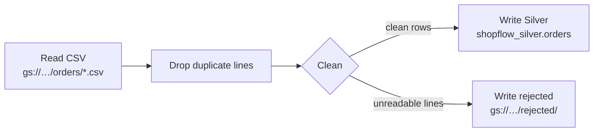

# Dataflow: clean orders into Silver

## Concept

### Dataflow and Apache Beam
**Dataflow** is Google's managed service for data-processing jobs. You don't write "Dataflow
code": you write an **Apache Beam** pipeline (open source, in Python or Java), and Dataflow runs
it. Dataflow starts the VMs, splits the work across them, retries failed pieces, scales the
number of VMs and shuts them down when the job ends.

In the lab, a Spark job does this work. The ideas map one to one:

| Spark (lab) | Beam / Dataflow |
|---|---|
| DataFrame | **PCollection**: a dataset flowing through the pipeline |
| a transformation (`filter`, `dropDuplicates`, …) | **PTransform**: a step, such as `Map`, `FlatMap`, `Distinct` |
| the Spark cluster | the **runner**: `DirectRunner` (your shell) or `DataflowRunner` (Google's VMs) |
| `spark.read.csv(...)` / `df.write...` | **I/O connectors**: `ReadFromText`, `WriteToBigQuery`, … |

The same Beam file runs on either runner. You test it on **DirectRunner** in Cloud Shell, which
is free, quick and prints errors straight away. Then you run it on **DataflowRunner**, where it
scales and shows up in the console.

### Batch and streaming
Beam handles **batch** (a fixed set of files, like here) and **streaming** (endless events, e.g.
from Pub/Sub) with the same transforms. This lesson is batch. A batch job stops by itself when the
input is done.

### The plan for ShopFlow orders


Cleaning rules, the same ones you'd write in Spark:

- duplicate lines: keep one
- `status` and `channel`: trim spaces, lower case (` Delivered `, `DELIVERED` → `delivered`)
- empty `currency` → `USD`
- `customer_id`, `order_id` → integers, `order_ts` → a timestamp, empty `promo_id` → `NULL`
- a line where any of that fails (`unknown`, `not a date`) is **not dropped silently**. It goes
  to `rejected/`, where someone can look at it.

## Lab

### 1 · Let Dataflow's workers read and write
Dataflow's VMs run as the project's **Compute Engine default service account**, a robot account
named `PROJECT_NUMBER-compute@developer.gserviceaccount.com`. Give it exactly what this job needs:

```bash
PROJECT_NUMBER=$(gcloud projects describe $PROJECT --format='value(projectNumber)')
SA=${PROJECT_NUMBER}-compute@developer.gserviceaccount.com
for role in dataflow.worker storage.objectAdmin bigquery.dataEditor bigquery.jobUser; do
  gcloud projects add-iam-policy-binding $PROJECT \
      --member=serviceAccount:$SA --role=roles/$role --condition=None --quiet > /dev/null
done
echo "granted to $SA"
```

- **`gcloud projects describe … --format='value(projectNumber)'`** prints just the project
  *number* (digits, not the ID). The service account's name is built from it.
- **A service account** is an identity for a program, not a person. IAM **roles** say what it
  may do.
- **`gcloud projects add-iam-policy-binding`** grants a role on the whole project:
  `dataflow.worker` (run Dataflow work), `storage.objectAdmin` (read and write objects),
  `bigquery.dataEditor` (write tables), `bigquery.jobUser` (run load jobs).
- **`--condition=None --quiet`** adds the role with no condition and doesn't ask questions.
  `> /dev/null` hides the long policy it prints.

!!! tip "See the roles in the console"
    Console → **IAM & Admin** → **IAM** → the **View by principals** tab. A **principal** is
    anyone who can be given roles: a person, a group or a service account.

    1. In the **Filter** box, type `compute@`. That leaves the row
       `PROJECT_NUMBER-compute@developer.gserviceaccount.com`, named *Compute Engine default
       service account*.
    2. The **Role** column lists its roles: **BigQuery Data Editor**, **BigQuery Job User**,
       **Dataflow Worker** and **Storage Object Admin**, the four you just granted. Many
       projects also show **Editor** there, which Google grants to this account when Compute
       Engine is turned on.
    3. **✏️ Edit principal** (the pencil at the end of the row) shows the same roles, where you
       can also add or remove one by hand.

    The account itself is under **IAM & Admin** → **Service accounts**. That page lists the
    project's service accounts; the roles are on the **IAM** page.

    The same check from Cloud Shell:

    ```bash
    gcloud projects get-iam-policy $PROJECT --flatten="bindings[].members" \
        --filter="bindings.members:$SA" --format="value(bindings.role)"
    ```

    - **`get-iam-policy`** prints the project's whole policy: which roles each principal has.
    - **`--flatten`** makes one row per role and member, **`--filter`** keeps only `$SA`'s rows,
      and **`--format="value(bindings.role)"`** prints just the role names.

    ```
    roles/bigquery.dataEditor
    roles/bigquery.jobUser
    roles/dataflow.worker
    roles/editor
    roles/storage.objectAdmin
    ```

    (`roles/editor` appears only if Google granted it to this account.)

### 2 · Get the pipeline and install Beam
```bash
curl -sLO https://maarthala.github.io/data-engineering-lab/assets/gcp/silver_orders.py
python3 -m venv ~/beam
source ~/beam/bin/activate
pip install -q 'apache-beam[gcp]'
```

- **`curl -sLO URL`** downloads a file into the current folder (`-s` quiet, `-L` follow
  redirects, `-O` keep the file's name). The same file is here:
  [:material-download: silver_orders.py](../assets/gcp/silver_orders.py){: download="silver_orders.py" }
- **`python3 -m venv ~/beam`** makes a private Python environment, so Beam's packages don't clash
  with Cloud Shell's own. **`source ~/beam/bin/activate`** switches to it, and your prompt
  starts with `(beam)`. After a Cloud Shell restart, run the `source` line again.
- **`pip install 'apache-beam[gcp]'`** installs Beam with its Google Cloud connectors
  (`[gcp]`). It takes 2–3 minutes.

### 3 · Read the pipeline
Open it with **Open Editor** (Cloud Shell's top bar) or `cat silver_orders.py`. The parts:

```python
def clean(line):
    try:
        order_id, customer_id, channel, order_ts, status, currency, promo_id = next(csv.reader([line]))
        row = {"order_id": int(order_id), "customer_id": int(customer_id),
               "channel": channel.strip().lower(), ...,
               "currency": currency.strip().upper() or "USD",
               "promo_id": int(promo_id) if promo_id else None}
        if row["status"] not in STATUSES:
            raise ValueError(...)
        yield row
    except ValueError:
        yield beam.pvalue.TaggedOutput("rejected", line)
```

- **`next(csv.reader([line]))`** splits one CSV line into its values, respecting quotes. (A
  plain `line.split(",")` breaks on a value like `"Home, Kitchen"`.)
- **`int("unknown")`** and **`datetime.strptime("not a date", …)`** raise **`ValueError`**, and
  that lands in `except`.
- **`.strip().lower()`** removes outer spaces, then lower-cases. **`x or "USD"`** gives `"USD"`
  when `x` is empty.
- **`yield`** makes `clean` a *generator*: it hands back one result per line, either a clean
  row or a **`TaggedOutput("rejected", line)`**, which goes to a second output named
  `rejected`.

```python
with beam.Pipeline(options=PipelineOptions(beam_args)) as p:
    rows = (
        p
        | "Read CSV" >> beam.io.ReadFromText(args.input, skip_header_lines=1)
        | "Drop duplicate lines" >> beam.Distinct()
        | "Clean" >> beam.FlatMap(clean).with_outputs("rejected", main="clean")
    )
    rows.clean | "Write Silver" >> beam.io.WriteToBigQuery(args.output_table, schema=SCHEMA,
        create_disposition=beam.io.BigQueryDisposition.CREATE_IF_NEEDED,
        write_disposition=beam.io.BigQueryDisposition.WRITE_TRUNCATE)
    rows.rejected | "Write rejected" >> beam.io.WriteToText(args.rejected, file_name_suffix=".csv")
```

- **`with beam.Pipeline(...) as p:`** builds the pipeline. It **runs when the `with` block
  ends**. Nothing happens line by line.
- **`|`** applies a step to a PCollection. **`"Name" >> step`** names the step; the name is what
  you see in the Dataflow graph.
- **`ReadFromText(path, skip_header_lines=1)`**: one element per line from every file matching
  the path, skipping each file's header.
- **`beam.Distinct()`** keeps one copy of each identical element: the 150 duplicate lines go.
- **`beam.FlatMap(fn)`** calls `fn` per element; `fn` may give back zero, one or many results
  (here always one). **`.with_outputs("rejected", main="clean")`** splits the results into
  `rows.clean` and `rows.rejected`.
- **`WriteToBigQuery`**: `schema` is `name:TYPE,…`, `CREATE_IF_NEEDED` makes the table,
  `WRITE_TRUNCATE` replaces its rows on every run, so reruns are safe.
- **`WriteToText(prefix, file_name_suffix=".csv")`** writes files named
  `prefix-00000-of-00001.csv`. Beam splits output into **shards** (parts) and numbers them.
- **`parse_known_args()`** takes this script's own options (`--input`, `--output_table`,
  `--rejected`) and passes all the others (`--runner`, `--region`, …) to Beam as `beam_args`.

### 4 · Test it in Cloud Shell (DirectRunner)
```bash
python silver_orders.py \
    --input "gs://$BUCKET/shopflow/orders/*.csv" \
    --output_table $PROJECT:shopflow_silver.orders \
    --rejected gs://$BUCKET/rejected/orders \
    --temp_location gs://$BUCKET/tmp \
    --project $PROJECT
```

- No `--runner` means **DirectRunner**: it runs inside Cloud Shell.
- **`--temp_location`**: `WriteToBigQuery` first writes files there, then loads them with a load
  job.

It takes about a minute and ends without an error. In BigQuery Studio:

```sql
select count(*) as orders from shopflow_silver.orders;
```

| orders |
|---|
| 39900 |

40,150 lines − 150 duplicates − 100 rejected = **39,900**. Check the rejects:

```bash
gcloud storage cat gs://$BUCKET/rejected/orders*.csv | wc -l
gcloud storage cat gs://$BUCKET/rejected/orders*.csv | head -3
```

- **`wc -l`** counts lines.

```
100
24418,unknown,app,2025-09-18 07:04:52,delivered,EUR,
32188,436,marketplace,not a date,delivered,USD,
13254,N/A,wholesale,2026-04-10 20:18:17,delivered,INR,
```

(The order of the lines can differ.)

### 5 · Run it on Dataflow
Same command, plus three options:

```bash
python silver_orders.py \
    --input "gs://$BUCKET/shopflow/orders/*.csv" \
    --output_table $PROJECT:shopflow_silver.orders \
    --rejected gs://$BUCKET/rejected/orders \
    --temp_location gs://$BUCKET/tmp \
    --project $PROJECT \
    --runner DataflowRunner --region $REGION --job_name silver-orders
```

- **`--runner DataflowRunner`** sends the job to Dataflow instead of running it here.
- **`--region`**: where the worker VMs run, the same region as the bucket and the datasets.
- **`--job_name`**: lower-case letters, digits and `-`. It's the name in the console.

The command waits until the job ends, which takes **5–8 minutes**: most of that is starting the
VMs. While it runs: Console → **Dataflow** → **Jobs** → `silver-orders`.

- The **job graph** shows your named steps: *Read CSV → Drop duplicate lines → Clean → Write
  Silver / Write rejected*. Click a step to see how many elements went in and out.
- **Job metrics** shows the workers: usually 1 VM for this little data.
- **Logs** (bottom panel) is where Python errors show up if a step fails.

When it shows **Succeeded**, `select count(*) from shopflow_silver.orders` is still **39,900**.
`WRITE_TRUNCATE` replaced the rows; it didn't add them a second time.

!!! tip "Cost"
    A small batch job like this costs a few cents: VMs per second while the job runs, nothing
    after. A batch job ends by itself, so there's nothing to stop.

### 6 · Look at Silver
```sql
select status, count(*) as orders
from shopflow_silver.orders
group by status
order by orders desc;
```

| status | orders |
|---|---|
| delivered | 28005 |
| placed | 4096 |
| cancelled | 3907 |
| shipped | 3892 |

Four statuses instead of twelve, and the right number of delivered orders. Open
`shopflow_silver.orders` → **Schema**: `order_id` `INTEGER`, `order_ts` `TIMESTAMP`, `promo_id`
`INTEGER` (nullable): typed by the pipeline's `SCHEMA`.

!!! note "No code at all: Dataflow templates"
    Dataflow also has ready-made **templates** (Console → Dataflow → **Create job from
    template**), e.g. *Text Files on Cloud Storage to BigQuery*. You fill in a form instead of
    writing Beam. They're fine for plain copies. Rules like the ones above need your own pipeline.

## Check yourself
1. What's the difference between DirectRunner and DataflowRunner? *(Same code. DirectRunner runs
   it in your shell for testing, and DataflowRunner runs it on Google's VMs and scales.)*
2. Why does a bad line go to `rejected/` instead of being dropped? *(So nothing disappears
   unseen: someone can count it, look at it, fix the source and reload.)*
3. You run the Dataflow job twice. How many rows are in Silver? *(39,900. `WRITE_TRUNCATE`
   replaces the table's rows every run.)*
