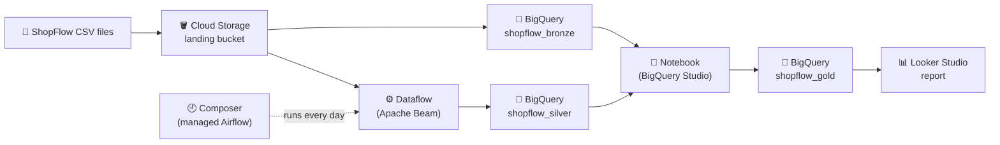

# Your Google Cloud trial & project

This part of the course happens **in Google Cloud itself**, not in the lab. You bring a Google
Cloud **free trial**, land the **ShopFlow** files in Cloud Storage, and build the same Bronze →
Silver → Gold pipeline you built in the lab, this time with Google's managed services:



| Lab (this course) | Google Cloud | Lesson |
|---|---|---|
| My files (object storage) | **Cloud Storage** | [Cloud Storage: land the ShopFlow files](storage.md) |
| Trino / Iceberg tables | **BigQuery** | [BigQuery: Bronze from your files](bigquery.md) |
| Spark job | **Dataflow** (Apache Beam) | [Dataflow: clean orders into Silver](dataflow.md) |
| Jupyter notebook | **BigQuery Studio notebook** (Colab Enterprise) | [Notebook: build Gold](notebook.md) |
| Airflow | **Cloud Composer** | [Composer: orchestrate the pipeline](composer.md) |
| Superset | **Looker Studio** | [A small report in Looker Studio](report.md) |

!!! info "Why your own account?"
    These are managed cloud services: there's no copy of them to run in the lab. What you learned
    in the lab carries over (files → Bronze → Silver → Gold, SQL, DataFrames, DAGs). What's new
    here is **how Google Cloud does it**: projects, buckets, IAM, regions and paying per use.

## Concept

### The free trial
New Google Cloud customers get a **free trial**: **US$300 of credit for 90 days**. Sign-up asks
for a card to check you're a real person. Google does **not** charge it when the trial ends,
unless you click **Activate full account** yourself. When the credit or the 90 days run out, your
resources stop.

This unit costs a few dollars of the credit if you follow the clean-up steps. Two things cost
more if you forget them:

- **Cloud Composer** bills every hour it exists, even when no DAG runs. Its lesson tells you
  when to create it and when to delete it. You can also skip it and practise the same DAG in the
  lab's Airflow.
- **A notebook runtime** (a small VM) bills while it runs. Its lesson shows how to stop it.

### Projects
Everything in Google Cloud lives in a **project**: the resources, the bill and who may use
them. A project has a **name** (free text) and a **project ID** (unique worldwide, e.g.
`shopflow-de-4821`). Commands and code use the **ID**. Deleting the project deletes everything
in it, which makes it the simplest clean-up there is.

### The console and Cloud Shell
- **Google Cloud console** (`console.cloud.google.com`) is the web UI. The **project picker** at
  the top says which project you're working in.
- **Cloud Shell** is a free Linux terminal in the browser: click the **>_** icon (top right).
  It has `gcloud`, `bq`, Python and your login already set up. Every command in this unit runs
  there.

### Regions
Google Cloud runs in **regions** such as `us-central1` (Iowa) or `europe-west1` (Belgium). Put
the bucket, the BigQuery datasets, Dataflow and Composer in **one region**. BigQuery can only
load from a bucket in the same location, and moving data between regions costs money. This unit
uses **`us-central1`**: it's cheap, has every service, and its Cloud Storage falls under the free
tier. Pick another one if you like, but then use it everywhere.

## Lab

### 1 · Start the trial and create the project
1. Go to `cloud.google.com/free` → **Get started for free**. Sign in with a Google account and
   finish the sign-up.
2. In the console: the project picker (top bar) → **New project**. Name it `shopflow-de`. Google
   suggests a project ID; note it down.
3. Make sure the project picker now shows **shopflow-de**.

### 2 · Set a budget alert
Console → **Billing** → **Budgets & alerts** → **Create budget**:

- **Name**: `shopflow-de`, **Projects**: `shopflow-de`
- **Amount**: `20` (USD)
- **Actions**: keep the alerts at 50 %, 90 % and 100 %

!!! warning "A budget sends e-mail. It doesn't stop anything."
    Google e-mails you when spending crosses a threshold, but nothing is stopped or capped. The
    clean-up steps are what keep the bill at zero.

### 3 · Open Cloud Shell and set your variables
Open Cloud Shell (**>_**) and run:

```bash
gcloud config set project YOUR_PROJECT_ID
echo 'export PROJECT=$(gcloud config get-value project 2>/dev/null)' >> ~/.bashrc
echo 'export REGION=us-central1'                                      >> ~/.bashrc
echo 'export BUCKET=${PROJECT}-shopflow'                               >> ~/.bashrc
source ~/.bashrc
echo "$PROJECT | $REGION | $BUCKET"
```

- **`gcloud config set project`** makes every `gcloud` and `bq` command use this project.
  Replace `YOUR_PROJECT_ID` with the ID from step 1.
- **`echo '…' >> ~/.bashrc`** appends a line to `~/.bashrc`, which runs every time Cloud Shell
  opens. Your variables survive a Cloud Shell restart (Cloud Shell stops after an hour or so idle).
- **`export NAME=value`** sets a shell variable that later commands read as `$NAME`.
  `$(gcloud config get-value project)` runs that command and puts its output (the project ID)
  there.
- **`source ~/.bashrc`** runs the file now, so you don't have to reopen the shell.

Example output:

```
shopflow-de-4821 | us-central1 | shopflow-de-4821-shopflow
```

Bucket names are worldwide, so starting the name with your project ID makes it unique.

### 4 · Turn on the services
A new project has most services (APIs) switched off. Turn on the ones this unit uses:

```bash
gcloud services enable storage.googleapis.com bigquery.googleapis.com \
    dataflow.googleapis.com compute.googleapis.com \
    aiplatform.googleapis.com dataform.googleapis.com
```

- **`gcloud services enable`** switches an API on for the project. Enabling one costs nothing;
  only using it does. It takes a minute or two.
- `dataflow` runs Beam pipelines on `compute` (VMs). `aiplatform` and `dataform` are what
  BigQuery Studio notebooks run on.

Check it:

```bash
gcloud services list --enabled | grep -E "storage|bigquery|dataflow|compute"
```

- **`gcloud services list --enabled`** lists the APIs that are on. **`grep -E "a|b"`** keeps only
  the lines that contain one of the words.

You should see lines like `bigquery.googleapis.com  BigQuery API` and
`dataflow.googleapis.com  Dataflow API`.

## Check yourself
1. Where does every resource of this unit live, and what's the quickest way to remove all of it?
   *(In the project `shopflow-de`. Deleting the project removes everything.)*
2. Does the budget stop spending at US$20? *(No. It only sends e-mails.)*
3. Why does everything go in one region? *(BigQuery loads only from a bucket in the same
   location, and moving data between regions costs money.)*
