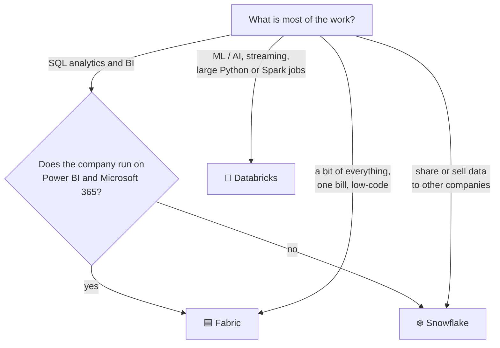

# Which platform for which job: Snowflake, Databricks or Fabric

All three can run a Bronze→Silver→Gold pipeline like ShopFlow's — the [component
map](rosetta.md) shows the same building blocks in each. They differ in **who they're built for**,
**how you pay**, and **what they do best**. This page helps you pick, and explain the choice.

## In one line each

| Platform | Built around | Best when |
|---|---|---|
| ❄️ **Snowflake** | a **SQL data warehouse** run for you | the work is mostly SQL and analytics, many users query at once, and nobody wants to run infrastructure |
| 🧱 **Databricks** | **Spark** and the **lakehouse** (open Delta / Iceberg files) | the work includes heavy engineering, streaming, data science and machine learning on large data |
| 🟦 **Microsoft Fabric** | **one SaaS for the whole Microsoft data stack** around OneLake and Power BI | the company runs on Microsoft 365, Azure and Power BI and wants one product and one bill |

## Strengths and weak spots

### ❄️ Snowflake
**Strong at**

- **Almost no administration** — no clusters, files or tuning; storage is managed for you (the
  [micro-partitions](../snowflake/performance.md) lesson).
- **Concurrency** — separate warehouses per team, multi-cluster for peaks; loading never slows BI.
- **SQL experience** — what analysts and SQL developers already know; quick to be productive.
- **Data sharing & Marketplace** — share live tables with partners or customers, no copies, no ETL.
- **Governance** — RBAC, masking and row access policies, Time Travel, cloning
  ([security](../snowflake/security.md), [cloning](../snowflake/clone-time-travel.md)).
- **Semi-structured data** in SQL with `VARIANT` ([JSON](../snowflake/json.md)).

**Weaker at**

- **Machine learning at scale** — Snowpark and Cortex cover a lot, but Databricks has the
  deeper ML tooling.
- **Low-latency streaming** — Snowpipe Streaming and dynamic tables give seconds to minutes, not
  milliseconds.
- **Cost surprises** — warehouses left running, a 1-minute `target_lag`, oversized warehouses
  ([cost](../snowflake/cost.md)). Needs resource monitors and habits.
- **Openness** — native tables are Snowflake's format; Iceberg tables are the open option.

### 🧱 Databricks
**Strong at**

- **Big, complex engineering** — Spark for TB–PB batch jobs, Python/Scala/SQL in one place.
- **Streaming** — Structured Streaming and declarative pipelines for continuous data.
- **Data science and ML / AI** — notebooks, MLflow, model serving, feature tables, GPUs.
- **Open lakehouse** — data stays as Delta (or Iceberg) files in **your** cloud storage; other
  engines can read it.
- **One catalog** for tables, files, models and notebooks.

**Weaker at**

- **More to understand** — clusters, Spark, file layout, `OPTIMIZE`/`VACUUM`; serverless helps
  but the skill bar is higher than Snowflake's.
- **Two bills** — Databricks units *plus* your cloud provider's compute and storage (serverless
  bundles them).
- **Pure BI for many casual users** — SQL warehouses do it well, but it's not where it started.

### 🟦 Microsoft Fabric
**Strong at**

- **Microsoft shops** — Entra ID sign-in, Microsoft 365, Teams, Purview, Azure — all built in.
- **Power BI** — Direct Lake reads OneLake tables without import or refresh; the best Power BI
  experience of the three.
- **One product for everything** — data factory pipelines, Spark, warehouse, real-time
  intelligence, Power BI, all in one workspace.
- **Capacity pricing** — one fixed capacity (F SKU) per month that every workload shares; easy
  to budget.
- **Low-code** — Dataflows and pipelines for teams with fewer engineers.

**Weaker at**

- **Maturity** — the youngest of the three; features and limits still change often.
- **Capacity sharing** — one heavy Spark job can slow everyone's Power BI on the same capacity
  (throttling); needs capacity planning.
- **Outside the Microsoft world** — works, but loses most of its advantage.

## Which solution for which business case

| Business case | Best fit | Why | Also works |
|---|---|---|---|
| Enterprise data warehouse for finance, sales, HR reporting | ❄️ Snowflake | SQL, concurrency, governance, little admin | 🟦 Fabric (Warehouse) |
| Self-service BI for hundreds of analysts | ❄️ Snowflake | per-team warehouses, multi-cluster, result cache | 🟦 Fabric if they live in Power BI |
| Company standardised on **Power BI** and Microsoft 365 | 🟦 Fabric | Direct Lake, Entra, one bill | ❄️ Snowflake + Power BI |
| Sharing data with partners, suppliers, customers | ❄️ Snowflake | secure data sharing, Marketplace, reader accounts | 🧱 Databricks (Delta Sharing) |
| Selling data as a product | ❄️ Snowflake | Marketplace listings, billing | 🧱 Databricks Marketplace |
| Machine learning: forecasting, recommendations, churn | 🧱 Databricks | MLflow, feature tables, GPUs, model serving | ❄️ Snowpark ML for SQL-heavy teams |
| Generative AI / LLM apps on company data | 🧱 Databricks | model serving, vector search, fine-tuning | ❄️ Cortex for SQL-level AI (summaries, sentiment) |
| IoT and sensor data, near-real-time (e.g. building telemetry every 10 s) | 🧱 Databricks | Structured Streaming, large volumes | 🟦 Fabric Real-Time Intelligence (Eventhouse/KQL) |
| Log and event analytics, time-series dashboards | 🟦 Fabric (Eventhouse/KQL) | built for fast queries on event streams | 🧱 Databricks |
| Very large batch ETL (TB–PB), complex Python transformations | 🧱 Databricks | Spark, full control of compute | ❄️ Snowflake for SQL-shaped ELT |
| SQL-centred ELT with dbt | ❄️ Snowflake | dbt's most common pairing; dynamic tables | 🧱 Databricks SQL, 🟦 Fabric Warehouse |
| Open data lake, avoid lock-in, several engines on the same files | 🧱 Databricks | Delta/Iceberg in your storage | ❄️ Snowflake Iceberg tables, 🟦 OneLake shortcuts |
| Migrating an on-prem SQL Server / SSIS / SSAS estate | 🟦 Fabric | same Microsoft skills and tools | ❄️ Snowflake |
| Migrating Teradata / Oracle / Netezza warehouses | ❄️ Snowflake | closest warehouse model, mature migration tooling | 🧱 Databricks |
| Migrating Hadoop / Hive / on-prem Spark | 🧱 Databricks | same engine, same concepts | 🟦 Fabric Spark |
| Small team, little engineering, quick results | ❄️ Snowflake or 🟦 Fabric | managed, SQL or low-code | — |
| Strict regulated data (banking, health) | any of the three | all offer encryption, private networking, compliance certificates; pick by the rest of the stack | — |

## A quick decision path

## How you pay

| | ❄️ Snowflake | 🧱 Databricks | 🟦 Fabric |
|---|---|---|---|
| Compute | **credits per second** while a warehouse runs | **DBUs** per second + cloud VMs (or serverless, bundled) | **capacity** (F SKU), a fixed amount per hour/month shared by all workloads |
| Storage | per TB per month (managed) | your cloud storage bill | OneLake per TB per month |
| Idle cost | none if warehouses auto-suspend | none if clusters auto-terminate | the capacity costs money while it's on (pause it) |
| Budget control | resource monitors, budgets | budgets, cluster policies | capacity size + pause/resume |
| Typical risk | warehouses that never suspend | clusters left running, oversized | an overloaded capacity throttles everyone |

## They're often combined

Many companies use two of them:

- **Databricks for engineering and ML, Snowflake for the warehouse and sharing** — Gold tables
  in Iceberg/Delta, read by both.
- **Databricks or Snowflake for the data, Power BI (or Fabric) for reporting** — Fabric can
  *shortcut* Snowflake or Databricks data into OneLake instead of copying it.
- **Fabric for the Microsoft side, Databricks for heavy Spark** — both read Delta in ADLS/OneLake.

Open table formats (Delta, Iceberg) make this easier: one copy of the data, several engines.

## What this course gives you for each

Everything you built on the open-source stack carries over:

| You learned here | Snowflake | Databricks | Fabric |
|---|---|---|---|
| SQL, `MERGE`, window functions, SCD2 | same | same | same |
| Medallion layers | raw / staging / marts | Bronze / Silver / Gold | Bronze / Silver / Gold on OneLake |
| Spark (PySpark) | Snowpark (similar API) | Spark itself | Fabric Spark notebooks |
| Iceberg + Polaris (catalog, RBAC) | Iceberg tables, Open Catalog, RBAC | Delta + the Databricks catalog | OneLake + workspace roles + Purview |
| Airflow DAGs | tasks & streams | Workflows / Jobs | Data Factory pipelines |
| dbt | dbt-snowflake | dbt-databricks | dbt-fabric |

## Check yourself
1. A retailer wants daily sales reports for 300 store managers in Power BI, and IT is all
   Microsoft. Which platform first? *(Fabric — Power BI and Entra are built in.)*
2. A team needs churn prediction models retrained weekly on 5 TB of clickstream. *(Databricks —
   Spark for the data, MLflow for the models.)*
3. A data provider wants to give 50 customers live access to their own slice of the data without
   sending files. *(Snowflake — secure data sharing with row access policies.)*
