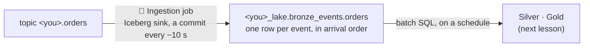

# Land events in Bronze

## Concept
Kafka keeps events for 24 hours, then they're gone. To keep them, query them with SQL and build
on them, land every event in a lakehouse table: **Bronze**, exactly as it arrived. A stream gives
you rows in **arrival order**, late ones included. Bronze keeps it that way: nothing merged,
nothing dropped. Sorting events out by when they *happened* is the next layer's job.

This is the **ELT** pattern for events: **E**xtract and **L**oad first (every event, as it came),
**T**ransform later in batch, as often as you like, from a table you can always rebuild from.



## Lab
You need the two streams from [Events, topics and partitions](events.md).

### 1 · The destination
**📡 Ingestion → Destinations → + New destination**:

| Field | Value |
|---|---|
| Name | `Events Bronze` |
| Lakehouse | `<you>_lake` |
| Namespace | **+ New namespace…** → `bronze_events` |

**Save destination**: the namespace is made at once.

### 2 · A Datastream job for orders
First make both streams sources: **Sources → + New source → 📨 Pub/Sub stream** lists your streams;
**Add as source** for *orders* and *clicks*. The **Sources** tab now has *orders (Pub/Sub)* and
*clicks (Pub/Sub)*, with the topic as their connection. (A shortcut: a stream's page on 📨 Pub/Sub has
**🏞 Lakehouse → + New Ingestion job**, which adds it as a source and opens this form with it chosen.)

**Jobs → + New job**:

1. **Source**: **orders (Pub/Sub) · topic &lt;you&gt;.orders**.
2. **Destination**: **Events Bronze**. The line under **Table** says where it lands:
   *Every event of topic &lt;you&gt;.orders → &lt;you&gt;_lake.bronze_events.orders*.
3. **Mode**: **Every event as a new row**, the only mode for a stream.
4. **Runs**: **Datastream**. **Job name**: `orders to Bronze` → **Create & start stream**.

The job streams: *● streaming*, with a live **Log**. Its first commit has every event the topic
still holds, from the oldest, so the table has your whole stream so far, not only what comes next.

### 3 · A Manual job for clicks
The same with **clicks (Pub/Sub)**, **Runs: Manual** → **Create & run**. Its first run:

```text
14:25:51 topic zzcourse.clicks: 71 events kept, 71 not in zzcourse_lake.bronze_events.clicks yet
14:25:51 resumed the sink
14:26:06 the sink has committed everything up to the run's start to Iceberg (156 events)
14:26:06 paused the sink
```

A Manual or Cron run starts the sink, waits until it has saved everything the topic held when the
run began, and pauses it again. The next run continues where this one stopped. It counted 156, not
71, because the stream kept publishing during the 15 seconds and the sink saved those too.

### 4 · What landed
In the SQL editor:

```sql
SELECT event_type, count(*) AS events
FROM <you>_lake.bronze_events.orders
GROUP BY event_type ORDER BY events DESC;
```

```text
   event_type    | events
-----------------+--------
 order_placed    |   2471
 order_paid      |   2034
 order_shipped   |    719
 order_cancelled |    257
 order_delivered |      6
```

Few *delivered* yet: an order takes half an hour to go from placed to delivered. Every row also has
**`_kafka`**, where it came from in Kafka. It's a **row** column (a struct): read its fields with a dot.

```sql
SELECT _kafka.partition AS p, count(*) AS events, min(_kafka.offset) AS first, max(_kafka.offset) AS last
FROM <you>_lake.bronze_events.orders GROUP BY 1 ORDER BY 1;
```

```text
 p | events | first | last
---+--------+-------+------
 0 |   1902 |     0 | 1901
 1 |   1741 |     0 | 1740
 2 |   1844 |     0 | 1843
```

Each partition counts from 0, with no gaps: every event is there once.

### 5 · How late is late?
`date_diff` ([Functions](../unit2/functions.md)) also takes `'millisecond'` and `'second'`. Late
means more than 5 seconds between the two times:

```sql
SELECT count(*) AS events,
       count_if(date_diff('millisecond', event_time, publish_time) > 5000) AS late,
       max(date_diff('second', event_time, publish_time))                AS latest_s
FROM <you>_lake.bronze_events.orders;
```

```text
 events | late | latest_s
--------+------+----------
   5487 |  632 |      584
```

The latest arrived 584 s, almost 10 minutes, after it happened. That's the stream's *up to 10 min*.
Fewer than 20 % are late *so far*: the events of the last minutes that will be late haven't
arrived yet.

### 6 · Out of order
`LAG` ([Window functions](../unit2/window-functions.md)) gives the row before. Here that's the same
order's previous event in **arrival** order: `PARTITION BY order_id ORDER BY _kafka.offset` (one
order's events share a partition, so the offset is their arrival order). An event that happened
*before* the one that arrived ahead of it came out of order:

```sql
SELECT count(*) AS out_of_order
FROM (SELECT event_time,
             LAG(event_time) OVER (PARTITION BY order_id ORDER BY _kafka.offset) AS before_it
      FROM <you>_lake.bronze_events.orders)
WHERE event_time < before_it;
```

```text
 out_of_order
--------------
          278
```

One of them, in arrival order:

```sql
SELECT event_type, event_time, publish_time, _kafka.offset AS o
FROM <you>_lake.bronze_events.orders WHERE order_id = 'o_bdff63fefaa5' ORDER BY _kafka.offset;
```

```text
  event_type   |           event_time           |          publish_time          |  o
---------------+--------------------------------+--------------------------------+------
 order_paid    | 2026-11-03 14:26:00.182000 UTC | 2026-11-03 14:26:00.432000 UTC |   56
 order_placed  | 2026-11-03 14:25:36.602000 UTC | 2026-11-03 14:26:56.879000 UTC |  196
 order_shipped | 2026-11-03 14:31:52.759000 UTC | 2026-11-03 14:31:52.911000 UTC | 1100
```

The payment arrived first. The order it pays for was placed 24 seconds earlier, but that event
reached Kafka 80 seconds late. A report that trusts arrival order would see a payment for an order
that doesn't exist yet. Bronze keeps the order of arrival; the next lessons put things in event
order.

!!! tip "Numbers differ"
    Your streams have their own random orders, delays and bursts: the counts and ids won't match
    these, but the shape will. About 1 in 5 events is late once a stream has run longer than its
    *how late*.

## Check yourself
1. Why land events in Bronze at all, when Kafka already keeps them?
2. A Manual run counted more events than *not in the table yet* at its start. Why?
3. Which column tells you an event's arrival order, and which one when it happened?

??? success "Answers"
    1. Kafka keeps them 24 hours. Bronze keeps them as long as you like, and you can query, join and
       rebuild everything from it with SQL.
    2. The stream kept publishing while the run waited for the sink to save, and those were saved too.
    3. Arrival: `publish_time`, or `_kafka.offset` within a partition. Happened: `event_time`.

## You can now…
- land a stream in Bronze with an Ingestion job (Datastream, Manual or Cron);
- read `_kafka` to see where each row came from;
- measure how late events are, and find events that arrived out of order.
