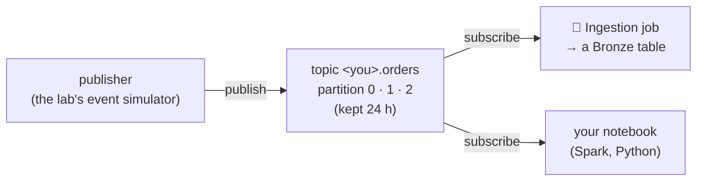

# Events, topics and partitions

## Concept
Change data capture copies **rows**: what a table looks like now, and how it changed. Many systems
also produce **events**: small messages that say *something happened*. Examples are a click on a
product page, an order placed, a payment captured, a box of stock received. An event is never
updated. It happened, at a time, and that's it.

**Publish / subscribe (pub/sub)** is how such events travel. One side **publishes** each event to a
named stream, a **topic**. Any number of others **subscribe** to the topic and read the events at
their own pace. The publisher doesn't know who reads, and readers don't slow it down. The lab runs
**Kafka**, the most used pub/sub system for data:



| Word | Meaning |
|---|---|
| **topic** | a named stream of events, e.g. `<you>.orders`; Kafka keeps them for a while (here 24 h), so a reader can start late or read again |
| **partition** | a topic is split into partitions (here 3) so several readers can work in parallel; inside one partition the events keep their order |
| **offset** | an event's position in its partition: 0, 1, 2 … A reader remembers the offset it got to |
| **key** | each event has one (an order's `order_id`, a click's `session_id`); the same key always goes to the same partition, so one order's events stay in order |
| **consumer group** | readers that share the work and one bookmark (their offsets); two groups each read everything |

Every event here carries two times:

- **`event_time`**: when it happened, on the phone or in the shop.
- **`publish_time`**: when it reached Kafka.

Usually they're a second apart. When a phone was offline, or a till couldn't reach the server, the
event arrives **late**: minutes after it happened, and after events that happened later. Late data
is normal in real systems, and the next lessons are about handling it.

!!! info "Needs the Streaming unit"
    Kafka and the event simulator are the **Streaming** unit, off until a lab manager switches it
    on: on your laptop `make status` → **Streaming** → **s**, on a team stack **Manage → ⚙️ Settings
    → Services → Streaming**. While it's off, the Pub/Sub page says so and nothing is published.

## Lab
### 1 · Make two streams
Open **📨 Pub/Sub** (left menu, Tools) → **+ New stream**:

| Carries | Name | Events a second | Late events | How late | Pattern |
|---|---|---|---|---|---|
| **Orders** | `orders` | 10 | **20 % of events** | up to 10 min | **Random delays** |
| **Click events** | `clicks` | 5 | **20 % of events** | up to 1 min | **Offline bursts** |

**Create & start** each one. The form shows the fields every event has, and its key. The two
patterns:

- **Random delays**: each late event is held back for a random time, so it arrives after events
  that happened later. That's out of order.
- **Offline bursts**: a phone goes offline. Its events wait, then all arrive at once when it's back.
  That's a block of old events.

Within seconds the list says **● publishing** and counts *N sent · 🕓 M late*. Your topics are
`<you>.orders` and `<you>.clicks`. Only you may read them.

### 2 · Peek
Click **orders**. **👀 Peek** shows the last events the simulator sent, newest first, refreshing
every 2 seconds:

```text
Published   Partition · offset   Key              Event          event_time   Late
14:26:00    2 · 58               o_45adbdcba5f8   order_placed   14:26:00     0.8s
14:26:00    2 · 57               o_4c1f54ae72a0   order_placed   14:26:00     0.2s
14:26:00    0 · 83               o_0212d326798d   order_placed   14:26:00     0.3s
14:26:00    2 · 56               o_bdff63fefaa5   order_paid     14:26:00     0.3s
14:26:00    1 · 73               o_b5b37b7a84ed   order_placed   14:25:58     1.5s
```

- **Partition · offset**: three partitions, each counting up on its own (2 · 56, 2 · 57, 2 · 58).
- **Late**: `publish_time - event_time`. Under a second or two is normal travel time.

Click a row for the event itself, as JSON:

```json
{
  "event_id": "30c15529a07e4ad2b462d60a9cdcdf52",
  "event_type": "order_placed",
  "event_time": "2026-11-03T14:26:00.054Z",
  "publish_time": "2026-11-03T14:26:00.834Z",
  "order_id": "o_45adbdcba5f8",
  "customer_id": 1284,
  "items": [{"product_id": 17, "quantity": 1, "price": 18.77}, …],
  "total": 907.29, "currency": "EUR", "country": "FR"
}
```

`customer_id` and `product_id` are Tidewell's real customers and products from the live shop
([Meet the live shop](../cdc/live-shop.md)), so events join with what Ingestion copies from it.

### 3 · See late events arrive
Now open **clicks** and switch Peek to **🕓 Late only**. A burst looks like this: one session on
an iPhone, many events that happened over 10 seconds, all **published in the same millisecond**,
on consecutive offsets of one partition:

```text
Published   Partition · offset   Key              Event          event_time   Late
14:25:57    2 · 61               s_53e80413ee3a   product_view   14:25:45     🕓 +11.5s
14:25:57    2 · 60               s_53e80413ee3a   product_view   14:25:43     🕓 +13.5s
14:25:57    2 · 59               s_53e80413ee3a   search         14:25:43     🕓 +13.9s
…
14:25:57    2 · 49               s_53e80413ee3a   page_view      14:25:34     🕓 +22.3s
```

On **orders**, late events trickle in one at a time instead, up to 10 minutes after they happened.

### 4 · Pause, settings, limits
- **⏸ Pause** stops publishing. The topic and its events stay. A stream also pauses itself after
  8 hours; **▶ Resume** starts it again.
- **Settings** on the stream's page changes the rate and the late events while it runs.
- **Delete** removes the stream and its topic.
- A lab manager sets how many streams you may have, and how many events a second.

Keep both streams running: the next lessons use them.

## Check yourself
1. Two readers in **different** consumer groups subscribe to `<you>.orders`. How many of the
   events does each one get?
2. Why does every event of one order land in the same partition, and why does that matter?
3. An event shows `event_time 10:00:05` and `publish_time 10:07:40`. What probably happened, and
   which of the two times should a report on "orders per minute" use?

??? success "Answers"
    1. All of them. Each group has its own bookmark. Only readers in the **same** group share the
       events between them.
    2. The partition comes from the key, here `order_id`. Inside a partition events keep their
       order, so *placed → paid → shipped* for one order is read in the order it was published.
    3. It was held back, e.g. a phone without signal, and arrived over 7 minutes late. A report on
       when orders happened uses `event_time`; `publish_time` only says when the lab heard of it.

## You can now…
- explain publish / subscribe, and topic, partition, offset, key and consumer group;
- create a stream of events and read it with Peek;
- tell `event_time` from `publish_time`, and recognise random late events and offline bursts.
