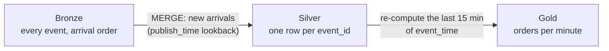

# Silver and Gold from late events (batch)

## Concept
Bronze has every event in arrival order ([Land events in Bronze](bronze.md)). A report needs them
by **event time**: *orders placed per minute*. The catch: a minute isn't finished when it ends.
Some of its orders arrive up to 10 minutes later. A batch job handles that with a **lookback**:

- **Silver** takes only the events that arrived since the last run, plus a margin. It adds each
  one once, keyed by `event_id`, so overlapping runs never add one twice.
- **Gold** doesn't just add the newest minute. Every run re-computes the **last N minutes of
  event time** from Silver. A minute keeps changing while late events come in, then settles.



The lookback plays the role a watermark plays in streaming
([Stream processing in a notebook](stream-processing.md)): the longest lateness you accept. An
event later than it is only counted when you rebuild Gold from Silver completely.

## Lab
In the SQL editor. You need **orders to Bronze** streaming from the last lesson.

### 1 · The two tables
```sql
CREATE TABLE IF NOT EXISTS <you>_lake.silver.order_events AS
SELECT event_id, order_id, event_type, event_time, publish_time, customer_id, total, currency, country
FROM <you>_lake.bronze_events.orders WITH NO DATA;

CREATE TABLE IF NOT EXISTS <you>_lake.gold.orders_per_minute (
  minute timestamp(6) with time zone, orders bigint, revenue double, computed_at timestamp(6) with time zone);
```

**`WITH NO DATA`** makes a table with the columns and types of the `SELECT`, but no rows: a quick
way to copy a shape. Silver drops `items` and `_kafka`; Bronze keeps them.

### 2 · Silver: new arrivals, each once
```sql
MERGE INTO <you>_lake.silver.order_events s
USING (SELECT event_id, order_id, event_type, event_time, publish_time, customer_id, total, currency, country
       FROM <you>_lake.bronze_events.orders
       WHERE publish_time > (SELECT coalesce(max(publish_time), TIMESTAMP '1970-01-01 00:00:00 UTC') - INTERVAL '10' MINUTE
                             FROM <you>_lake.silver.order_events)) b
ON s.event_id = b.event_id
WHEN NOT MATCHED THEN INSERT VALUES (b.event_id, b.order_id, b.event_type, b.event_time, b.publish_time,
                                     b.customer_id, b.total, b.currency, b.country);
```

- **`INTERVAL '10' MINUTE`** is a length of time. A timestamp minus an interval is a timestamp:
  `max(publish_time) - INTERVAL '10' MINUTE` is ten minutes before the newest arrival Silver
  already has. Other units: `SECOND`, `HOUR`, `DAY`.
- The filter takes what arrived since then: the new events, plus some Silver already has (the margin).
- **`MERGE … WHEN NOT MATCHED THEN INSERT`** ([MERGE & upserts](../unit2/merge.md)) adds only the
  `event_id`s that aren't there yet. The margin's events are matched and skipped. That's what makes
  the run safe to repeat.
- The first run has an empty Silver: `coalesce` ([Conditional logic](../unit2/conditional.md))
  turns its `NULL` maximum into 1970, so everything comes in.

```text
MERGE: 6159 rows
```

Run it again straight away: `MERGE: 108 rows`, only the few seconds' worth that arrived meanwhile.
Silver has each event once:

```sql
SELECT count(*) AS rows, count(DISTINCT event_id) AS events FROM <you>_lake.silver.order_events;
```
```text
 rows | events
------+--------
 6159 |   6159
```

### 3 · Gold: re-compute the lookback
```sql
DELETE FROM <you>_lake.gold.orders_per_minute
WHERE minute >= date_trunc('minute', current_timestamp - INTERVAL '15' MINUTE);

INSERT INTO <you>_lake.gold.orders_per_minute
SELECT date_trunc('minute', event_time) AS minute, count(*) AS orders, round(sum(total), 2) AS revenue,
       current_timestamp AS computed_at
FROM <you>_lake.silver.order_events
WHERE event_type = 'order_placed' AND event_time >= date_trunc('minute', current_timestamp - INTERVAL '15' MINUTE)
GROUP BY 1;
```

The last 15 minutes of Gold are thrown away and computed again from Silver. Older minutes stay as
they were. 15, because this stream's events come at most 10 minutes late, plus some room.

```sql
SELECT minute, orders, revenue, computed_at FROM <you>_lake.gold.orders_per_minute ORDER BY minute DESC LIMIT 3;
```
```text
             minute             | orders | revenue  |          computed_at
--------------------------------+--------+----------+--------------------------------
 2026-11-03 14:36:00.000000 UTC |    141 | 58806.16 | 2026-11-03 14:37:01.112000 UTC
 2026-11-03 14:35:00.000000 UTC |    189 | 85862.01 | 2026-11-03 14:37:01.112000 UTC
 2026-11-03 14:34:00.000000 UTC |    182 | 84095.09 | 2026-11-03 14:37:01.112000 UTC
```

(14:36 is still running: that's the minute of the run itself.)

### 4 · Watch late events correct the past
Wait five minutes. Run step 2 (Silver) and step 3 (Gold) again, then look at the same minutes:

```sql
SELECT minute, orders, revenue, computed_at FROM <you>_lake.gold.orders_per_minute
WHERE minute BETWEEN TIMESTAMP '2026-11-03 14:33:00 UTC' AND TIMESTAMP '2026-11-03 14:35:00 UTC' ORDER BY minute;
```
(Use three minutes from your own first run.)

| minute | orders, first run (14:37) | orders, 6 min later (14:43) |
|---|---|---|
| 14:33 | 211 | **234** |
| 14:34 | 182 | **212** |
| 14:35 | 189 | **217** |

Nothing happened again in those minutes. The orders placed then were still on their way. A
report that wrote 14:35 down once, at 14:37, would have missed 28 orders, over 10 %. After 10
minutes, the lateness this stream allows, a minute doesn't change any more.

### 5 · Make it a job
Steps 2 and 3, every few minutes, is a pipeline: one task each in an Airflow DAG
([Schedule ingestion & Spark jobs](../unit5/schedule.md)), Silver first. In dbt it's an
**incremental** model with the lookback in its `is_incremental()` filter
([Incremental models](../dbt/incremental.md)).

## Check yourself
1. Why does Silver's filter use `publish_time`, but Gold's uses `event_time`?
2. You run the Silver `MERGE` twice in a row. Why are no events doubled?
3. An event arrives 20 minutes late. With a 15-minute lookback, is it in Gold? How would you get it in?

??? success "Answers"
    1. Silver picks up what's **new in Bronze**, and that's decided by when events arrived. Gold
       counts what **happened** in each minute, and that's event time.
    2. `WHEN NOT MATCHED` only inserts `event_id`s Silver doesn't have yet. The overlap is matched
       and skipped.
    3. It's in Silver (the next `MERGE` adds it), but its minute is older than the lookback, so
       Gold isn't re-computed for it. Re-compute Gold from Silver completely now and then (e.g.
       nightly), or lengthen the lookback.

## You can now…
- build Silver from Bronze with a lookback that's safe to repeat;
- re-compute a Gold aggregate over a lookback window of event time;
- show how late events change past results, and choose a lookback for them.
