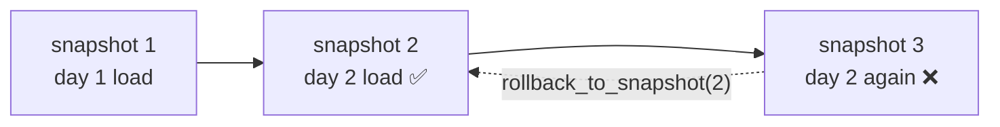

# Undo a bad load: time travel & rollback

## Concept
Sooner or later a load goes wrong. A job is re-run by mistake and appends the same batch twice,
or a bug writes every amount 100 times too big. Downstream reports pick up the bad numbers within
minutes. You need two things fast: **see the table as it was before the bad load**, and **put it
back** — without re-running every load since the beginning.

Our lakehouse tables are **Iceberg** tables, and Iceberg makes this cheap. Every write (create,
append, overwrite, `UPDATE`, `MERGE`) adds new files and records a new **snapshot**: one
complete, committed version of the table. Files are never edited in place, so every earlier
snapshot still points at its own files ([table maintenance](../unit4/table-maintenance.md)
showed the same from the storage side).



- **Time travel** — *read* the table as it was at an earlier snapshot (or time). Nothing changes;
  it's a query.
- **Rollback** — make an earlier snapshot the **current** one again. No data is copied: the table
  just points back at the good snapshot. The bad snapshot stays in the history (you can still
  read it) until it's cleaned up.

!!! warning "Rollback only works while the old snapshot exists"
    `expire_snapshots` ([table maintenance](../unit4/table-maintenance.md)) deletes old snapshots
    and their files. After that you can't travel back to them. That's why platforms keep a few
    days of history by default before expiring.

## Lab
Assume the `spark` session (Spark Connect) and the `my` catalog from Unit {unit:unit4/fundamentals.md}.

### 1 · Two good loads
A tiny `orders` table, loaded on two days:

```python
spark.sql("CREATE SCHEMA IF NOT EXISTS my.recipes")

day1 = spark.createDataFrame([(1, '2026-11-01', 'US', 100.0), (2, '2026-11-01', 'UK', 50.0)],
                             ['order_id', 'order_date', 'country', 'amount'])
day1.writeTo("my.recipes.orders_undo").using("iceberg").createOrReplace()

day2 = spark.createDataFrame([(3, '2026-11-02', 'IN', 20.0), (4, '2026-11-02', 'US', 80.0)],
                             ['order_id', 'order_date', 'country', 'amount'])
day2.writeTo("my.recipes.orders_undo").append()

spark.sql("SELECT count(*) AS orders, sum(amount) AS total FROM my.recipes.orders_undo").show()
```

```
+------+-----+
|orders|total|
+------+-----+
|     4|250.0|
+------+-----+
```

**Read it step by step:**

- **`writeTo(...).using("iceberg").createOrReplace()`** — creates the Iceberg table with the
  day 1 rows (the first snapshot). Re-running the cell starts the table over.
- **`writeTo(...).append()`** — adds the day 2 rows to the existing table: a second snapshot.
- 4 orders, total 250 — the right answer. Remember these two numbers.

### 2 · The bad load: the same batch twice
Someone re-runs the day 2 job. It appends the same rows again — the classic **duplicate load**:

```python
day2.writeTo("my.recipes.orders_undo").append()

spark.sql("SELECT count(*) AS orders, sum(amount) AS total FROM my.recipes.orders_undo").show()
spark.sql("""SELECT order_id, count(*) AS copies FROM my.recipes.orders_undo
             GROUP BY order_id HAVING count(*) > 1""").show()
```

```
+------+-----+
|orders|total|
+------+-----+
|     6|350.0|
+------+-----+

+--------+------+
|order_id|copies|
+--------+------+
|       3|     2|
|       4|     2|
+--------+------+
```

Revenue is now 100 too high, and orders 3 and 4 are there twice. (`GROUP BY … HAVING count(*) > 1`
is the usual duplicate check: keep only the keys that occur more than once.)

### 3 · Find the bad load in the history
Every Iceberg table has **metadata tables** next to it. `<table>.snapshots` lists every snapshot:

```python
snaps = spark.sql("""
    SELECT snapshot_id, parent_id, committed_at, operation, summary['added-records'] AS added
    FROM my.recipes.orders_undo.snapshots
    ORDER BY committed_at""")
snaps.show(truncate=False)
```

```
+-------------------+-------------------+-----------------------+---------+-----+
|snapshot_id        |parent_id          |committed_at           |operation|added|
+-------------------+-------------------+-----------------------+---------+-----+
|6564931515894013147|NULL               |2026-11-02 09:03:01.851|overwrite|2    |
|6148139884424356762|6564931515894013147|2026-11-02 09:03:02.716|append   |2    |
|7316646194385913011|6148139884424356762|2026-11-02 09:03:06.992|append   |2    |
+-------------------+-------------------+-----------------------+---------+-----+
```

Your ids and times differ — they're generated on every write.

**Read it step by step:**

- **`my.recipes.orders_undo.snapshots`** — the table name plus `.snapshots` reads the table's
  history instead of its rows.
- **`snapshot_id`** — the id of that version; **`parent_id`** — the snapshot it was built on
  (the one before it); **`committed_at`** — when the write finished.
- **`operation`** — what kind of write it was: `append` adds rows; the first write shows as
  `overwrite` or `append` depending on how the table was created.
- **`summary['added-records']`** — `summary` is a **map** (key → value) of facts about the write;
  `['added-records']` picks one key: how many rows it added. Other keys include
  `total-records` and `deleted-records`.

The last snapshot is the bad re-run. Its **parent** is the last good version. Pick both ids in
Python so you don't have to copy long numbers:

```python
bad = snaps.collect()[-1]
good_id = bad.parent_id
print("bad:", bad.snapshot_id, " last good:", good_id)
```

- **`snaps.collect()`** — an **action** that brings the rows to Python as a list; **`[-1]`** is
  the last one (the newest snapshot, because we sorted by `committed_at`).
- **`bad.parent_id`** — a field of that row: the snapshot just before the bad load.

### 4 · Look before you roll back: time travel
Check that the good snapshot really holds the right numbers — a read, nothing changes:

```python
spark.sql(f"""SELECT count(*) AS orders, sum(amount) AS total
              FROM my.recipes.orders_undo VERSION AS OF {good_id}""").show()
```

```
+------+-----+
|orders|total|
+------+-----+
|     4|250.0|
+------+-----+
```

- **`VERSION AS OF <snapshot id>`** — read the table as it was at that snapshot.
- **`f"""…{good_id}"""`** — a Python **f-string**: `{good_id}` is replaced by the variable's value.
- You can also travel by time: **`TIMESTAMP AS OF '2026-11-02 09:03:03'`** reads the snapshot
  that was current at that moment.

4 orders, 250 — exactly the state before the bad load.

### 5 · Roll back
Make the good snapshot the current one again:

```python
spark.sql(f"CALL my.system.rollback_to_snapshot('recipes.orders_undo', {good_id})").show()
spark.sql("SELECT count(*) AS orders, sum(amount) AS total FROM my.recipes.orders_undo").show()
```

```
+--------------------+-------------------+
|previous_snapshot_id|current_snapshot_id|
+--------------------+-------------------+
| 7316646194385913011|6148139884424356762|
+--------------------+-------------------+

+------+-----+
|orders|total|
+------+-----+
|     4|250.0|
+------+-----+
```

**Read it step by step:**

- **`CALL my.system.rollback_to_snapshot('recipes.orders_undo', <id>)`** — an Iceberg
  **procedure** (a built-in command run with `CALL`, like `expire_snapshots` in
  [table maintenance](../unit4/table-maintenance.md)). The table name is given *without* the
  catalog (`recipes.orders_undo`); the catalog is the one in `my.system`.
- It answers with the snapshot that **was** current (the bad one) and the one that **is**
  current now (the good one).
- Every reader — Spark, Trino, Superset — now sees 4 orders and 250 again. Nothing was copied, so
  this is instant even on a huge table.

### 6 · The bad load is still in the history
`<table>.history` shows which snapshot was current when:

```python
spark.sql("""SELECT made_current_at, snapshot_id, is_current_ancestor
             FROM my.recipes.orders_undo.history ORDER BY made_current_at""").show(truncate=False)
```

```
+-----------------------+-------------------+-------------------+
|made_current_at        |snapshot_id        |is_current_ancestor|
+-----------------------+-------------------+-------------------+
|2026-11-02 09:03:01.851|6564931515894013147|true               |
|2026-11-02 09:03:02.716|6148139884424356762|true               |
|2026-11-02 09:03:06.992|7316646194385913011|false              |
|2026-11-02 09:03:09.771|6148139884424356762|true               |
+-----------------------+-------------------+-------------------+
```

- **`made_current_at`** — when that snapshot became the current one. The last row is the rollback.
- **`is_current_ancestor`** — `true` when the snapshot is part of the table's current line of
  history. The bad snapshot is now `false`: it's off to the side, but still readable with
  `VERSION AS OF` — useful to investigate what went wrong. `expire_snapshots` removes it later.

!!! tip "Fix the cause too"
    A rollback undoes the damage; it doesn't stop it happening again. The lasting fix is a load
    that's safe to run twice — an **idempotent** load such as `MERGE` on the order key
    ([MERGE & upserts](../unit2/merge.md)) or overwriting just that day's partition — so a re-run
    can't duplicate anything.

## Challenge
A bug multiplies the day 2 amounts by 100. You don't know the snapshot id — only that the table
was fine *before the job ran*.

1. Note the time **before** the bad job: `before = spark.sql("SELECT current_timestamp() AS t").collect()[0].t`.
2. Run the "bug": `UPDATE my.recipes.orders_undo SET amount = amount * 100 WHERE order_date = '2026-11-02'`
   and look at the amounts.
3. Roll back **by time** with the procedure `rollback_to_timestamp`, and check the amounts again.
4. Clean up: drop the table.

??? note "Solution"
    ```python
    before = spark.sql("SELECT current_timestamp() AS t").collect()[0].t

    spark.sql("UPDATE my.recipes.orders_undo SET amount = amount * 100 WHERE order_date = '2026-11-02'")
    spark.sql("SELECT order_id, amount FROM my.recipes.orders_undo ORDER BY order_id").show()

    spark.sql(f"CALL my.system.rollback_to_timestamp('recipes.orders_undo', TIMESTAMP '{before}')").show()
    spark.sql("SELECT order_id, amount FROM my.recipes.orders_undo ORDER BY order_id").show()

    spark.sql("DROP TABLE my.recipes.orders_undo PURGE")
    ```
    After the `UPDATE`, orders 3 and 4 show `2000.0` and `8000.0`; after the rollback they're
    back to `20.0` and `80.0`.

    **Read it step by step:**

    - **`current_timestamp()`** — the time now; `.collect()[0].t` takes it out of the one-row
      result into a Python value.
    - **`UPDATE … SET amount = amount * 100 WHERE …`** — changes rows in place; for Iceberg that
      writes a new snapshot like any other write.
    - **`rollback_to_timestamp('recipes.orders_undo', TIMESTAMP '…')`** — makes current the
      snapshot that was current at that time: the one before the bug. Handy when you know
      *when* things went wrong but not the snapshot id.
    - **`DROP TABLE … PURGE`** — removes the table *and* its files (without `PURGE` the files may
      stay on storage).

!!! tip "🎯 The same idea on Databricks, Snowflake & Fabric"
    **What you just did:** found a bad load in the table's history, read the table as it was
    before it, and pointed the table back at the good version.

    - **Azure Databricks / Microsoft Fabric (Delta Lake)** — `DESCRIBE HISTORY t` lists the
      versions, `SELECT … FROM t VERSION AS OF 5` (or `TIMESTAMP AS OF`) time-travels, and
      `RESTORE TABLE t TO VERSION AS OF 5` rolls back. `VACUUM` ends the history, like
      `expire_snapshots`.
    - **Snowflake** — Time Travel: `SELECT … FROM t AT(OFFSET => -3600)` or
      `BEFORE(STATEMENT => '<query id>')`; to put a table back, clone it at that point
      (`CREATE TABLE t_fixed CLONE t AT(…)`) and swap it in; `UNDROP TABLE` brings back a dropped
      table. History is kept for the table's retention period (1 day by default).

    Versions you can read and restore are a lakehouse and cloud-warehouse standard — only the
    syntax changes.

## Key terms, at a glance
| Term | Plain meaning |
|---|---|
| **Snapshot** | One committed version of an Iceberg table; every write makes one |
| **`<table>.snapshots`** | Metadata table: every snapshot with its id, parent, time, operation, summary |
| **`<table>.history`** | Metadata table: which snapshot was current when |
| **`parent_id`** | The snapshot a write was built on — the version just before it |
| **Time travel** | Read a table as it was: `VERSION AS OF <id>` / `TIMESTAMP AS OF '<time>'` |
| **Rollback** | Make an earlier snapshot current again — no data copied |
| **`rollback_to_snapshot` / `rollback_to_timestamp`** | Iceberg procedures (`CALL my.system.…`) that roll back by id / by time |
| **`is_current_ancestor`** | Whether a snapshot is on the table's current line of history |
| **Duplicate load** | The same batch loaded twice — doubles rows and totals |
| **`expire_snapshots`** | Deletes old snapshots — after it, you can't go back to them |

## You can now…
- Spot a bad load and find it in a table's `.snapshots` history
- Read a table as it was before the bad load with `VERSION AS OF` / `TIMESTAMP AS OF`
- Roll back an Iceberg table with `rollback_to_snapshot` or `rollback_to_timestamp`
- Explain why rollback stops working after `expire_snapshots`, and why idempotent loads are the lasting fix
