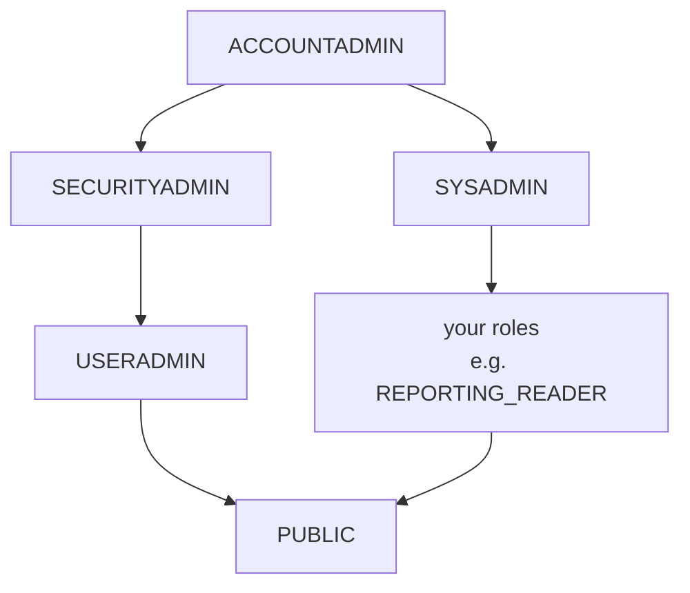

# Roles, grants & data governance

## Concept

### Role-based access control (RBAC)
In Snowflake, **privileges go to roles, roles go to users** — and to other roles, forming a
hierarchy. A user works as one role at a time (`use role …`) and gets everything that role and
the roles below it can do.

The system roles:



| Role | For |
|---|---|
| `ACCOUNTADMIN` | everything — use rarely, give to few people |
| `SECURITYADMIN` | grant and revoke privileges |
| `USERADMIN` | create users and roles |
| `SYSADMIN` | create warehouses, databases and other objects |
| `PUBLIC` | every user has it |

**Best practice:** grant every custom role to `SYSADMIN`, so admins can manage what those roles
create.

It's the same model you used in the lab with Polaris: principals, roles and grants on
catalog → namespace → table ([Grant table access](../unit6/grant-and-query.md)).

To read a table a role needs **three** grants, one per level: `usage` on the **database**, `usage`
on the **schema**, `select` on the **table** — plus `usage` on a **warehouse** to run anything.

### Future grants
`grant select on all tables in schema …` covers the tables that exist **now**. A table created
(or **re-created**) later doesn't get it. **`grant … on future tables in schema …`** covers tables
created later. dbt re-creates its tables on every run, so without future grants a reader loses
access after each `dbt run`.

### Policies *[Enterprise]*
- **Masking policy** — a function on a **column** that decides, per query, what the user sees:
  the real value or a masked one.
- **Row access policy** — a function on a **table** that decides which **rows** a user sees.

Both are attached once and apply in every query, tool and role — nobody can bypass them by
writing a different query.

## Lab

### 1 · A reader role for Gold

```sql
use role useradmin;
create role if not exists REPORTING_READER;

use role securityadmin;
grant role REPORTING_READER to role SYSADMIN;
grant role REPORTING_READER to user <your_user>;      -- your user name: select current_user();

grant usage  on warehouse PRACTICE_WH                    to role REPORTING_READER;
grant usage  on database  SHOPFLOW                       to role REPORTING_READER;
grant usage  on schema    SHOPFLOW.GOLD                  to role REPORTING_READER;
grant select on all tables    in schema SHOPFLOW.GOLD    to role REPORTING_READER;
grant select on all views     in schema SHOPFLOW.GOLD    to role REPORTING_READER;
grant select on future tables in schema SHOPFLOW.GOLD    to role REPORTING_READER;
grant select on future views  in schema SHOPFLOW.GOLD    to role REPORTING_READER;
```

- **`current_user()`** — your user name; put it in place of `<your_user>`.

Test it as the reader:

```sql
use role REPORTING_READER;
use warehouse PRACTICE_WH;

select * from SHOPFLOW.GOLD.DAILY_SALES limit 5;       -- works
select * from SHOPFLOW.BRONZE.CUSTOMERS limit 5;       -- error: does not exist or not authorized

show grants to role REPORTING_READER;
```

Snowflake answers "does not exist **or not authorized**" — it doesn't reveal that a table you
may not see exists.

### 2 · Future grants in action

```sql
use role accountadmin;
create or replace table SHOPFLOW.GOLD.TOP_PRODUCTS as
select product_id, category, sum(line_revenue) as revenue
from SHOPFLOW.SILVER.ORDER_LINES
group by product_id, category
order by revenue desc
limit 10;

use role REPORTING_READER;
select * from SHOPFLOW.GOLD.TOP_PRODUCTS;     -- works: the future grant covered it
```

Revoke the future grant, re-create the table, and the reader loses access — what happens to a
dbt project without it.

!!! tip "dbt link"
    In a real project, dbt runs as its own `DBT_ROLE` (owning the SILVER and GOLD schemas) — not
    as `ACCOUNTADMIN`.

### 3 · Mask e-mail addresses *[Enterprise]*

```sql
use role accountadmin;
use schema SHOPFLOW_DEV.PRACTICE;

create or replace masking policy EMAIL_MASK as (val varchar) returns varchar ->
  case when current_role() in ('ACCOUNTADMIN', 'SYSADMIN') then val
       else regexp_replace(val, '.+@', '*****@')
  end;

alter table SHOPFLOW_DEV.BRONZE.CUSTOMERS
  modify column email set masking policy EMAIL_MASK;
```

- **`current_role()`** — the role running the query; policies usually decide on it.
- **`regexp_replace(text, pattern, replacement)`** — replace what the pattern matches.

Let the reader see the dev customers, then compare:

```sql
grant usage  on database SHOPFLOW_DEV                    to role REPORTING_READER;
grant usage  on schema   SHOPFLOW_DEV.BRONZE             to role REPORTING_READER;
grant select on table    SHOPFLOW_DEV.BRONZE.CUSTOMERS   to role REPORTING_READER;

select email from SHOPFLOW_DEV.BRONZE.CUSTOMERS limit 2;  -- customer1@example.com

use role REPORTING_READER;
select email from SHOPFLOW_DEV.BRONZE.CUSTOMERS limit 2;  -- *****@example.com
```

### 4 · Row access: UK customers only *[Enterprise]*

```sql
use role accountadmin;

create or replace row access policy SHOPFLOW_DEV.PRACTICE.UK_ONLY
  as (country_col varchar) returns boolean ->
  current_role() in ('ACCOUNTADMIN', 'SYSADMIN') or country_col = 'UK';

alter table SHOPFLOW_DEV.BRONZE.CUSTOMERS
  add row access policy SHOPFLOW_DEV.PRACTICE.UK_ONLY on (country);

select country, count(*) from SHOPFLOW_DEV.BRONZE.CUSTOMERS group by country;  -- all countries

use role REPORTING_READER;
select country, count(*) from SHOPFLOW_DEV.BRONZE.CUSTOMERS group by country;  -- UK only
```

The same query, different results per role — and the reader's e-mails are still masked.

!!! info "Learn next"
    **Object tagging** and **tag-based masking** (one policy for every column tagged `PII`),
    **`ACCESS_HISTORY`** (who read which column), **data classification** (Snowflake finds PII
    for you), **secure views** and **data sharing**.

## Check yourself
1. A reader has `select` on a table but gets "does not exist or not authorized". What's missing?
   *(`usage` on the database or schema — or a warehouse to run on.)*
2. After every `dbt run`, the BI tool loses access to Gold. Fix? *(`grant select on future
   tables in schema …` to the BI role.)*
3. Masking policy or row access policy — which hides whole customers? *(Row access. Masking
   changes column values.)*
