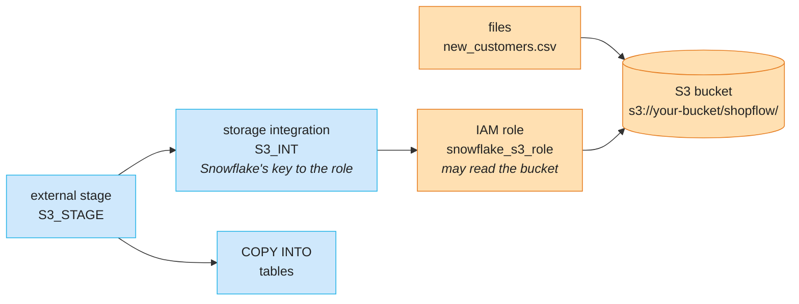

# Stages: upload & load files

A **stage** is where Snowflake meets **files**: you put a file in a stage, then load it into a
table. This lesson does that twice — with an **internal** stage inside Snowflake, uploading
from your computer (Lab A), and with an **external** stage on your own **AWS S3** bucket
(Lab B) — and shows where each appears in the web UI.

## Concept

### Internal and external stages
A **stage** is a place for **files** that Snowflake can load from or unload to:

- **Internal stage** — storage inside Snowflake (`create stage …`). Upload in the web UI
  (**Catalog → Explorer**) or with `PUT`.
- **External stage** — your own S3 / ADLS / GCS location, connected through a **storage
  integration** (the cloud-side permission).

A **file format** describes the files (CSV with header? JSON? Parquet?). **`COPY INTO`** loads
files into a table — or unloads a query into files. Snowflake remembers **which files it already
loaded** (load history, 64 days), so running the same `COPY` twice doesn't duplicate data.

It's the lab's ingestion flow — files in a bucket (RustFS), read into Bronze tables — as SQL
commands.

### Where stages show up in the web UI

| Where (left icon bar) | Shows | Used in |
|---|---|---|
| database icon → **Catalog → Explorer** (the *Catalog explorer* page) | databases → schemas → **Stages**: each stage's files, **Upload Files** (internal stages) | Lab A, step 4 · Lab B, step 5 |
| **+** (**Create**, near the top) → **Stage** | a dialog that creates a stage — **External Stage** for S3 / Azure / GCS — and shows its SQL | Lab B, step 5 |
| database icon → **Catalog → Connections** (earlier: **External data**) | **Data connections**: link an external **Iceberg catalog** (AWS Glue, S3 Tables, Databricks Unity Catalog, OneLake, any REST catalog) and query its tables **without copying** them. **Metadata connections** *(preview)*: lineage from BI tools, other databases and dbt. **Not** for stages | Lab B, step 6 |

### Files in AWS S3
A **public** bucket needs only its URL. A **private** one needs three more pieces:



| Piece | Where | What it is |
|---|---|---|
| **S3 bucket** | AWS | the folder in the cloud that holds the files |
| **IAM role** | AWS | an identity that **may** read that bucket — and that **only Snowflake** may use |
| **Storage integration** | Snowflake | the link to that role. Created once by an admin; no passwords or keys stored |
| **External stage** | Snowflake | a named pointer to a path in the bucket, using the integration. Works like the internal stages: `list`, `select $1`, `COPY INTO` |

It's the same idea as the lab's vended credentials: the engine never holds a permanent key.

| Lab | Snowflake |
|---|---|
| RustFS bucket `…-lake` | S3 bucket |
| Polaris vends short-lived credentials to Spark / Trino | storage integration + IAM role |
| Bronze job reads files from the bucket | external stage + `COPY INTO` |

## Lab A — internal stage: upload & load

```sql
use role accountadmin;
use warehouse PRACTICE_WH;
create schema if not exists SHOPFLOW_DEV.PRACTICE;
use schema SHOPFLOW_DEV.PRACTICE;
```

### 1 · A file format and a stage

```sql
create or replace file format CSV_FMT
  type = csv  skip_header = 1  field_optionally_enclosed_by = '"';

create or replace stage CSV_STAGE
  file_format = CSV_FMT
  directory   = (enable = true);
```

- **`create file format`** — how to read the files: `type = csv`; `skip_header = 1` skips the
  header line; `field_optionally_enclosed_by = '"'` handles values wrapped in quotes.
- **`create stage`** — an **internal** stage (no `url`): file storage inside Snowflake.
  `file_format = CSV_FMT` is used for every file in it unless you say otherwise.
- **`directory = (enable = true)`** — keeps a list of the stage's files (a **directory
  table**), which the web UI needs to show them.

To have a file to practise with, write ShopFlow's customers into the stage as a CSV:

```sql
copy into @CSV_STAGE/customers.csv
from SHOPFLOW_DEV.BRONZE.CUSTOMERS
file_format = (type = csv  field_optionally_enclosed_by = '"'  compression = none)
header = true  single = true;

alter stage CSV_STAGE refresh;
list @CSV_STAGE;
```

- **`@CSV_STAGE/customers.csv`** — a path inside the stage; `@` marks a stage.
- **`copy into @stage from table`** — the reverse of loading (**unloading**): writes a table
  as files. `header = true` writes the column names, `single = true` one file instead of
  several, `compression = none` plain text.
- **`alter stage … refresh`** — updates the stage's file list (the directory table).
- **`list @stage`** — the files in it, with size and checksum.

### 2 · Look inside a staged file

```sql
select $1, $2, $3, $4
from @CSV_STAGE/customers.csv
limit 3;
```

- **`$1`, `$2`, `$3` …** — the 1st, 2nd, 3rd … column of each line of the file, as **text**.
  You can query a staged file before loading it — handy to check it's what you expect.

Example output:

| $1 | $2 | $3 | $4 |
|---|---|---|---|
| 1 | Customer 1 | customer1@example.com | FR |
| 2 | Customer 2 | customer2@example.com | UK |
| 3 | Customer 3 | customer3@example.com | AU |

```sql
select metadata$filename, metadata$file_row_number, $1
from @CSV_STAGE/customers.csv
limit 3;
```

- **`metadata$filename`**, **`metadata$file_row_number`** — the file and the line number in it;
  handy to trace a bad row back to its file.

### 3 · Load it into a table — and see load history at work

```sql
create or replace table CUSTOMERS_LOADED like SHOPFLOW_DEV.BRONZE.CUSTOMERS;

copy into CUSTOMERS_LOADED
from @CSV_STAGE/customers.csv
on_error = 'abort_statement';

-- the same COPY again
copy into CUSTOMERS_LOADED
from @CSV_STAGE/customers.csv
on_error = 'abort_statement';

select count(*) from CUSTOMERS_LOADED;
```

- **`create table … like …`** — an empty table with the same columns.
- **`copy into table from @stage`** — **load**: reads the file with the stage's file format and
  inserts the rows.
- **`on_error`** — what to do with a bad row: `abort_statement` (default for `COPY`),
  `continue` (skip bad rows), `skip_file`.

The first `COPY` lists the file as `LOADED` with `rows_loaded = 6000`. The second returns
`Copy executed with 0 files processed.` — Snowflake remembers **which files it already loaded**
(load history, 64 days), so a job that runs twice by mistake doesn't duplicate data. The count
stays `6000`. Add `force = true` to load a file again anyway.

### 4 · Upload your own file in the web UI
Now bring a file **from your computer** into the stage — how you'd load a spreadsheet export or
a file someone mailed you. (The Snowflake website is called **Snowsight** — just its name, not
a separate menu.)

If you get *Stage … does not exist or not authorized* later, step 1 didn't run — or ran in a
different schema. Check the context at the top of the editor shows `SHOPFLOW_DEV.PRACTICE`.

**a · Make the file.** In any text editor, save this as **`new_customers.csv`** — the same
columns as `CUSTOMERS`, with a header line:

```
customer_id,full_name,email,country,signup_date,loyalty_tier,marketing_opt_in
900001,Ana Silva,ana.silva@example.com,PT,2025-01-15,none,true
900002,Lars Berg,lars.berg@example.com,SE,2025-01-16,silver,false
900003,Mei Chen,mei.chen@example.com,SG,2025-01-17,gold,true
```

**b · Open the stage's page.** Uploading happens on the stage's own page — not in your SQL
file.

1. In the **far-left icon bar**, click the **database icon** (a cylinder, about halfway down).
   Hovering shows **Catalog** → choose **Explorer** (some accounts: **Database Explorer**).
2. A page titled **Catalog explorer** opens, with a tree of databases. Click through
   **SHOPFLOW_DEV → PRACTICE → Stages → CSV_STAGE**.
3. The middle of the page now shows **CSV_STAGE**, with **Select warehouse** and
   **Upload Files** at the top right.

```
left icon bar → 🛢 Catalog → Explorer
  Catalog explorer
  └── SHOPFLOW_DEV
      └── PRACTICE
          └── Stages
              └── CSV_STAGE        ← click: the stage's page opens
                    top right: [Select warehouse]  [Upload Files]
```

Shortcut — this address opens it directly (put your own account in place of
`<org>/<account>`, as in your browser's address bar):
`https://app.snowflake.com/<org>/<account>/#/data/databases/SHOPFLOW_DEV/schemas/PRACTICE/stage/CSV_STAGE`

!!! note "The SQL file's side panel can't upload"
    The **Databases** tab next to **Workspaces** in a SQL file shows the same tree, but only
    lets you copy names. Uploading needs the **Catalog explorer** page.

(**Catalog → Connections** — earlier called **External data** — is for linking external Iceberg catalogs and lineage — not for stages.)

**c · Pick a warehouse.** Listing a stage's files needs a running warehouse. If the page says
*Stage files could not be loaded — Select a warehouse to proceed*, it's trying `COMPUTE_WH` —
which you dropped in the setup. Click **Select warehouse** (top right) → **PRACTICE_WH**. The
stage now lists its files — `customers.csv` from step 1. Shows *No Files Added Yet*? Run
`alter stage CSV_STAGE refresh;` and click the refresh icon.

**d · Upload.** Click **Upload Files** (top right). In the pop-up, drag in
`new_customers.csv` (or click to browse to it) and click **Upload**. The file now shows next to `customers.csv`. Check it with SQL too:

```sql
list @CSV_STAGE;
```

**e · Load it** — the same `COPY` as step 3, with the new file name:

```sql
copy into CUSTOMERS_LOADED
from @CSV_STAGE/new_customers.csv
on_error = 'abort_statement';

select * from CUSTOMERS_LOADED where customer_id >= 900001;
```

The result of `COPY` lists the file as `LOADED` with `rows_loaded = 3`, and the `select`
shows Ana, Lars and Mei.

!!! tip "Loading without SQL"
    The web UI can also load a file straight into a table: in **Catalog → Explorer** open the
    table (**SHOPFLOW_DEV → PRACTICE → Tables → CUSTOMERS_LOADED**) and use **Load Data**. It
    walks you through the file, the file format and the options — and runs the same `COPY INTO`
    for you.

## Lab B — external stage on AWS S3
Same schema and warehouse as Lab A. No AWS account needed.

### 5 · A public bucket
Some buckets are **public**: anyone may read them. A stage on a public bucket needs no
integration — just the URL. Snowflake's own tutorials publish one:

```sql
create or replace stage PUBLIC_S3_STAGE
  url = 's3://snowflake-workshop-lab/citibike-trips-csv/';

list @PUBLIC_S3_STAGE;
```

- **`url = 's3://bucket/path/'`** — makes it an **external** stage; without `url` a stage is
  internal.
- **`list`** — the files in the bucket path: name, size, last modified.

**The same in the web UI** — no SQL needed:

1. In the left icon bar, click **+** (**Create**) → **Stage** → **External Stage**.
2. Provider: **Amazon S3**.
3. **Stage Name** `PUBLIC_S3_STAGE_UI`, database **SHOPFLOW_DEV**, schema **PRACTICE**.
4. **URL** `s3://snowflake-workshop-lab/citibike-trips-csv/`. Leave **Authentication** off — the
   bucket is public.
5. **Directory table** — keep it on to see the files in the UI (listing them needs a running
   warehouse, so it costs a little); you can turn it on later too.
6. Expand **SQL Preview**: it's the same `create stage … url = …` as above. Click **Create**.

The dialog writes the SQL for you — handy to learn the options; in projects you keep the SQL in
files so it can be reviewed and re-run.

Peek at the first columns of one file:

```sql
select $1, $2, $3, $4
from @PUBLIC_S3_STAGE
limit 5;
```

!!! note "Public bucket gone or empty?"
    Public sample buckets are owned by someone else and can change. If `list` returns nothing or
    an access error, read on — step 6 is what you'd use in practice anyway.

You can also see it in the web UI: **Catalog → Explorer → SHOPFLOW_DEV → PRACTICE → Stages →
PUBLIC_S3_STAGE** (pick **PRACTICE_WH** if it asks).

### 6 · A private bucket — what you need
Your **own** data is never in a public bucket. Connecting a private one is a one-time job for
an **AWS admin** and a **Snowflake admin** together. You don't do it in this course — but you
should know what each side has to provide.

**From AWS (the bucket owner):**

| Information | Example | Why |
|---|---|---|
| Bucket URL and path | `s3://shopflow-landing/shopflow/` | where the files are — the stage's `url` |
| Bucket region | `eu-central-1` | best the **same** region as your Snowflake account (`select current_region();`); across regions AWS charges for the transfer |
| An **IAM role ARN** | `arn:aws:iam::123456789012:role/snowflake_s3_role` | the identity Snowflake uses. The role may **read** the path (`s3:GetObject`, `s3:ListBucket`) — and nothing else |

**From Snowflake (to give back to AWS):** the admin creates a **storage integration** with that
role, then reads two values from it:

```sql
-- an example to read, not to run — the admin's part (needs CREATE INTEGRATION)
create storage integration S3_INT
  type                      = external_stage
  storage_provider          = 'S3'
  enabled                   = true
  storage_aws_role_arn      = 'arn:aws:iam::123456789012:role/snowflake_s3_role'
  storage_allowed_locations = ('s3://shopflow-landing/shopflow/');

desc integration S3_INT;
```

| Value from `desc integration` | Goes to |
|---|---|
| `STORAGE_AWS_IAM_USER_ARN` | the AWS admin — Snowflake's AWS user, allowed to use the role |
| `STORAGE_AWS_EXTERNAL_ID` | the AWS admin — a check that only **your** Snowflake account may use the role |

The AWS admin adds both to the role's **trust policy**. From then on anyone with access to the
integration can create stages on the allowed paths — no keys, no passwords:

```sql
create stage S3_STAGE
  url                 = 's3://shopflow-landing/shopflow/'
  storage_integration = S3_INT
  file_format         = CSV_FMT;

copy into CUSTOMERS_LOADED from @S3_STAGE/new_customers.csv;   -- then: same as Lab A
```

- **`storage_integration`** — how the stage gets into the bucket. After that, `list`,
  `select $1` and `COPY INTO` work exactly like Lab A.
- In the web UI's **Create → Stage → External Stage** dialog, this is the **Authentication**
  switch: turn it on and pick the storage integration.
- **`storage_allowed_locations`** — the only paths stages may use with this integration.

!!! note "Why a role and not an access key?"
    A stage can also take an AWS access key (`credentials = (aws_key_id = … aws_secret_key = …)`),
    but keys are long-lived secrets that leak — in SQL history, in code, in Git. With a role,
    AWS hands Snowflake **short-lived** credentials, and only for your external ID. Use keys only
    for a quick test.

!!! warning "Storage integrations are made in SQL, not on the Connections page"
    **Catalog → Connections** (earlier called **External data**) connects **Iceberg catalogs**. Its buttons make
    **catalog integrations** (for Iceberg tables) — not the **storage integration** an S3 stage
    needs — and the page runs as your **default role**, so it can fail with *You do not have the
    required privileges to create a catalog integration … CREATE INTEGRATION privilege*. (To act
    as `ACCOUNTADMIN` in the UI: bottom-left your name → **Switch role** → **ACCOUNTADMIN**.)

### 7 · Clean up

```sql
drop stage if exists PUBLIC_S3_STAGE;
drop stage if exists PUBLIC_S3_STAGE_UI;
```

!!! info "Learn next"
    **`validation_mode`** (dry-run a `COPY` and see the errors without loading),
    **`infer_schema`** (columns from Parquet files), **Snowpipe** with `auto_ingest = true` (loads
    each new S3 file automatically — like the lab's
    [file-arrival trigger](../recipes/file-trigger.md)), **Snowpipe Streaming**, and **external
    tables** / **Iceberg tables** that query the files in place.

## Check yourself
1. A nightly job runs the same `COPY INTO` twice by mistake. Do you get duplicates? *(No — load
   history skips files already loaded.)*
2. You uploaded a file in the web UI, but the stage page says *No Files Added Yet*. What do you
   run? *(`alter stage … refresh;` — the directory table only lists files after a refresh.)*
3. Your team wants Snowflake to load from a private S3 bucket. What must the AWS admin give
   you, and what do you give back? *(The bucket URL and an IAM role ARN that may read it; you
   give back the integration's `STORAGE_AWS_IAM_USER_ARN` and `STORAGE_AWS_EXTERNAL_ID` for the
   role's trust policy.)*
4. Why a storage integration and not an AWS access key? *(No long-lived secret is stored;
   AWS hands Snowflake short-lived credentials, only for your external ID.)*
