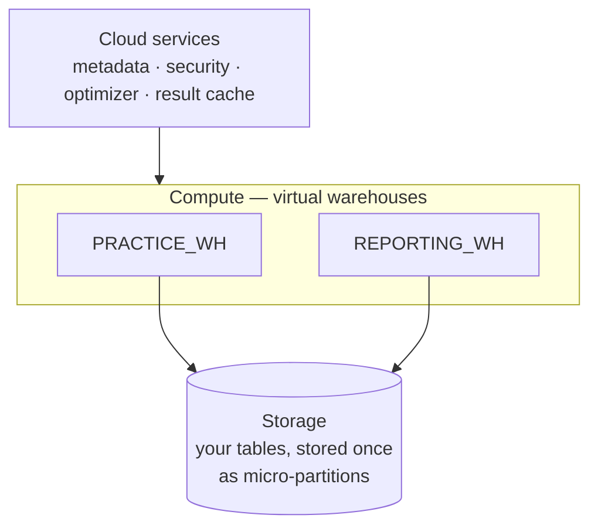
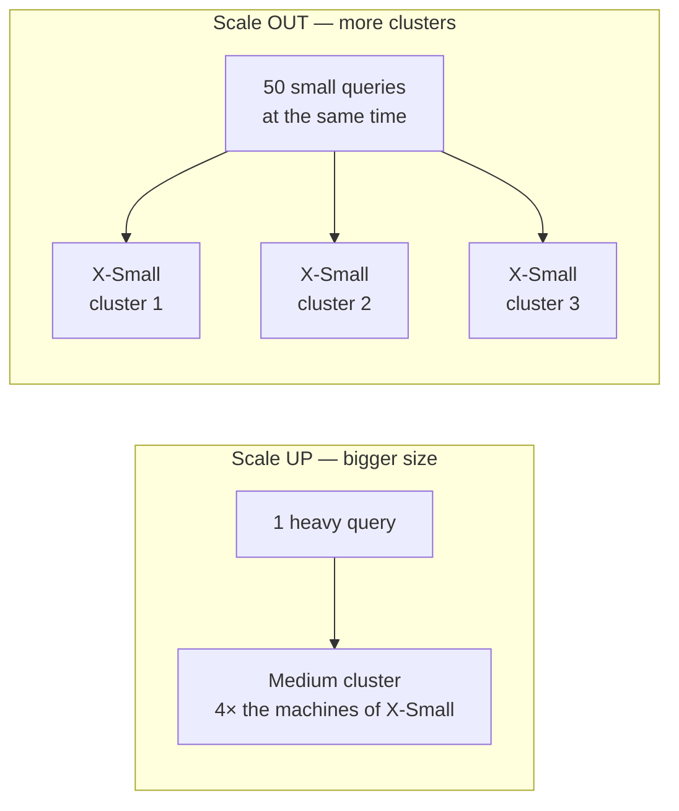

# Architecture & virtual warehouses

## Concept
Snowflake splits into three layers that scale independently:



- **Storage** — your data, stored **once**, in Snowflake's own compressed columnar format.
- **Compute** — **virtual warehouses**: clusters that run your queries. Many warehouses can read
  the same data at the same time without slowing each other down.
- **Cloud services** — metadata, logins, access control, the query optimizer and the result
  cache. Always on; you don't manage it.

You've seen this split in the lab: tables in object storage (RustFS + Iceberg) and **separate**
engines (Trino, Spark) reading them. In Snowflake the storage format and the engines are one
product, and a warehouse starts in a second or two.

### Sizes and billing
| Size | Credits / hour | |
|---|---|---|
| X-Small | 1 | |
| Small | 2 | each size up **doubles** compute and credits |
| Medium | 4 | |
| Large | 8 | … up to 6X-Large |

A warehouse is billed **per second while it runs** (with a 60-second minimum each time it
starts). A suspended warehouse costs nothing. Two settings keep that automatic:

- **`auto_suspend`** — seconds of no queries before it stops itself.
- **`auto_resume`** — a query to a suspended warehouse starts it again.

### Scale up vs scale out
A warehouse is a **cluster** of compute: a set of machines that run your queries. A slow
warehouse can need one of two very different fixes.

Think of a supermarket checkout:

- **Scale up** = a **faster cashier**. One customer with a huge trolley gets through quicker.
  A long queue of people with one item each barely moves faster.
- **Scale out** = **more checkouts open**. The queue disappears, but each customer still takes
  as long as before.



| | Scale **up** | Scale **out** |
|---|---|---|
| What changes | the **size**: X-Small → Small → Medium … | the **number of clusters** of the same size (multi-cluster warehouse *[Enterprise]*) |
| Helps when | **one query** is slow: big joins, big sorts, lots of data | **many queries at once** wait for each other |
| Doesn't help when | many small queries queue — they still share one cluster | one query is slow — it still runs on one cluster of the same size |
| The sign | the query **spills** to disk (`BYTES_SPILLED_TO_…` in `QUERY_HISTORY`), or scans lots of data | queries **queue** (`QUEUED_OVERLOAD_TIME` in `QUERY_HISTORY`) |
| How | `alter warehouse … set warehouse_size = 'MEDIUM'` — you change it yourself | `min_cluster_count` / `max_cluster_count` — Snowflake starts and stops clusters itself |
| Cost | each size up **doubles** the credits per hour | each running cluster costs its size's credits; extra clusters stop when the queue is gone |

Typical cases:

- A nightly job joining every order with every line takes 40 minutes → **scale up**.
- 50 people open the same dashboard at 9:00, every query is small, but they wait → **scale
  out**.

## Lab

```sql
use role accountadmin;

-- you made PRACTICE_WH in setup step 1; this one is just to experiment with
create warehouse if not exists SCRATCH_WH
    warehouse_size      = 'XSMALL'
    auto_suspend        = 60
    auto_resume         = true
    initially_suspended = true;

show warehouses;
```

- **`initially_suspended = true`** — don't start (and bill) it until the first query.
- **`show warehouses`** — lists them with `state` (`STARTED` / `SUSPENDED`), `size`,
  `auto_suspend` and more.

Run a query on it and watch it start:

```sql
use warehouse SCRATCH_WH;
select count(*) from SHOPFLOW.BRONZE.ORDER_ITEMS;   -- 100000
show warehouses like 'SCRATCH_WH';                  -- state: STARTED
```

Resize while it runs — new queries use the new size:

```sql
alter warehouse SCRATCH_WH set warehouse_size = 'SMALL';
alter warehouse SCRATCH_WH set warehouse_size = 'XSMALL';
```

Multi-cluster *[Enterprise]* — up to 2 clusters when queries queue:

```sql
alter warehouse SCRATCH_WH set
    min_cluster_count = 1
    max_cluster_count = 2
    scaling_policy    = 'STANDARD';
```

- **`scaling_policy`** — `STANDARD` starts an extra cluster as soon as queries queue; `ECONOMY`
  waits until there's enough work to keep it busy (cheaper, slower to react).

Stop it and drop it:

```sql
alter warehouse SCRATCH_WH suspend;
drop warehouse SCRATCH_WH;
use warehouse PRACTICE_WH;
```

## Check yourself
1. A dashboard with 50 users at once is slow, but each query is simple. Scale up or out?
   *(Out — more clusters for concurrency. A bigger size helps one heavy query.)*
2. A warehouse runs one 5-second query, then sits idle with `auto_suspend = 600`. How long is it
   billed? *(About 10 minutes — it keeps running until auto-suspend stops it. Keep
   `auto_suspend` short for ad-hoc work.)*
3. What's the lab's equivalent of a warehouse? *(A query engine — Trino or the Spark cluster —
   reading the same lake tables. The [OSS ⇄ platforms page](../platforms/rosetta.md) maps them.)*
